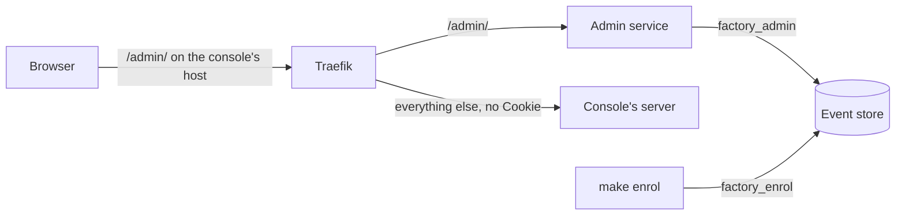

# Admin service

Martin's sign-in, his sessions, and the one way a browser changes the factory (spec 5.4). Part of the [factory plane](README.md#factory-plane).

- **v1:** `factory admin` (`apps/factory/src/admin`), with passkeys through [SimpleWebAuthn](https://simplewebauthn.dev); `factory admin enrol` adds a passkey; the [console](CONSOLE.md#signing-in)'s sign-in and enrolment pages call it. One replica in `factory` (`deploy/base/factory/admin.yaml`), routed under `/admin/` on the console's host (`deploy/overlays/local/console-ingress.yaml`). Held to OWASP ASVS 5.0 level 2, with its threat model, in [ADR 0012](../architecture/adr/0012-martins-sign-in.md).
- **Later:** the actions of tasks 5 to 10, each a write route in the access table.

## Who may do what

Every route it answers is in [`policy/access.ts`](../../policy/access.ts), and it answers nothing else: 404 for any path, or method, the table does not give it. Each route is held to what its entry says (`admin/guard.ts`):

| Entry | Routes | Takes |
|---|---|---|
| `admin.health` | `GET /admin/health` | nothing |
| `session` | `GET /admin/session` | his session; it answers with the token his writes carry, and his passkeys |
| `full-events` | `GET /admin/events/stream` | his session |
| `enrol` | `POST /admin/enrol/options`, `POST /admin/enrol` | the code, the console's `Origin`, and the enrolment's rate limit |
| `sign-in` | `POST /admin/sign-in/options`, `POST /admin/sign-in` | a passkey, the console's `Origin`, and the sign-in's rate limit |
| `step-up` | `POST /admin/step-up/options`, `POST /admin/step-up` | a write's four checks, and the session's own passkey |
| `sign-out`, `sign-out-everywhere` | `POST /admin/sign-out`, `POST /admin/sign-out-everywhere` | a write's four checks |
| `passkey.revoke` | `POST /admin/passkeys/:id/revoke` | a write's four checks, and the passkey given within five minutes |

A write's four checks, in order: `Origin` exactly the console's origin in configuration, never one made from the request's `Host`; a live session; the session's token in `X-CSRF-Token`; and, for an action the table marks, the passkey given again within `STEP_UP.minutes`. Every write is a `POST` with a JSON body, which no form can send. The actions of tasks 5 to 10 plug in the same way: a route on their entry, and a handler; the guard comes from the table.

## Signing in

- **Passkeys,** user verification required, with the origin and the relying party from configuration. Signing in names no passkey, so nobody without a session learns a passkey's id; enrolling makes a resident one. Attestation is not asked for: the code, not the authenticator's maker, is what proves Martin.
- **A challenge is used once.** The store keeps each, bound to its purpose and to the enrolment code or session it is for, for five minutes; using it spends it before the passkey's answer is checked, so no answer is tried twice.
- **Enrolment takes a code.** `make enrol` (`factory admin enrol`, as `factory_enrol`) prints a code of 128 random bits, in Crockford's base 32, which the page takes with or without its dashes and in any case. Only the newest code is live, so a new `make enrol` replaces any code before it, and an older one never becomes live again. Each try at enrolment with something shaped like a code counts against the live code, so a code allows five, from anywhere; anything else is refused and counts against none. A wrong code's refusal says how many tries the live code has left (`left`), and none when no code is live, so the page can tell a mistyped code from one that can no longer be used. A good code then makes a passkey, which signs in. While two are held a third is refused before the code is tried, so it costs none of its tries. No session adds a passkey.
- **Recovery.** `make enrol REVOKE_OTHERS=1` revokes every passkey and ends every session before it prints a code, and records each passkey it revokes.
- **Sessions are kept on the server.** The cookie is `__Host-session`, `Secure`, `HttpOnly`, `SameSite=Strict`, `Path=/`, holding 32 random bytes; the store keeps their SHA-256 and sets the session's eight hours from its own clock. Each sign-in or enrolment makes a new id and ends the one the browser had, which is recorded as signed out if it was still live. Signing out ends the session on the server; signing out everywhere ends them all.
- **The token** a session's writes carry is a hash of its id, with a purpose of its own, so the store keeps nothing more and its copy of the session gives nothing away.
- **Fast hashes, on purpose.** Codes, session ids and tokens are random, never chosen by a person, so a SHA-256 keeps them safe at rest, as it does a runner's job token; a slow, salted hash protects nothing more here.

## Headers and limits

- Every response: a Content Security Policy of `default-src 'none'` with `frame-ancestors 'none'`, HSTS, `Cache-Control: no-store`, `nosniff`, no referrer, and `X-Frame-Options: DENY`. Its answers are JSON, or the event stream, alone.
- Enrolment allows ten requests in ten minutes from an address, five ceremonies; signing in allows thirty, fifteen. The counts are in memory: the service is one replica.
- The address is the connection's, unless the connection comes from one of `ADMIN_TRUSTED_PROXIES`: then it is the last address in `X-Forwarded-For` that is not the proxy's own. What a client writes there is believed from nowhere else.

## The full events

`GET /admin/events/stream` sends a signed-in session every event whole, the public stream's twin, with its seq as its ID. It checks the session every five seconds, and closes, saying why, when the session is signed out, revoked or expires: at once when the service itself ends it, and at the next check when `make enrol` revokes it or its eight hours run out. An admin event none of Martin's roles appended is left out, as the factory ignores it.

## What it records

Every action is an event with Martin as its actor, appended in the same transaction as the action, so it is done and recorded or neither: `passkey.enrolled`, `admin.signed-in`, `admin.signed-out` (here, everywhere, or by signing in again over a live session in the same browser), `admin.stepped-up` (the passkey given again) and `passkey.revoked` (from the console, or the command line). Each is one of [Martin's commands](EVENT-STORE.md#martins-commands), which no worker can append. Their public views say what he did and never with which passkey: no name, id, address or browser.

## Settings

| Variable | |
|---|---|
| `ADMIN_ORIGIN` | The console's origin, such as `https://console.localhost:8443`: what `Origin` must be, and what a passkey's ceremony must name. Required. |
| `ADMIN_RP_ID` | The relying party a passkey belongs to; by default the origin's host name. |
| `ADMIN_TRUSTED_PROXIES` | The proxy in front, as addresses or CIDR ranges; none by default. |
| `PORT` | Where it listens, 8080 by default. |
| `DATABASE_URL`, `PG*` | The store, as `factory_admin`, whose password is in `postgres-admin`. |

## On the cluster

- **One origin.** Traefik sends `/admin/` on the console's host to the admin service and everything else to the console's server, with the `Cookie` header removed (the `console-no-cookies` middleware), so the session cookie, whose path is `/`, never reaches the console's server.
- **One replica, replaced and never doubled,** since the rate limits are held in memory.
- **Fenced.** Its network policy lets in Traefik alone, and lets it reach the store and the collector, nothing else. That is why it believes forwarded headers from the whole pod network (`ADMIN_TRUSTED_PROXIES=10.42.0.0/16`, k3s's default range): only Traefik can connect, and Traefik replaces whatever `X-Forwarded-For` a client sends. Locally every request reaches Traefik through k3d's load balancer, so the rate limits key on that one address, and hold for the Mac as a whole. `make egress` proves the fence on the cluster.
- **No other route on its host.** The app's repository, which agents write to, may make Traefik routes in `website`, and a route on the console's host would take the session cookie. The `website-routes` admission policy (`deploy/base/admission/website/routes.yaml`) admits a route there only if it begins with one of the app's hosts and widens it with no `||`. `scripts/route-refusals.sh` keeps the cluster's answers to the routes that matter (`deploy/test/route-refusals.json`), which the fence test reads.
- `apps/factory/test/admin-fences.test.ts` holds the route, the cookie's removal, the fence and the admission policy.
