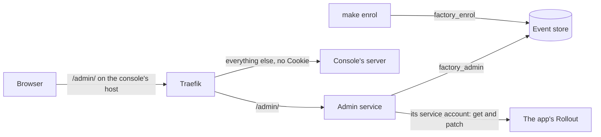

# Admin service

Martin's sign-in, his sessions, and the one way a browser changes the factory (spec 5.4). Part of the [factory plane](README.md#factory-plane).

- **v1:** `factory admin` (`apps/factory/src/admin`), with passkeys through [SimpleWebAuthn](https://simplewebauthn.dev); `factory admin enrol` adds a passkey; the [console](CONSOLE.md#signing-in)'s sign-in and enrolment pages call it. One replica in `factory` (`deploy/base/factory/admin.yaml`), routed under `/admin/` on the console's host (`deploy/overlays/local/console-ingress.yaml`). Held to OWASP ASVS 5.0 level 2, with its threat model, in [ADR 0012](../architecture/adr/0012-martins-sign-in.md).
- **v1:** Martin's controls of the canary: Promote, Pause, Resume, Abort and Retry, patching the app's Rollout as the one service of ours that may ([below](#the-canarys-controls)).
- **v1:** Martin's settings: each agent's model and effort, and the spend caps, within policy ([below](#the-settings)).
- **v1:** Martin's answers to holds, from Needs you: approve, reject, or answer in words ([below](#needs-you)).
- **v1:** Stop the line and Start the line, from the console's header, with the canary in flight aborted as the line stops ([below](#stopping-and-starting-the-line)).
- **v1:** the line's controls: the autonomy level, whether agents take new work, auto-merge, and what the line takes, within policy ([below](#the-lines-controls)).
- **Later:** improvement requests, feature flags and their stages, the red-team attacks, auto-rollback's switch and visitor keys' usage (spec 5.4), each a route in the access table.

## Who may do what

Every route it answers is in [`policy/access.ts`](../../policy/access.ts), and it answers nothing else: 404 for any path, or method, the table does not give it. Each route is held to what its entry says (`admin/guard.ts`):

| Entry | Routes | Takes |
|---|---|---|
| `admin.health` | `GET /admin/health` | nothing |
| `session` | `GET /admin/session` | his session; it answers with the token his writes carry, his passkeys, and the deployment's tools his menu links to |
| `full-events` | `GET /admin/events/stream` | his session |
| `enrol` | `POST /admin/enrol/options`, `POST /admin/enrol` | the code, the console's `Origin`, and the enrolment's rate limit |
| `sign-in` | `POST /admin/sign-in/options`, `POST /admin/sign-in` | a passkey, the console's `Origin`, and the sign-in's rate limit |
| `step-up` | `POST /admin/step-up/options`, `POST /admin/step-up` | a write's four checks, and the session's own passkey |
| `sign-out`, `sign-out-everywhere` | `POST /admin/sign-out`, `POST /admin/sign-out-everywhere` | a write's four checks |
| `passkey.revoke` | `POST /admin/passkeys/:id/revoke` | a write's four checks, and the passkey given within five minutes |
| `release.promote` | `POST /admin/release/promote` | a write's four checks, and the passkey given within five minutes |
| `release.pause`, `release.resume`, `release.abort` | `POST /admin/release/pause`, `/resume`, `/abort` | a write's four checks |
| `release.retry` | `POST /admin/release/retry` | a write's four checks, and the passkey given within five minutes |
| `settings.save` | `POST /admin/settings` | a write's four checks, and the passkey given within five minutes when the save raises anything (`agent.raise`, `caps.raise`) |
| `hold.approve` | `POST /admin/holds/:workItem/approve` | a write's four checks, and the passkey given within five minutes when the stored hold's cause is a guardrail (`hold.approve-guardrail`) |
| `hold.reject`, `hold.answer` | `POST /admin/holds/:workItem/reject`, `/answer` | a write's four checks |
| `line.stop` | `POST /admin/line/stop` | a write's four checks |
| `line.start` | `POST /admin/line/start` | a write's four checks, and the passkey given within five minutes |
| `line.controls` | `POST /admin/line/controls` | a write's four checks, and the passkey given within five minutes when the change loosens (`autonomy.loosen`, `auto-merge.on`, `take.widen`) |

A write's four checks, in order: `Origin` exactly the console's origin in configuration, never one made from the request's `Host`; a live session; the session's token in `X-CSRF-Token`; and, for an action the table marks, the passkey given again within `STEP_UP.minutes`. Every write is a `POST` with a JSON body, which no form can send. An action added later plugs in the same way: a route on its entry, and a handler; the guard comes from the table.

## Signing in

- **Passkeys,** user verification required, with the origin and the relying party from configuration. Signing in names no passkey, so nobody without a session learns a passkey's id; enrolling makes a resident one. Attestation is not asked for: the code, not the authenticator's maker, is what proves Martin.
- **A challenge is used once.** The store keeps each, bound to its purpose and to the enrolment code or session it is for, for five minutes; using it spends it before the passkey's answer is checked, so no answer is tried twice.
- **Enrolment takes a code.** `make enrol` (`factory admin enrol`, as `factory_enrol`) prints a code of 128 random bits, in Crockford's base 32, which the page takes with or without its dashes and in any case. Only the newest code is live, so a new `make enrol` replaces any code before it, and an older one never becomes live again. Each try at enrolment with something shaped like a code counts against the live code, so a code allows five, from anywhere; anything else is refused and counts against none. A wrong code's refusal says how many tries the live code has left (`left`), and none when no code is live, so the page can tell a mistyped code from one that can no longer be used. A good code then makes a passkey, which signs in. While two are held a third is refused before the code is tried, so it costs none of its tries. No session adds a passkey.
- **Recovery.** `make enrol REVOKE_OTHERS=1` revokes every passkey and ends every session before it prints a code, and records each passkey it revokes.
- **Sessions are kept on the server.** The cookie is `__Host-session`, `Secure`, `HttpOnly`, `SameSite=Strict`, `Path=/`, holding 32 random bytes; the store keeps their SHA-256 and sets the session's 30 minutes from its own clock. Each sign-in or enrolment makes a new id and ends the one the browser had, which is recorded as signed out if it was still live. Signing out ends the session on the server; signing out everywhere ends them all.
- **The token** a session's writes carry is a hash of its id, with a purpose of its own, so the store keeps nothing more and its copy of the session gives nothing away.
- **Fast hashes, on purpose.** Codes, session ids and tokens are random, never chosen by a person, so a SHA-256 keeps them safe at rest, as it does a runner's job token; a slow, salted hash protects nothing more here.

## Headers and limits

- Every response: a Content Security Policy of `default-src 'none'` with `frame-ancestors 'none'`, HSTS, `Cache-Control: no-store`, `nosniff`, no referrer, and `X-Frame-Options: DENY`. Its answers are JSON, or the event stream, alone.
- Enrolment allows ten requests in ten minutes from an address, five ceremonies; signing in allows thirty, fifteen. The counts are in memory: the service is one replica.
- The address is the connection's, unless the connection comes from one of `ADMIN_TRUSTED_PROXIES`: then it is the last address in `X-Forwarded-For` that is not the proxy's own. What a client writes there is believed from nowhere else.

## The full events

`GET /admin/events/stream` sends a signed-in session every event whole, the public stream's twin, with its seq as its ID. It checks the session every five seconds, and closes, saying why, when the session is signed out, revoked or expires: at once when the service itself ends it, and at the next check when `make enrol` revokes it or its 30 minutes run out. An admin event none of Martin's roles appended is left out, as the factory ignores it and the console's server's public stream leaves it out too; a test appends one with row security switched off and finds it in neither. The console reads this stream while Martin is signed in and not previewing as a visitor ([console](CONSOLE.md#signing-in)), and shows a report's text from it, made plain, as text.

## The canary's controls

The Canary panel's controls (`admin/rollout.ts`), each the patch `kubectl argo rollouts` makes, on the app's Rollout (`RELEASE_ROLLOUT`), and nothing else:

| Control | What it patches | When |
|---|---|---|
| Promote | the status's step, on to the next step that sets a weight short of 100%, and its pauses cleared | a canary in flight with such a step, not being promoted fully; the passkey again |
| Promote fully (`fully: true`) | `status.promoteFull` | a canary in flight, not being promoted fully already; the passkey again |
| Pause, Resume | `spec.paused` | a canary in flight, not paused or paused |
| Abort | `status.abort`, and `spec.paused` cleared if Martin had paused it | a canary in flight |
| Retry | `status.abort`, cleared, and `spec.paused` too if it was left set | a release that was stopped (aborted, or stopped with the line or by an analysis error), not rolled back, and the line not stopped; the passkey again |

- **Promote** moves the canary on wherever it is in its step, setting its weight, pausing or being analysed: Argo Rollouts stops the analysis of the step it leaves. A promotion also resumes a paused canary, as `kubectl argo rollouts promote` does, and so do an abort and a retry, so no pause outlives its canary. Resuming gives a paused canary back to its own analysis, and promotes nothing.
- **No rollback.** A rollback stays the analysis's alone; a rolled-back release is never retried, and goes out with the next release that carries its work items.
- **The release the panel showed.** Each control names it (`{"release": "<hash>-<revision>"}`, as the line names releases), and is refused (409) when the Rollout's is another, when the line has not recorded its start yet, or when its state does not take the control. Each patch is conditional on the Rollout as it was read for it (its `resourceVersion`), and a second patch (a resume after a promotion, an abort or a retry) is made only while the same release is in it: a Rollout that changed before the first is read again, and the control decided again, up to three times. A second patch the Rollout changed before, as the controller's writes to its status often change it, is read and tried again, up to three times too; one that still cannot be made leaves the control made, and its answer (200) carries a `warning` that Martin's pause is still set, which the Canary panel shows where he pressed.
- **Retry while the line is stopped** is refused by the service, not only disabled on the page: a stopped line starts no canary.
- **Recorded once made.** Its event, `release.controlled`, is checked before the patch and appended after the first, before any resume, in a transaction of its own, so a patch Kubernetes refuses leaves none (502), and no connection to the store waits on Kubernetes. A patch whose answer never came, or came as a server error, is read back, and counts as made if the Rollout shows it (a flag Argo Rollouts leaves out when false, such as `status.abort`, counts as false), or shows the controller acted on it: a promotion's canary at or past its step, whatever its pauses say now, or a full promotion's already all of the traffic. An append that fails is tried once more, and logged if that fails too. The line then records what the Rollout did: after an abort, [`release.aborted` with `by: martin`](RELEASE-AND-VERIFY.md#its-events).
- **Read as the line reads it.** The Rollout is read through the line's own schema and `observe` (`release/rollout.ts`, which the line's release watch reads it with too), and the release in it is named as the line names it (`namedReleases`), from the line's records of every release of its pod hash, read with the line's own queries (`release/recorded.ts`): a release the line recorded under another name than the Rollout's, such as one named by its pod hash alone from before releases were named by revision, is controlled by that name.
- **Unset,** with no `RELEASE_ROLLOUT`, every control is refused (503), and the service reaches nothing in Kubernetes.

## Stopping and starting the line

The console's header stops and starts the line (`admin/line.ts`), each with Martin's reason (`{"reason": "…"}`, up to 200 characters), for the audit log: visitors see it, with anything shaped like a secret left out.

- **Stop the line** (`POST /admin/line/stop`) appends `line.stopped`, the same event as `make stop-the-line`, which every worker heeds: each agent stops at the end of its step, and nothing new is taken ([orchestrator](ORCHESTRATOR.md#stopping-the-line)). It never asks for the passkey: it tightens.
- **Then it aborts the canary in flight,** recorded by the line or not, with the same patch as the panel's Abort, through the same Role. Its `release.controlled` says it came with the stop (`stop: true`), so the line records the abort `by: stop` from the event, not the time. A release the line has not recorded yet has no version to record: it is aborted all the same, with no control, and the line tells it by the stop just before. A Rollout whose status has not caught up with its spec yet, as a release starts, is read again each second for up to five, and its canary aborted once it is named. The answer says what became of the canary: `aborted` (with the release, and whether its control was `recorded`), `none` in flight, or `not-aborted`.
- **The stop first.** The stop is appended before the abort, so the agents stop even when Kubernetes cannot be reached. If the abort fails, the line stays stopped, and the answer (200) carries a `warning` that the canary was not aborted and that `make stop-the-line` will abort it, which the dialog shows where Martin pressed. Without `RELEASE_ROLLOUT` it says the same.
- **Start the line** (`POST /admin/line/start`) appends `line.started`, with the passkey given within five minutes (asked again as the start is taken). A release stopped with the line stays stopped until Martin retries it from the Canary panel.
- **Only when it does something** (409 otherwise, having appended nothing): a stopped line is not stopped again, nor a running one started. Each is taken under the lock every append takes, so two presses cannot both do it.
- **`make stop-the-line` keeps its own path,** unchanged: `factory line stop` as Martin's command line's role, then `scripts/abort-canaries.sh` with his own kubeconfig, each run whichever fails. It needs neither the console nor the admin service.

## The line's controls

`POST /admin/line/controls` changes one of the line's controls (`admin/line.ts`), within [`policy/line.ts`](../../policy/line.ts), with one of `{"autonomy": "guarded"}`, `{"newWork": false}`, `{"autoMerge": true}` or `{"take": {"kind": "every" | "next-few", "count": 3 | "just-one", "workItem": "1290"}}`.

- **One event a change,** `controls.changed`: every control as it now stands (the autonomy level, `newWork`, `autoMerge`, and the take, or none), and the one changed, with its value before and after. Its summary says what he did ("Martin loosened autonomy from Supervised to Guarded", "Martin narrowed what the line takes to just #1290"), and its public view is the event as it is. A change to what is already so records nothing (200, `change: null`). Changes are taken one at a time, under the lock every append takes.
- **The passkey again to loosen,** decided from the controls in force as the change is taken, read from the store after the lock, never from the request: a looser autonomy level (Supervised, then Guarded, then Lights-out), auto-merge on, or a wider take, which takes more kinds of work (just one, then the next few, then every ticket) or the next few more of them or counted again from now. Policy sees neither how many the line has taken nor when, so it cannot tell that a count started again admits no more (five with four taken, chosen again as two, let it take one more): choosing any number of the next few asks, fewer too. Their opposites, and new work either way, ask nothing: starting the line again is what asks. Just one moved to another work item is no wider. A first take, set over the line's own default (`LINE_TAKE`, `LINE_ONLY`), which the service cannot see, counts as wider whatever it is.
- **Within policy, or refused** (422), having changed nothing: the next few are 1 to 20 work items, and just one is a work item with an open ticket (one that has not closed, and not a sample's, which the line never takes). The line checks what it reads again, with the same function (`controlsInForce`), as the console's Controls is to: an event outside policy has no effect there either.
- **The next few count from when he chose them,** to the microsecond by the store's clock. Any number chosen, larger, smaller or the same, starts the count again from then: "the next two" are two from now.
- **What each does:** the line reads the take and the switch for new work at its next pass ([orchestrator](ORCHESTRATOR.md#taking-work)). Nothing routes by the autonomy level or auto-merge until approval routing comes (Part C): every merge still waits for Martin. Auto-rollback has no route: a failing canary is always rolled back until Part C gives it a switch.
- **Each change alerts Martin,** as a [security event](ALERTING.md#security-events) of its own kind, at its kind's level: loosening autonomy pages him, tightening it or a widening notifies him, and any other tightening informs him.

## The settings

`POST /admin/settings` saves Martin's settings (`admin/settings.ts`): each agent's model and effort, and the day's, the month's and a work item's spend caps, within the bounds [`policy/models.ts`](../../policy/models.ts) and [`policy/spend.ts`](../../policy/spend.ts) set. The body gives only what changes: `{"agents": {"coder": {"model": "claude-opus-5-5", "effort": "high"}}, "caps": {"workItemUsd": 2}}`, where a month's cap of `null` is the profile's default, which on `local` is none.

- **Within policy, or refused whole** (422), having changed nothing: a model the agent may not use on the profile, more effort than its most, an effort for a local model (LM Studio sets that), or a cap that is not a figure above nothing and at most its ceiling. The check is `policy/settings.ts`'s, the same the [gateway](LLM-GATEWAY.md#settings) and the [line](ORCHESTRATOR.md#settings) make as they read the settings, so what is refused here would have no effect there either.
- **The passkey again to raise.** The access table's `settings.save` is each of `agent.raise`, `agent.lower`, `caps.raise` and `caps.lower` that the save does, against the settings in force as it is taken: a dearer model, by the gateway's prices, which put a local model below every Claude one, or more effort, or a higher cap, needs the passkey given within five minutes; a save that only lowers does not. One save that raises one thing and lowers another asks.
- **One event a save,** `settings.changed`: every setting as it now stands, and each field the save changed with its value before and after. A save that changes nothing records nothing. Saves are taken one at a time.
- **Raising a work item's cap answers a `spend` hold** it clears: a hold still open (not answered, closed or reopened since) whose spend, recorded on the hold, is under the new cap. The save takes the lock every append takes, and the line appends a spend hold under it only while the cap in force still holds the work item, so a hold and a raise never cross. Each gets a `hold.answered` approving it, in the same transaction as the settings, saying the cap was raised, and the line carries on with it. Raising the day's or the month's cap answers nothing: the gateway clears its own `spend.capped` once spend is under the new cap, within a minute.

## Needs you

Martin answers a hold from its card in Needs you (`admin/holds.ts`): `POST /admin/holds/:workItem/approve`, `/reject` or `/answer`, each with the hold the card showed, by its `hold.started` event's id (`{"hold": "<id>"}`, and `"words"` to answer, up to 300 characters). Each is one `hold.answered`, naming the hold, which the [line](ORCHESTRATOR.md#holds-and-martins-answers) or [triage](TRIAGE.md#a-suggestion) acts on as `ANSWERS` says for its cause.

- **Only the hold the card showed** (409 otherwise, having appended nothing): the work item's latest hold, with nothing since that answered or ended it (an answer, a merge, a close, a reopening, for a `deploy` hold a release, or for a `merge` hold gates that failed). Words on one of triage's holds leave it open (`WORDS_LEAVE_HELD`), for his approval or rejection. Answers are taken one at a time, under the lock every append takes, so two cannot answer one hold.
- **Only an answer that does something** (422): `answersTo` in the events package, which Needs you draws its rows from. Approving a `merge` (he merges on GitHub), a `deploy` (a release ends it) or a `suggestion` (until improvements), or words on a `deploy`, is refused.
- **The passkey again to approve a guardrail's hold**, as the access table's `hold.approve-guardrail` says: `scope`, `beyond-ticket`, `review`, `gates`, `verify`, `spend` and `merge`. One route approves every hold, and the cause comes from the stored hold, never from the request. Rejecting, words, and approving any other cause never ask.
- **His words on a visitor's report stay his.** On a work item a visitor's report opened (its first signal is a report), at any stage, the answer is marked `report`, and its public view leaves his words out, and says only how he answered: a paraphrase of a report would pass any redactor. The line leaves them out too: no agent reads them, and nothing it writes from the answer (a return's or a close's reason, its comments on GitHub) carries them; the answer still does what it does. Everywhere else his words are public, through the redactor.

## What it records

Every action is an event with Martin as its actor, appended in the same transaction as the action, so it is done and recorded or neither: `passkey.enrolled`, `admin.signed-in`, `admin.signed-out` (here, everywhere, or by signing in again over a live session in the same browser), `admin.stepped-up` (the passkey given again), `passkey.revoked` (from the console, or the command line) `release.controlled` (a control of the canary: which, the release, its version, the canary's weight then, for a promotion the weight it goes to, and whether it was Stop the line's abort), `line.stopped` and `line.started` (with his reason), `controls.changed` (the line's controls, with the one changed before and after), `settings.changed` (the settings, with each change before and after), with a `hold.answered` for each `spend` hold a raised work item's cap clears, and `hold.answered` (his answer to a hold from Needs you, naming the hold). Each is one of [Martin's commands](EVENT-STORE.md#martins-commands), which no worker can append. Their public views say what he did and never with which passkey: no name, id, address or browser.

## Settings

| Variable | |
|---|---|
| `ADMIN_ORIGIN` | The console's origin, such as `https://console.localhost:8443`: what `Origin` must be, and what a passkey's ceremony must name. Required. |
| `ADMIN_RP_ID` | The relying party a passkey belongs to; by default the origin's host name. |
| `ADMIN_TRUSTED_PROXIES` | The proxy in front, as addresses or CIDR ranges; none by default. |
| `RELEASE_ROLLOUT` | The app's Rollout, as `<namespace>/<name>`, as the line is given it: what the canary's controls patch. Unset, they are refused. |
| `KUBE_API_URL` | On a host, where `kubectl proxy` serves the API; in the cluster, its service account's token. |
| `GRAFANA_URL`, `ARGOCD_URL` | This deployment's Grafana and Argo CD, each an `http` or `https` address with no user name or password in it, which a signed-in session is told so the account menu links to them. Only a session is told: a public deployment's internal hosts never reach a visitor's page. Unset, the menu has no link to that tool. |
| `FACTORY_PROFILE` | `local`, `do` or `aws`, `local` by default, as the gateway's and the line's: the bounds Martin's settings are held to, and their defaults. |
| `PORT` | Where it listens, 8080 by default. |
| `DATABASE_URL`, `PG*` | The store, as `factory_admin`, whose password is in `postgres-admin`. |

## On the cluster

- **One origin.** Traefik sends `/admin/` on the console's host to the admin service and everything else to the console's server, with the `Cookie` header removed (the `console-no-cookies` middleware), so the session cookie, whose path is `/`, never reaches the console's server.
- **One replica, replaced and never doubled,** since the rate limits are held in memory.
- **Fenced.** Its network policy lets in Traefik alone, and lets it reach the store, the collector and the API server's port (6443, as the line's does), nothing else. That is why it believes forwarded headers from the whole pod network (`ADMIN_TRUSTED_PROXIES=10.42.0.0/16`, k3s's default range): only Traefik can connect, and Traefik replaces whatever `X-Forwarded-For` a client sends. Locally every request reaches Traefik through k3d's load balancer, so the rate limits key on that one address, and hold for the Mac as a whole. `make egress` proves the fence on the cluster.
- **No other route on its host.** The app's repository, which agents write to, may make Traefik routes in `website`, and a route on the console's host would take the session cookie. The `website-routes` admission policy (`deploy/base/admission/website/routes.yaml`) admits a route there only if it begins with one of the app's hosts and widens it with no `||`. `scripts/route-refusals.sh` keeps the cluster's answers to the routes that matter (`deploy/test/route-refusals.json`), which the fence test reads.
- **The one service of ours that may change a Rollout.** Its service account, `admin`, holds one Role (`deploy/base/analysis/admin-controls-release.yaml`): get and patch the app's Rollout, and patch its status, by name. A Role names objects, not fields, so the `website-rollout-controls` admission policy ([admission control](ADMISSION-CONTROL.md#the-admin-services-hold-on-the-rollout)) refuses any change of the service's but `spec.paused` and the status fields its controls set. Its Deployment runs as that account, with its token mounted, and `RELEASE_ROLLOUT=website/website`; in `factory` only it and the line hold a token. `scripts/rollout-refusals.sh` keeps the cluster's answers to its controls' patches and to the changes it must not make (`deploy/test/rollout-refusals.json`), sent as the service sends them, which the fence test reads.
- `apps/factory/test/admin-fences.test.ts` holds the route, the cookie's removal, the fence, the service account and the admission policy; `release-fences.test.ts` the Role, the policy on the Rollout and the cluster's answers to it.
