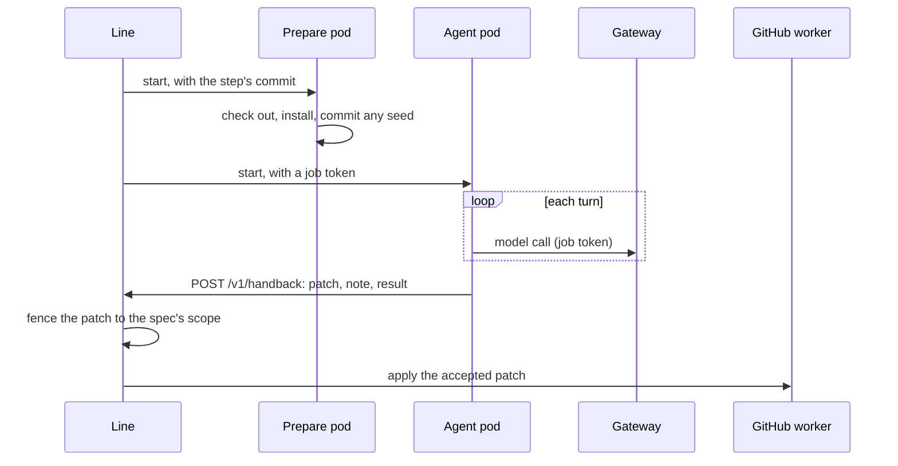

# Agent runners

One disposable sandbox per step, with the repository checked out and its toolchain (ADR 0008). Part of the [factory plane](README.md#factory-plane).

- **v1:** two Kubernetes Jobs per attempt at a step, in `runners` (`apps/factory/src/runners/jobs.ts`).
- **Later:** gVisor or Firecracker isolation.

## The Jobs

- **Named** by the agent, the work item, the agent's round and the step's number within the work item. `reviewer-1002-1-4` is the reviewer's first round and the work item's fourth step. The number follows both the line's count of the work item's steps and the last number among its job tokens, so a step tried again never meets the Jobs or the token of the attempt before it, even when the work item's row on the line was made afresh.
- **On a volume** that lives until the work item merges or ends. `DELETE /v1/work-items/<id>` on the line ends it.
- **Fenced:** the restricted Pod Security Standard, no service account token, a read-only root and a deadline. The deadline is the pod's, so a pod out of time fails and stays, with its log, until the line has kept it; the Job's own, a minute later, is a backstop.
- **One image:** both run `factory-runner` (`apps/runner`: Node, git, pnpm through corepack, the Agent SDK).
- **Logged** as JSON lines, each naming the job, the work item and the pod (`apps/runner/src/log.ts`). A step that fails says why in its last line.

### The prepare pod

`runner prepare` checks out the commit and installs it, with no lifecycle scripts. It may reach the internet on 443.

- **A step that reads a change** gets its base beside it, as the branch `base`, and the commits between, so `git log base..HEAD` holds every round's.
- **A seed**, when the step has one, is committed under a neutral message at a fixed time, so its base has the same sha every run. The checkout's files get that time too, so a search lists them alike.
- **A dry run's commits**, which GitHub never had, are committed on the real commit under them, as the pull request's own.

### The agent pod

`runner agent` reaches only the gateway and the line's handback, and has no DNS: the line writes their addresses into its hosts. It:

1. checks its own fence;
2. runs the agent on the Agent SDK (Claude Code), logging each turn, each tool call by the tool's name, and each call that failed (never a tool's input or output), with:
   - the step's turn limit;
   - no settings from the checkout;
   - a system prompt that is the same on every run;
   - for a step that names a skill, that skill alone, from the runner's own plugin (`apps/runner/plugin`, read-only in the image; nothing in the checkout or the volume adds one);
3. hands back:
   - a patch of everything changed since the step's commit, committed or not;
   - its note, its turns and its session;
   - when the step asks for one, its result.

**The result** is JSON the agent writes to `$WORK/out/result.json`, outside the checkout. Any field the step has it write as a Markdown file of its own beside it is read in, up to 64 KiB, each file measured before it is read. The line reads the result through that agent's schema (`line/agents/`).

**Its only credential** is a job token, made for the step and ended when it is over ([gateway](LLM-GATEWAY.md#agents)).

## The line's side

The line (`factory line serve`):

- starts the Jobs with a service account that may create Jobs and volumes in `runners`, list their pods and read their logs, and nothing else;
- keeps each pod's log with the step, however it ended, before it deletes the step's Jobs, since their pods go with them (below);
- takes handbacks at `POST /v1/handback`, checked with Zod, each token once;
- fences each patch to the spec's scope (`runners/scope.ts`), and never lets one change `.github/`, `deploy/` or a path the app's CODEOWNERS gives a person at the step's commit, which the line reads through the GitHub worker.

The [GitHub worker](GITHUB-WORKER.md) applies an accepted patch, outside the sandbox (`github/patches.ts`).

### A step's logs

The line deletes a step's Jobs as the step ends, so it reads their pods' logs first (`runners/logs.ts`):

- **What:** each pod's last 2,000 lines, from the Kubernetes API, once the agent pod has ended after its handback (or two seconds on). The runner keeps its lines short, so those lines hold how the step ended.
- **Where:** the text goes in the artifact store, and its index in Postgres (`step_logs`): the job, the work item, the agent, the pod, and how the step ended (handed back, failed with its reason, stopped with the line, or errored in the line).
- **When:** however the step ended, and before the line stops a step's agent. The Jobs wait no more than ten seconds for it, so stopping the line still stops every agent. A log that cannot be read, such as a pod that never started, is warned of, and the Jobs are deleted all the same.
- **Who sees them:** no event names a log, so the console serves none. The line's step API serves a work item's as plain text, step by step, at `GET /v1/work-items/<id>/logs`, to a person's port-forward (`kubectl -n factory port-forward svc/line 8092:8080`): it listens on loopback only, and reading there starts no second process in the line's pod.
- **If the store cannot take them** (before migration 0017 has run, or with no volume at `ARTIFACTS_DIR`), the line warns and the step goes on as ever. Without `ARTIFACTS_DIR` it keeps none, and says so when it starts.

## Trying a runner

- **The smoke run.** `POST /v1/smoke` on the line's port-forwarded API runs a coder on an off-by-one seeded in a scratch copy of the app, with the GitHub worker in a dry run.
- **The bench.** `factory line bench <agent> <fixture>` runs one agent's step on a developer's machine, on a fixture of invented work (`line/bench/fixtures.ts`), against a gateway on the host. It runs the runner's own two steps, with no network fence, and:
  - fences a coder's patch as the line does, sending one it refuses back;
  - commits a reviewer's change on the base as the pull request's head;
  - works in a fixed folder in the developer's own cache, with a home emptied each run and none of the developer's environment but `PATH`, so a second run replays from the cassettes.
- **Spend.** Each bench run, and each smoke run, caps its spend as a work item of its own.
