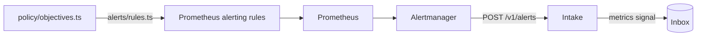

# Alerting

The app's objectives, watched by the standard tools. Part of the [runtime plane](README.md#runtime-plane).

- **v1:** Prometheus's alerting rules, generated from policy, and Alertmanager with one receiver.

## The objectives

`policy/objectives.ts` holds one error-ratio and one latency objective:

- applied to every route alike, over a short window;
- judged only for a route with a minimum number of requests.

## The rules

`apps/factory/src/alerts/rules.ts` generates Prometheus's alerting rules from it into `deploy/base/telemetry/values/prometheus-rules.yaml`, labelled with the route and the symptom class (`server-error`, `slow-response`). Each rule compares every route's error ratio or p95 over the window, once it has had enough requests, with the objective, by the same expression Prometheus records for dashboards ([recording rules](TELEMETRY.md#each-route-against-the-objectives)), and reads only the app's own series. `make check` fails when the file is out of date.

## The intake

Alertmanager has one receiver: a webhook to the intake. The intake (`factory intake`) answers `POST /v1/alerts`:

- **each firing alert** becomes a `metrics` signal, with:
  - the series behind it, as a metric picture;
  - the app's version;
  - the route, as the app's log names it;
- **a resolved alert** writes nothing.
