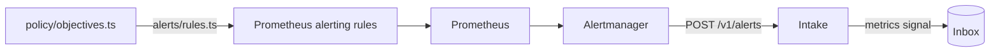

# Alerting

The app's objectives, watched by the standard tools. Part of the [runtime plane](README.md#runtime-plane).

- **v1:** Prometheus's alerting rules, generated from policy, and Alertmanager with one receiver.

## The objectives

`policy/objectives.ts` holds one error-ratio and one latency objective:

- applied to every route alike, over a short window;
- judged only for a route with a minimum number of requests.

## The rules

`apps/factory/src/alerts/rules.ts` generates Prometheus's alerting rules from it, and the [alerts to Martin](#security-events), into `deploy/base/telemetry/values/prometheus-rules.yaml`, labelled with the route and the symptom class (`server-error`, `slow-response`). Each rule compares every route's error ratio or p95 over the window, once it has had enough requests, with the objective, by the same expression Prometheus records for dashboards ([recording rules](TELEMETRY.md#each-route-against-the-objectives)), and reads only the app's own series. `make check` fails when the file is out of date.

## The intake

Alertmanager has one receiver: a webhook to the intake. The intake (`factory intake`) answers `POST /v1/alerts`:

- **each firing alert** becomes a `metrics` signal, with:
  - the series behind it, as a metric picture;
  - the app's version;
  - the route, as the app's log names it;
- **a resolved alert** writes nothing.

## Security events

Martin is paged for each of his security events, counted from the stored events by the line (`apps/factory/src/line/security.ts`), not by the admin service, which appends most of them: a compromised admin service cannot keep its own actions quiet, as it can neither reach the line nor change an event once stored. Each is told from the stored event alone, and counted whatever role appended it, as row security keeps any but Martin's roles from appending these types:

| Kind | The stored event |
|---|---|
| `sign-in` | `admin.signed-in` |
| `passkey-enrolled`, `passkey-revoked` | `passkey.enrolled`, `passkey.revoked` |
| `setting-changed` | every `settings.changed` |
| `stepped-up` | `admin.stepped-up`: the passkey given again |
| `release-control` | `release.controlled` that promotes a canary or retries a release |
| `guardrail-approved` | `hold.answered` approving a hold whose cause is a guardrail (`GUARDRAIL_HOLDS` in `policy/access.ts`), the cause read from the hold it answers |
| `line-started` | `line.started` |

The rest of what the access table marks as needing the passkey again (loosening autonomy, auto-merge on, auto-rollback off, a wider take) has no event yet, and a test fails until each that gains one is counted.

- **One rule for each kind** pages when its count rises: the first of a kind too, as each count starts at 0. Several of a kind within five minutes are one page.
- **Another pages when the count is missing or stale:** gone for ten minutes after being there in the six hours before, or the line unable to read the store for five. Meanwhile no security event would page.
- **A silence pages,** while Alertmanager has one in place, active or pending, from its own `alertmanager_silences`. Nothing here makes one, and only Prometheus and Grafana reach Alertmanager.
- **A new hold notifies:** each hold the store records, by its cause, whoever started it.
- **Each reads only the line's own series,** by what the collector stamps on them ([telemetry](TELEMETRY.md#which-series-are-the-lines)), so no other worker can page Martin through them. The silence's rule takes the highest of any series by its name, so another could only page him more, never less.

### What they cannot do

- **A silence can hide its own page.** A silence that matches every alert keeps this one quiet too. The cover is milestone 10's dead man's switch and check from outside, which no silence in the cluster reaches.
- **They count what is stored.** An action the admin service takes without appending its event is not counted: a sign-in, or a change it makes to the app's Rollout. The factory acts on Martin's other commands only once they are stored, so those are counted when they take effect.
- **Alerts from inside the cluster stop with it.** Whether the factory is up is answered from outside it, in milestone 10.
