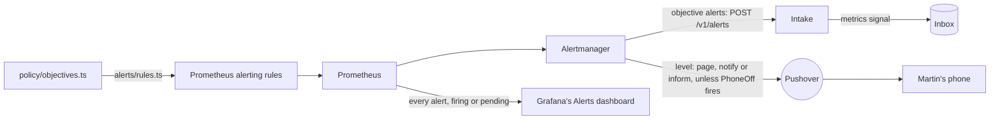

# Alerting

The app's objectives, and what Martin must hear about, watched by the standard tools. Part of the [runtime plane](README.md#runtime-plane).

- **v1:** Prometheus's alerting rules, generated from policy, and Alertmanager, which sends the objectives' alerts to the intake and pages, notifies or informs Martin through Pushover, of his security events, the holds that wait for him, and the factory's health, releases and spend, while [a switch in Controls](#alerts-to-the-phone) sends them to his phone, off on the laptop; and Grafana's Alerts dashboard, which shows every alert, whatever its level.
- **Later:** alerts on the factory's images' vulnerabilities (milestone 7, Part D); a dead man's switch and a check from outside, since alerts from inside a cluster stop with it (milestone 10).

## The objectives

`policy/objectives.ts` holds one error-ratio and one latency objective:

- applied to every route alike, over a short window;
- judged only for a route with a minimum number of requests.

## The rules

`apps/factory/src/alerts/rules.ts` generates Prometheus's alerting rules from it, and the alerts to Martin ([security events](#security-events), [holds](#holds), [the flags the app holds](#the-flags-the-app-holds), [the shop's pod](#the-shops-pod), and [the factory's health, releases and spend](#the-factorys-health)), into `deploy/base/telemetry/values/prometheus-rules.yaml`, labelled with the route and the symptom class (`server-error`, `slow-response`). Each rule compares every route's error ratio or p95 over the window, once it has had enough requests, with the objective, by the same expression Prometheus records for dashboards ([recording rules](TELEMETRY.md#each-route-against-the-objectives)), and reads only the app's own series. `make check` fails when the file is out of date.

## Levels and routes

Each rule says how loudly it is told by a `level` label, and Alertmanager routes by it (`deploy/base/telemetry/values/prometheus.yaml`):

| Level | Label | Sent to | For |
|---|---|---|---|
| Page | `level: page` | Pushover, at high priority, which sounds through Martin's quiet hours | the console or the app down, the probes silent, the line stuck, a lease run out unreleased, the store down, a worker crash-looping, a spend cap reached; the security events that loosen a guardrail, change who can sign in or keep alerts from his phone, the security events' count missing or stale, a change by the admin service that no event records, or the line unable to compare them, a silence in place, a narrowing or Off of a flag the app has not taken within a minute |
| Notify | `level: notify` | Pushover, at normal priority | a release rolled back, aborted or in error, an Argo CD application Degraded or OutOfSync for half an hour, each hold that waits for Martin, the shop's pod 25 days old, the security events that widen what the line does (an improvement asked for or its spec approved among them) or a feature flag, act on a release, change a setting or tighten autonomy, the app holding other flags than those set, or not checked, for more than five minutes |
| Inform | `level: inform` | Pushover, at low priority, with no sound or vibration | the security events that tighten, but for autonomy, or only record Martin's own use |
| Dashboard only | none | no one: a receiver that sends nothing; [Grafana's Alerts dashboard](#seeing-them) shows it | `PhoneOff`, and everything else |

- **The app's objective alerts carry no level,** and go to the intake, matched by their `objective` label: they are the senses' signals, not alerts to Martin. An alert with a level never reaches the intake, which would make a signal of it.
- **Each message to Martin is one of its own,** never folded into another's, sent once when it fires and again every four hours while it still does, and not when it resolves.
- **A message says what happened and when:** the rule's summary as its title, its description, as the rule writes it, and the time it began firing, in UTC. Of the labels, the receiver adds only the alert's name, when a rule gives no summary, and a hold's [links](#holds).
- **A message is Pushover's HTML,** for those links. Alertmanager renders it with Go's `html/template` (`martin.message`, a template in the same values file), which escapes each value for where it lands: a description's text as text, a number in a link's address as its query or path. It sends no supplementary URL (`url`), which would otherwise be Alertmanager's own in-cluster address, which the phone cannot open.
- **Pushover's keys are in a Secret,** `pushover` in `telemetry`, which `make up` makes from the Keychain's `pushover-app-token` and `pushover-user-key` (`make pushover-key` alone), piped through stdin. Alertmanager reads them from files each time it sends, so a key added later needs no restart. With no keys, Alertmanager still starts and still sends to the intake; each message to Martin fails to send, and its own metrics count the failures (`alertmanager_notifications_failed_total`).
- **Emergency priority,** which repeats until acknowledged, is not used: most pages are of Martin's own actions, and it would repeat at each of them.

## Who reaches Alertmanager

Prometheus names it by its Service (`server.alertmanagers` in its values), and sends it no service account's token: the chart's default would find any pod in `telemetry` labelled as Alertmanager through the Kubernetes API, and send each the token.

Anything that reached it could make a silence, and a silence keeps a page from Martin's phone. So its [fence](NETWORK-POLICIES.md#telemetry) lets in only Prometheus's server, which sends it alerts and scrapes its metrics, and Grafana. It reaches only DNS, the intake and the internet on 443, for Pushover. With one replica it has no peers, and listens on no gossip port.

## Seeing them

Grafana's Alerts dashboard ([`dashboards/alerts.json`](../../deploy/base/telemetry/dashboards/alerts.json)), linked from every dashboard's Dashboards row, shows every alert Prometheus has, firing or pending, whatever its level, from Prometheus's own `ALERTS` series:

- **Now:** how many fire at each level (Page, Notify, Inform, Dashboard only), how many are pending, and whether alerts are reaching the phone: No while `PhoneOff` fires. Dashboard only leaves `PhoneOff` out, though it has no level: Reaching the phone says it, and it would otherwise read 1 whenever the phone is off;
- **Every alert now:** its name, state and level, then its labels, the app's objective alerts among them;
- **Over the range:** when each was pending and when it fired.

An alert Alertmanager [mutes](#one-cause-one-page) is still there: the dashboard shows what fired, and Alertmanager decides what reaches the phone.

## Alerts to the phone

One switch in the console's Controls sends every alert with a level to Martin's phone, or none: alerts carry more false positives than useful ones, no tuning makes them right under simulated load, and on the laptop they exist only to be tried before the cloud. Grafana's [Alerts dashboard](#seeing-them) is where he sees and checks them while it is off.

- **On by default on the cloud profiles, off on the laptop** (`PHONE_DEFAULT` in `policy/phone.ts`, by `FACTORY_PROFILE`), until he switches it: his latest `alerts.switched` is in force after that, on any profile ([admin service](ADMIN-SERVICE.md#alerts-to-the-phone)).
- **Switching it off needs the passkey again,** and pages him (`phone-off`): it loosens what reaches him, as nothing will. So on the cloud the last message before quiet says so. Switching it on informs him (`phone-on`).
- **How it mutes:** the admin service reports the switch in force (`admin_alerts_phone`, 1 or 0, read from its own pod alone), and so does the line, as it reads the switch in the store (`line_alerts_phone`, from the line's pod alone). While both read 0, `PhoneOff` fires, with no level, so it reaches no one; and Alertmanager mutes every alert with a level (`page`, `notify`, `inform`) while `PhoneOff` fires, but switching the phone itself, either way: off must reach him, and on would otherwise race `PhoneOff` resolving, and often lose. The app's objective alerts carry no level, go to the intake, and are never muted.
- **Neither alone mutes them.** The admin service appends the switch, so a compromised one could report it off without Martin switching it; the line reads only what his roles stored, and a compromised admin service can neither reach the line nor change an event once stored. One that appended a switch off in his name would mute them as his own does, and page him as it does (`phone-off`, which the mute lets through). One reading on, from any replica, is enough for every alert to reach the phone.
- **Failing loud:** with either series missing, from a worker that is down, not yet scraped or started without the store, `PhoneOff` cannot fire, and every alert reaches the phone. A worker that goes stops counting within a minute: the rule takes each worker's word only from a sample in the last minute, as pushed metrics leave Prometheus no stale marker, and it would otherwise read the last one for five. Once it has read the switch, a worker that cannot read the store again goes on reporting the switch it read last, which only Martin changes. So while the store is down the switch stands as he last set it: off, and `StoreDown` too stays off his phone, as he chose; on, and every alert reaches it; no switch can be recorded until the store is back.
- **Prometheus still has every alert,** muted or not: the dashboard shows them all, and says whether they are reaching the phone.
- **Proved** by `apps/factory/test/factory-alerts.test.ts` (`PhoneOff` fires only while both say 0: not with one on, one or both missing, or another worker's series) and `apps/factory/test/alertmanager.test.ts` (it mutes every alert the rules raise with a level, but the two switches, and none of the objectives').

## The intake

The intake (`factory intake`) answers `POST /v1/alerts`:

- **each firing alert** becomes a `metrics` signal, with:
  - the series behind it, as a metric picture;
  - the app's version;
  - the route, as the app's log names it;
- **a resolved alert** writes nothing.

## Security events

Martin is alerted to each of his security events, at its kind's level, counted from the stored events by the line (`apps/factory/src/line/security.ts`), not by the admin service, which appends most of them: a compromised admin service cannot keep its own actions quiet, as it can neither reach the line nor change an event once stored. Each is told from the stored event alone, and counted whatever role appended it, as row security keeps any but Martin's roles from appending these types, but a guardrail's proof, which is counted only from the proofs' role, the one row security lets append it:

| Kind | The stored event | Level |
|---|---|---|
| `sign-in` | `admin.signed-in` | Inform |
| `passkey-enrolled`, `passkey-revoked` | `passkey.enrolled`, `passkey.revoked` | Page |
| `setting-changed` | every `settings.changed` | Notify |
| `release-control` | `release.controlled` that promotes a canary or retries a release | Notify |
| `guardrail-approved` | `hold.answered` approving a hold whose cause is a guardrail (`GUARDRAIL_HOLDS` in `policy/access.ts`), the cause read from the hold it answers | Page |
| `line-started` | `line.started` | Notify |
| `line-stopped` | every `line.stopped`, from the console or `make stop-the-line` | Inform |
| `autonomy-loosened`, `autonomy-tightened` | `controls.changed` that makes the autonomy level looser or stricter | Page, Notify |
| `new-work-on`, `new-work-off` | `controls.changed` that lets agents take new work, or stops them | Notify, Inform |
| `auto-merge-on`, `auto-merge-off` | `controls.changed` that turns auto-merge of low-risk changes on or off | Notify, Inform |
| `take-widened`, `take-narrowed` | `controls.changed` that widens or narrows what the line takes | Notify, Inform |
| `auto-rollback-off`, `auto-rollback-on` | `controls.changed` that turns auto-rollback off, so a canary whose errors or latency are judged bad pauses for him, or on: told by what the event puts in force as well as the control its change names, so an event that names another change cannot turn it off quietly | Page, Inform |
| `phone-on`, `phone-off` | `alerts.switched` that sends every alert to his phone, or none | Inform, Page |
| `flag-widened`, `flag-narrowed`, `flag-off` | `flag.staged` that widens a feature flag (to Checks too, and turning one back on for everyone), narrows it, or turns it off | Notify, Inform, Inform |
| `improvement-requested` | every `improvement.requested`, from the console's "+" | Notify |
| `improvement-approved` | `hold.answered` approving a `spec` hold, read from the hold it answers, on a work item opened as an improvement | Notify |
| `guardrail-not-held` | `guardrail.proved` that did not hold, appended by `factory_proofs` (`make guardrails`); one that held, like a refusal, is the guardrail working, and alerts no one | Page |

Giving the passkey again (`admin.stepped-up`) alerts no one, though the audit log keeps it: every action that needs it alerts as its own kind, and the sign-in before it informs him.

Every change of the line's controls alerts him, each told from the stored change's before and after alone (`policy/line.ts`), as every change of the settings does, and every move of a feature flag, from its stages before and after alone (`policy/flag-moves.ts`).

- **Each kind has its level** (`SECURITY_LEVELS` in `apps/factory/src/alerts/rules.ts`, typed so a new kind cannot go without one). What loosens a guardrail, a proof that one did not hold, what changes who can sign in, and what keeps alerts from his phone, page him; what widens what the line does (asking for an improvement, or approving its spec, sets it building something new), or acts on a release, notifies him; what tightens, or only records his own use, informs him, but for tightening autonomy, which notifies him. Every kind still reaches his phone: only how loudly differs.
- **One rule for each kind** alerts when its count rises: the first of a kind too, as each count starts at 0. Several of a kind within five minutes are one message.
- **Another pages when the count is missing or stale:** gone for ten minutes after being there in the six hours before, or the line unable to read the store for five. Meanwhile no security event would reach him.
- **A silence pages,** while Alertmanager has one in place, active or pending, from its own `alertmanager_silences`. Nothing here makes one, and only Prometheus and Grafana reach Alertmanager.
- **Each reads only the line's own series,** by what the collector stamps on them ([telemetry](TELEMETRY.md#which-series-are-the-lines)), so no other worker can page Martin through them. The silence's rule takes the highest of any series by its name, so another could only page him more, never less.

### What they cannot do

- **A silence can hide its own page.** A silence that matches every alert keeps this one quiet too. The cover is milestone 10's dead man's switch and check from outside, which no silence in the cluster reaches.
- **They count what is stored.** An action the admin service takes without appending its event is not counted here: the line compares what it changes with the events instead, and pages when one is not recorded ([below](#changes-no-event-records)). The factory acts on Martin's other commands only once they are stored, so those are counted when they take effect.
- **Alerts from inside the cluster stop with it.** Whether the factory is up is answered from outside it, in milestone 10.

### Changes no event records

The admin service is the one service of ours that changes the flags, the app's Rollout and Martin's sessions, and it records each change as an event, from which the security events are counted. A change it made without its event, or one made round it, would reach no one. So the line compares each with the events that name it ([`line/admin-actions.ts`](../../apps/factory/src/line/admin-actions.ts)), reading each and never writing it, and Martin is paged when a change has stood for two minutes that no event names (`AdminActionUncounted`, one rule for each, in its own words):

| What | Named when | Read from |
|---|---|---|
| `flags` | each flag is at the stage Martin's latest move of it set (`flag.staged`), every other flag off, none in a shape no stage has, and the flag set's revision is one a move of his wrote | `flags` in `flagd`, by the line's Role there: get, by name, and nothing else (`deploy/base/flagd/line-reads-flags.yaml`) |
| `rollout` | `spec.paused` is set only after his latest pause or resume was a pause, and cleared only after a control that clears it (a resume, a promotion, an abort, a retry) or the line stopped has followed his latest pause; `status.promoteFull` is set only after his full promotion of the release the line recorded starting last | the app's Rollout, by the Role the line watches releases with |
| `sessions` | every session of the last hour has a sign-in of its own (`admin.signed-in`), appended at or within a minute after it started, as the one transaction that starts a session appends it | the store: when each session started, and nothing else of it (`0038_line-reads-sign-ins.sql`) |

- **Recorded once made.** The admin service checks a change's event before it acts and appends it once the change is made ([admin service](ADMIN-SERVICE.md#what-it-records)), so the audit log never records a change that failed. A change stands unnamed for the moment between the two, then, and for good if the append fails twice. The line reads Kubernetes first, then the store, every 15 seconds, and the alert waits two minutes: only a change that was never recorded pages. A session and its sign-in are one transaction, and read in one statement.
- **Only Martin's events name a change:** one his roles appended, never a sample's; and of a release's start, only the line's own record.
- **Gone is a change too.** `flags` missing once a move of his set a flag there, or the Rollout missing once the line has recorded a release of it, is named by nothing: admission refuses the admin service either deletion.
- **The stages, not only the revision.** A hand that kept the revision and widened a flag would pass a check of the revision alone, so every flag's stage is compared too.
- **What the Rollout cannot say.** Argo Rollouts' controller writes the status's abort and step too, so the Rollout cannot tell whose they were: admission holds the admin service to the moves the controls make ([admission control](ADMISSION-CONTROL.md#the-admin-services-hold-on-the-rollout)), and the line records what each release did. A pause set with `kubectl argo rollouts`, or any of these changed with Martin's own kubeconfig, pages too: nothing records it. Of a pause, it cannot tell his own pause, cleared by a later control and set again by hand, from his; nor a pause cleared by hand after a control that could not clear it (the admin service then warns him his pause is still set). A pause holds a canary where it is, and the audit log has his controls either side.
- **An hour of sessions,** so one made and ended at once is still there to compare: the alert resolves an hour after such a session started. The line reads when each started, never its hash or its passkey.
- **What Martin does:** for the flags, move each that differs in Controls, which records it; for the Rollout, act in the Canary panel; for a session, `make enrol REVOKE_OTHERS=1`, which ends every session, then enrol his passkey again. Then the admin service's log, for whether it was the one.
- **Not being able to compare pages too,** after ten minutes, for each of the three in words of its own, with the line as its worker (`line_admin_actions_compared` at 0): meanwhile a change none records would reach no one. A comparison that takes over ten seconds counts as not made, so the SDK never drops the collection and sends the last figures as if compared. The line's log says why.
- **Each reads only the line's own series,** as the security events' alerts do, and only what it sent in the last minute: its series come over OTLP, with no staleness marker, so a line replaced since would otherwise be read for five minutes more.
- **`PhoneOff` mutes it,** as it mutes every alert with a level, and only while the admin service and the line both report the phone off ([alerts to the phone](#alerts-to-the-phone)). So a compromised admin service cannot quiet it alone: muting it takes both pods, or an `alerts.switched` in the store that switches the phone off, which pages Martin (`phone-off`) whatever the switch says.
- **Auto-rollback** is compared in Prometheus, where both of its series are: the admin service's word on it (`admin_auto_rollback`, from its pod) against the line's read of Martin's latest switch in the store (`line_auto_rollback`, from its), each from a sample in the last minute. Differing either way for two minutes pages him (`AdminActionUncounted`, `action="auto-rollback"`): the admin service reports what he did not record, or cannot read the store. Each reads the store again at every export, so they differ only for a moment after a switch. With either missing there is nothing to compare, and a bad canary rolls back ([progressive delivery](PROGRESSIVE-DELIVERY.md#auto-rollback)).
- **Proved** by `apps/factory/test/line/admin-actions.test.ts`, against a store and a fake Kubernetes, and by `promtool` in `apps/factory/test/factory-alerts.test.ts`.

## Holds

Martin is notified of each hold that waits for him, once, as it starts to wait (`HoldWaits`, one rule for each [cause](ORCHESTRATOR.md#holds-and-martins-answers), with its own words in `HOLD_WORDS`), whoever started it. The message names the work item, as "#1304 waits for your merge", and links its sheet in the console, and for a merge or a deploy its pull request on GitHub ("Deploy #212" for a deploy, as the console names it), so he can answer it from his phone:

> **#1304 waits for your merge**
> Its fix has passed its gates and review.
> Firing since 09:41 UTC, 24 October.
> <u>#1304 in the console</u> · <u>Pull request #57</u>

- **It reads the line's `line_hold_age_seconds`,** one series for each hold that waits for him, by work item, cause and pull request, from the store ([telemetry](TELEMETRY.md#the-lines-metrics)). A merge hold's pull request is its latest pushed; a deploy hold waits for him, and alerts, only once its deploy pull request's checks have passed, or at once after a release he aborted or that erred, with no pull request.
- **Once:** it fires while the hold has waited less than half an hour (`HOLD_ALERT_MINUTES`), or while its series is newer than that, and resolves after, which sends nothing: Alertmanager would send it again only after four hours. The line exports every 15 seconds and Prometheus evaluates every minute, so half an hour cannot miss it.
  - A hold that waits again under the same labels, as a deploy pull request whose checks pass again after a newer build, is told again: its series reads 0 between, and its age starts again. Not if it waits again within the minute Alertmanager takes to see the first resolve, which a new build and its checks never are.
  - A series that appears having waited already is told as it appears: a merge hold's newer pull request, which is a new one to look at, or a hold triage started while the line was down. So is one the line or Prometheus had not sent or read for over half an hour, which may tell a hold twice.
  - A series at 0, a hold that no longer waits until the line next starts, never fires; nor one whose age has stopped, as when the line cannot read the store and its SDK sends each hold's last age again: it would otherwise read young, and be sent again every four hours.
- **Only a line that takes work reports the holds** (`LINE_MODE` not `off`). While none does, a hold triage starts (a suggestion, a finding, a burst, or one held for its backends) is told by its cause alone, as "A hold waits for you", from the line's count of the holds stored, which it reports whatever its mode (`HoldStarted`); Needs you lists it.
- **Nothing but numbers make a link.** Each rule matches only a work item and a pull request of digits, and alerts for no other: the line checks its labels the same way before it sends them, and the message links a label only if it is digits, so an alert from anything else that reaches Alertmanager links nothing. No title, reason or visitor's words is in a label or a message. A dry run's pull request (from 1,000,000,000) is on no GitHub, so the rule takes it off and links the sheet alone.
- **The console's origin is the profile's,** a template each overlay defines (`console.origin`, in its Prometheus values), the origin its passkeys are bound to: `https://console.localhost:8443` locally. A test fails for a profile without it, as Alertmanager could render no message to Martin without it.
- **A deploy hold whose pull request is not ready alerts no one.** While its checks run, fail, or it is merged or closed, the hold is not yet his ([its state](RELEASE-AND-VERIFY.md#the-deploy-pull-requests-state)), and the console says what it waits for. Nothing alerts on one that stays there: the `held` stage has no stuck limit, as it waits for Martin.

## The flags the app holds

flagd keeps serving the last flags it read when its watch of `flags` breaks after it started, and stays ready, so a change Martin makes in Controls might never reach the app ([feature flags](FEATURE-FLAGS.md#readiness)). The [admin service](ADMIN-SERVICE.md#whether-the-app-holds-the-flags) asks every pod of the app, every minute and soon after each write, for the revision it holds, and reports how long they have differed from `flags`. Its rules, in a group of their own (`flagRules`):

| Alert | When | Level |
|---|---|---|
| `FlagsNotTaken` | A narrowing or Off, or a write that dropped a flag and so turned it off, that the app has not been seen to take a minute after it was written, whether its pods hold other flags or could not be asked (`admin_flags_narrowing_seconds` over 60) | Page |
| `FlagsDiffer` | A pod of the app has held other flags than those set for more than five minutes, a check in those five minutes having asked every pod (`admin_flags_differing_seconds` over 300, `admin_flags_checked` 1 at least once in them) | Notify |
| `FlagsUnchecked` | The admin service has not been able to ask every pod for as long (`admin_flags_checked` 0 throughout), or its figures have gone while `flags` held a flag set (`admin_flags_set` 1 in the six hours before, and none for the five minutes Prometheus looks back) | Notify |

- **A kill switch that has not worked pages.** Martin narrows a flag, or turns it off, because what it shows is wrong; if the app still shows it a minute on, the switch has failed while visitors see it. Within a minute of his own action he is at the console, so the page reaches him at once, and it sounds through his quiet hours if he acted then. A widening not taken harms nobody, so it is told at five minutes, as a notification.
- **Not being able to ask notifies,** as a difference does; but not within a minute of a narrowing, which pages: a kill switch that nothing shows working is told as one that has not worked, and the message says it may be either. A pod that misses one check during a difference does not swap one alert for the other: any check in the five minutes that asked every pod makes it a difference.
- **The minute and the five minutes are policy:** `FLAGS_HELD` in `policy/flags.ts`, which the admin service and the rules both read.
- **One figure for the app,** counted on through pods that come and go, so a lagging pod replaced by another does not start the five minutes again; a pod a check cannot ask counts it on too. `flags` holding no flag set and the app saying `none` is no difference.
- **What Martin does:** look at Controls, which says whether the app holds the flags, which revision it holds and since when. When flagd has stopped watching `flags` (its log says so, or its binding or Role has gone), restart it, which reads `flags` again as it starts or stays unready until it can: `kubectl -n flagd rollout restart deployment/flagd`. When the app answers `stale`, flagd is down or out of its reach, and the app already treats every flag as off ([failing off](FEATURE-FLAGS.md#failing-off)). When it cannot be asked, `make egress` and the admin service's log say whether its fence, its Role or the app's pods are at fault.
- **Each reads only the admin service's own series,** by what the collector stamps on them ([telemetry](TELEMETRY.md#which-series-are-the-lines)), and the highest of each by its name.
- **Proved by Prometheus's own rule tester:** `apps/factory/test/flag-alerts.test.ts` runs `promtool test rules` (held in `mise.toml` to the server's minor release, at the patch `mise.lock` holds) over the rules as committed, for each alert's when and when not.

## The shop's pod

The node's container logs may hold a visitor's report, and they go only with the pod ([how long a report is kept](TRIAGE.md#how-long-a-report-is-kept)). So Martin is notified when a running shop pod is 25 days old (`ShopPodOld`), five days (`SHOP_POD_RELEASE_DAYS`) before the 30 the privacy pages promise (`REPORT_TEXT.promisedDays` in `policy/triage.ts`), from which the 25 is worked out: time to merge a pending update, or its deploy pull request, so that a release replaces the pod, or, with none pending, to restart the Rollout.

- **A restart takes the shop down for a moment.** Argo Rollouts restarts a Rollout by evicting its pods and letting the ReplicaSet replace them, without starting a new one first, so with the shop's one replica nothing answers until the new pod is ready. A release starts the new pod beside the old one, so it is the way to replace the pod when one is pending, and the alert offers the restart second and says so.
- **It reads kube-state-metrics:** each pod's start, from `kube_pod_start_time`, for the pods in `website` that a ReplicaSet owns, which are the Rollout's, while they run. The canary analysis's journeys, which Jobs own, are not the shop's.
- **It holds for an hour** before it fires: the age only grows, so the hour costs little of the five days. A gap in the series resolves it, and it is sent again an hour after the series returns.
- **It is sent every four hours** while it fires, as every notification is, until a new pod replaces the old one.
- **It takes the oldest start of any series** for a pod, so another series by that name can only tell Martin sooner, never later.
- **It says nothing while kube-state-metrics is down,** as nothing else watches it.

## The factory's health

Martin is paged when the factory is unhealthy or its spend runs out, and notified when a release goes wrong or Argo CD cannot deploy, by one group of rules (`factoryRules` in `apps/factory/src/alerts/rules.ts`):

| Alert | Level | Fires when | Read from |
|---|---|---|---|
| `ConsoleDown` | Page | an address of the console has answered none of the probes' checks for two minutes, and failed some, for a minute more | [the probes' checks](PROBES-AND-CRAWLER.md#who-answers), `probes_checks_total` |
| `AppDown` | Page | the same, of an address of the app | the same |
| `ProbesDown` | Page | the probes have counted no check for five minutes, or sent nothing for as long as Prometheus looks back (five minutes), for two minutes more: neither alert above could fire | the same |
| `LineStuck` | Page | a work item the line is carrying has stood at a stage past its limit in force | `line_taken_oldest_seconds` against `line_taken_limit_seconds` ([the line's metrics](TELEMETRY.md#the-lines-metrics)) |
| `LeaseOverrun` | Page | a work item's lease has run out more than five minutes ago and nobody has let it go or taken it back | `line_lease_overrun_seconds` |
| `StoreDown` | Page | Postgres has not answered its exporter for a minute | `pg_up`, from the [Postgres exporter](TELEMETRY.md#the-clusters-state-and-postgres) |
| `StoreUnwatched` | Page | the exporter has said nothing for five minutes, so the store going down would not be told: a name of its own, as the store may be up, and `StoreDown` mutes what follows from it | the same |
| `WorkerCrashLooping` | Page | a pod in `factory` has restarted three times in five minutes: a crash loop is told within two or three minutes of its first crash, as Kubernetes backs off 10, 20 and 40 seconds | `kube_pod_container_status_restarts_total`, from kube-state-metrics, its highest less its lowest over the five minutes; a pod a ReplicaSet owns (`kube_pod_owner`) is named by its Deployment as `worker` |
| `SpendCapReached` | Page | the day's or the month's spend has reached its cap, and the gateway refuses every model call | `gateway_cap_spent_usd` against `gateway_cap_limit_usd` ([the gateway's metrics](TELEMETRY.md#the-gateways-metrics)), which the gateway counts again after each paid call and once a minute |
| `ReleaseRolledBack` | Notify | a release ended rolled back, or aborted (each in words of its own) | `line_releases_total` |
| `ReleaseErrored` | Notify | a release ended in error: the canary's analysis could not judge it | the same |
| `ArgoCDDegraded` | Notify | an Argo CD application has been Degraded for half an hour | `argocd_app_info` |
| `ArgoCDOutOfSync` | Notify | an Argo CD application has been OutOfSync for half an hour | the same |

- **"Stuck" is the line not moving a work item it should be moving.** The line says what it is carrying: only the work items it has taken, none while it is stopped, none but the one under Just one, and none at Plan, Build or Review, where only a step moves a work item on, while the day's or month's cap is reached or agents take no new work; gates, Release and Verify go on under a cap and are still watched. The time the line was told to stand does not count: a work item's time runs from the line's last start, and at a step's stage from the last cap cleared or change of Martin's controls, so a line started again does not page for the hours it stood. Its limits are `policy/stuck.ts`'s ([the stuck limits](TELEMETRY.md#the-lines-stuck-limits)), four times longer at a stage whose agents run on the local model (`LOCAL_MODEL_PACE`), as `ALL_LOCAL` sends every agent. So a line told to stop, a cap, a night on Qwen or a ticket the line has not taken never pages. The line works this out, not the rule, which would otherwise repeat the line's own logic. A provider's own cap (credit spent, the local model not running) does page, after the limit: it needs Martin.
- **A cause that comes and goes pages once.** Every health alert, and Argo CD's, goes on firing for ten minutes after its cause has gone (`keep_firing_for`), so a flapping console or a worker that restarts and crashes again is one message, not one each time it returns. Not the security events, each one event, nor the spend cap, nor a release's end, each one occasion.
- **Crash loops are counted by restarts,** not by the waiting reason: `CrashLoopBackOff` clears each time the container starts again, so a rule that waited on it would start its wait again at every restart, and fire only once the back-off had grown longer than the wait, minutes later. One restart, or a rollout's new pod, is no loop.
- **A cap reached and lifted within a minute may page no one.** The gateway's figures are what it last counted (`gateway/spend.ts`), after each paid call and once a minute, and Prometheus evaluates once a minute: a cap raised again at once, or a window that ends just after it is reached, can come and go between. The line's `spend.capped` and `spend.cleared` record it all the same, and the gateway's refusals are counted (`gateway_cap_refusals_total`).
- **Half an hour for Argo CD,** on every profile: a sync, a rollout or a `try-the-line` run that pauses `root` passes through Degraded or OutOfSync for minutes, and only one that stays needs Martin.
- **A dry run's release is not counted:** it never shipped. Only a real release that ends badly notifies.
- **Each reads only its sender's own series,** the line's, the probes' and the gateway's, by what the collector stamps on them ([telemetry](TELEMETRY.md#which-series-are-the-lines)), so no other worker can page Martin through them, or answer for a console that is down. What Prometheus scrapes from an exporter is taken so that another series by its name could only page him more, never less: the lowest `pg_up`, the highest of the rest. And the collector drops any metric sent over OTLP in those exporters' families (`pg`, `kube`, `argocd`), since `StoreDown` and `WorkerCrashLooping` mute other pages while they fire: a worker that sent a `pg_up` at 0, or restarts of a pod it named, would otherwise page once, and keep the real pages quiet behind it, a silence on the decoy included.
- **The addresses are the profile's** (HEALTH_CHECKS on the probes' Deployment): each Service, from inside the cluster, on every profile; a public profile adds its public addresses (milestone 10), each checked and alerted on by itself, by its origin and path.
- **Proved by Prometheus's own rule tester:** `apps/factory/test/factory-alerts.test.ts`, as for the flags' alerts, for each alert's when and when not, and another worker's series never firing one.

## One cause, one page

Alertmanager mutes what follows from a cause while the cause fires (`inhibit_rules` in Prometheus's values), so Martin is paged once, for the cause. Prometheus still has every alert, and the [Alerts dashboard](#seeing-them) shows them all.

| While this fires | These are muted | Because |
|---|---|---|
| `StoreDown` | `LineStuck`, `LeaseOverrun`, `WorkerCrashLooping`, `SecurityEventsUncounted`, `AdminActionUncounted` | Without the store the line can neither move work nor let go of a lease, a worker that needs it crash-loops, and the line can neither count the security events nor compare the admin service's changes with theirs. A change no event records is still there once the store answers, and pages then |
| `StoreDown` | `ArgoCDDegraded` of `root` | `root` holds the store and the workers |
| `SpendCapReached` | `LineStuck` | The line starts no step until the cap clears; it already reports nothing while it does |
| `WorkerCrashLooping` | whatever is said of that worker, by its `worker` label: `LineStuck`, `LeaseOverrun`, `SecurityEventsUncounted` and `AdminActionUncounted` for not comparing, of the line, `ConsoleDown` of the console, `ProbesDown` of the probes, `FlagsUnchecked` of the admin service | The crash loop is the cause, and its page names the pod |
| `WorkerCrashLooping` | `ArgoCDDegraded` of `root` | A crash-looping pod makes `root` Degraded |
| `PhoneOff` | every alert with a level, but the security events of switching the phone (`phone-off`, `phone-on`) | Martin switched alerts to his phone off, or the profile has them off ([alerts to the phone](#alerts-to-the-phone)) |

- **`ProbesDown` mutes nothing:** `ConsoleDown` and `AppDown` cannot fire without the probes' checks, so there is nothing to mute.
- **No cause mutes a security event,** a silence, a hold or the shop's pod: each is its own occasion. Nor a change no event records, but while the store is down, when the line cannot tell; the line's crash loop mutes only its not comparing. Only `PhoneOff`, which is no cause but Martin's choice, mutes them, as it mutes everything with a level. A crash loop never mutes another.
- **Martin's own causes are not inhibitions:** the line told to stop, a cap or the local model's pace are left out where the line reports what it carries, so nothing fires.
- **Held to it by a test** (`apps/factory/test/alertmanager.test.ts`), which mutes as Alertmanager does, from the values as written, and checks every alert a rule names is one the rules raise.

