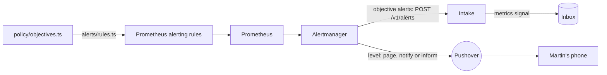

# Alerting

The app's objectives, and what Martin must hear about, watched by the standard tools. Part of the [runtime plane](README.md#runtime-plane).

- **v1:** Prometheus's alerting rules, generated from policy, and Alertmanager, which sends the objectives' alerts to the intake and pages, notifies or informs Martin through Pushover.
- **Later:** a dead man's switch and a check from outside, since alerts from inside a cluster stop with it (milestone 10).

## The objectives

`policy/objectives.ts` holds one error-ratio and one latency objective:

- applied to every route alike, over a short window;
- judged only for a route with a minimum number of requests.

## The rules

`apps/factory/src/alerts/rules.ts` generates Prometheus's alerting rules from it, and the [alerts to Martin](#security-events), into `deploy/base/telemetry/values/prometheus-rules.yaml`, labelled with the route and the symptom class (`server-error`, `slow-response`). Each rule compares every route's error ratio or p95 over the window, once it has had enough requests, with the objective, by the same expression Prometheus records for dashboards ([recording rules](TELEMETRY.md#each-route-against-the-objectives)), and reads only the app's own series. `make check` fails when the file is out of date.

## Levels and routes

Each rule says how loudly it is told by a `level` label, and Alertmanager routes by it (`deploy/base/telemetry/values/prometheus.yaml`):

| Level | Label | Sent to | For |
|---|---|---|---|
| Page | `level: page` | Pushover, at high priority, which sounds through Martin's quiet hours | the console or the app down, the line stuck, a spend cap reached, the security events that loosen a guardrail or change who can sign in, the security events' count missing or stale, a silence in place |
| Notify | `level: notify` | Pushover, at normal priority | a release rolled back or errored, a new hold, the security events that widen what the line does or act on a release, a security release or fixable vulnerability in a factory image |
| Inform | `level: inform` | Pushover, at low priority, with no sound or vibration | the security events that tighten, but for autonomy, or only record Martin's own use |
| Dashboard only | none | no one: a receiver that sends nothing | everything else |

- **The app's objective alerts carry no level,** and go to the intake, matched by their `objective` label: they are the senses' signals, not alerts to Martin. An alert with a level never reaches the intake, which would make a signal of it.
- **Each message to Martin is one of its own,** never folded into another's, sent once when it fires and again every four hours while it still does, and not when it resolves.
- **A message says what happened and when:** the rule's description or summary, as the rule writes it, and the time it began firing, in UTC. The receiver adds no label of its own choosing: only the alert's name, when a rule gives no summary.
- **Pushover's keys are in a Secret,** `pushover` in `telemetry`, which `make up` makes from the Keychain's `pushover-app-token` and `pushover-user-key` (`make pushover-key` alone), piped through stdin. Alertmanager reads them from files each time it sends, so a key added later needs no restart. With no keys, Alertmanager still starts and still sends to the intake; each message to Martin fails to send, and its own metrics count the failures (`alertmanager_notifications_failed_total`).
- **Emergency priority,** which repeats until acknowledged, is not used: every page so far is one of Martin's own actions, and it would repeat at each of them.

## Who reaches Alertmanager

Anything that reached it could make a silence, and a silence keeps a page from Martin's phone. So its [fence](NETWORK-POLICIES.md#telemetry) lets in only Prometheus's server, which sends it alerts and scrapes its metrics, and Grafana. It reaches only DNS, the intake and the internet on 443, for Pushover. With one replica it has no peers, and listens on no gossip port.

## The intake

The intake (`factory intake`) answers `POST /v1/alerts`:

- **each firing alert** becomes a `metrics` signal, with:
  - the series behind it, as a metric picture;
  - the app's version;
  - the route, as the app's log names it;
- **a resolved alert** writes nothing.

## Security events

Martin is alerted to each of his security events, at its kind's level, counted from the stored events by the line (`apps/factory/src/line/security.ts`), not by the admin service, which appends most of them: a compromised admin service cannot keep its own actions quiet, as it can neither reach the line nor change an event once stored. Each is told from the stored event alone, and counted whatever role appended it, as row security keeps any but Martin's roles from appending these types:

| Kind | The stored event | Level |
|---|---|---|
| `sign-in` | `admin.signed-in` | Inform |
| `passkey-enrolled`, `passkey-revoked` | `passkey.enrolled`, `passkey.revoked` | Page |
| `setting-changed` | every `settings.changed` | Notify |
| `stepped-up` | `admin.stepped-up`: the passkey given again | Inform |
| `release-control` | `release.controlled` that promotes a canary or retries a release | Notify |
| `guardrail-approved` | `hold.answered` approving a hold whose cause is a guardrail (`GUARDRAIL_HOLDS` in `policy/access.ts`), the cause read from the hold it answers | Page |
| `line-started` | `line.started` | Notify |
| `autonomy-loosened`, `autonomy-tightened` | `controls.changed` that makes the autonomy level looser or stricter | Page, Notify |
| `new-work-on`, `new-work-off` | `controls.changed` that lets agents take new work, or stops them | Inform |
| `auto-merge-on`, `auto-merge-off` | `controls.changed` that turns auto-merge of low-risk changes on or off | Notify, Inform |
| `take-widened`, `take-narrowed` | `controls.changed` that widens or narrows what the line takes | Notify, Inform |

Every change of the line's controls alerts him, each told from the stored change's before and after alone (`policy/line.ts`), as every change of the settings does. Auto-rollback off, which the access table marks too, has no event until Part C gives it a switch, and a test fails until it is counted.

- **Each kind has its level** (`SECURITY_LEVELS` in `apps/factory/src/alerts/rules.ts`, typed so a new kind cannot go without one). What loosens a guardrail, or changes who can sign in, pages him; what widens what the line does, or acts on a release, notifies him; what tightens, or only records his own use, informs him, but for tightening autonomy, which notifies him. Every kind still reaches his phone: only how loudly differs.
- **One rule for each kind** alerts when its count rises: the first of a kind too, as each count starts at 0. Several of a kind within five minutes are one message.
- **Another pages when the count is missing or stale:** gone for ten minutes after being there in the six hours before, or the line unable to read the store for five. Meanwhile no security event would reach him.
- **A silence pages,** while Alertmanager has one in place, active or pending, from its own `alertmanager_silences`. Nothing here makes one, and only Prometheus and Grafana reach Alertmanager.
- **A new hold notifies:** each hold the store records, by its cause, whoever started it.
- **Each reads only the line's own series,** by what the collector stamps on them ([telemetry](TELEMETRY.md#which-series-are-the-lines)), so no other worker can page Martin through them. The silence's rule takes the highest of any series by its name, so another could only page him more, never less.

### What they cannot do

- **A silence can hide its own page.** A silence that matches every alert keeps this one quiet too. The cover is milestone 10's dead man's switch and check from outside, which no silence in the cluster reaches.
- **They count what is stored.** An action the admin service takes without appending its event is not counted: a sign-in, or a change it makes to the app's Rollout. The factory acts on Martin's other commands only once they are stored, so those are counted when they take effect.
- **Alerts from inside the cluster stop with it.** Whether the factory is up is answered from outside it, in milestone 10.
