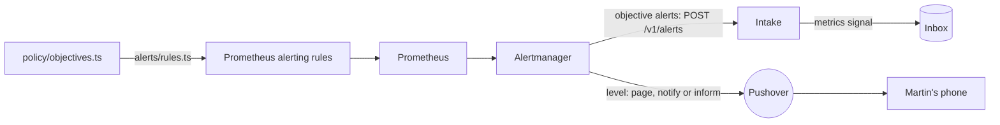

# Alerting

The app's objectives, and what Martin must hear about, watched by the standard tools. Part of the [runtime plane](README.md#runtime-plane).

- **v1:** Prometheus's alerting rules, generated from policy, and Alertmanager, which sends the objectives' alerts to the intake and pages, notifies or informs Martin through Pushover.
- **Later:** alerts on the factory's own health (a worker crash-looping, a lease stuck, the store down, Argo CD degraded), its releases and its spend (milestone 7, Part C), and its images' vulnerabilities (Part D); a dead man's switch and a check from outside, since alerts from inside a cluster stop with it (milestone 10).

## The objectives

`policy/objectives.ts` holds one error-ratio and one latency objective:

- applied to every route alike, over a short window;
- judged only for a route with a minimum number of requests.

## The rules

`apps/factory/src/alerts/rules.ts` generates Prometheus's alerting rules from it, and the alerts to Martin ([security events](#security-events), [holds](#holds), [the flags the app holds](#the-flags-the-app-holds) and [the shop's pod](#the-shops-pod)), into `deploy/base/telemetry/values/prometheus-rules.yaml`, labelled with the route and the symptom class (`server-error`, `slow-response`). Each rule compares every route's error ratio or p95 over the window, once it has had enough requests, with the objective, by the same expression Prometheus records for dashboards ([recording rules](TELEMETRY.md#each-route-against-the-objectives)), and reads only the app's own series. `make check` fails when the file is out of date.

## Levels and routes

Each rule says how loudly it is told by a `level` label, and Alertmanager routes by it (`deploy/base/telemetry/values/prometheus.yaml`):

| Level | Label | Sent to | For |
|---|---|---|---|
| Page | `level: page` | Pushover, at high priority, which sounds through Martin's quiet hours | the security events that loosen a guardrail or change who can sign in, the security events' count missing or stale, a silence in place, a narrowing or Off of a flag the app has not taken within a minute |
| Notify | `level: notify` | Pushover, at normal priority | each hold that waits for Martin, the shop's pod 25 days old, the security events that widen what the line does or a feature flag, act on a release, change a setting or tighten autonomy, the app holding other flags than those set, or not checked, for more than five minutes |
| Inform | `level: inform` | Pushover, at low priority, with no sound or vibration | the security events that tighten, but for autonomy, or only record Martin's own use |
| Dashboard only | none | no one: a receiver that sends nothing | everything else |

- **The app's objective alerts carry no level,** and go to the intake, matched by their `objective` label: they are the senses' signals, not alerts to Martin. An alert with a level never reaches the intake, which would make a signal of it.
- **Each message to Martin is one of its own,** never folded into another's, sent once when it fires and again every four hours while it still does, and not when it resolves.
- **A message says what happened and when:** the rule's summary as its title, its description, as the rule writes it, and the time it began firing, in UTC. Of the labels, the receiver adds only the alert's name, when a rule gives no summary, and a hold's [links](#holds).
- **A message is Pushover's HTML,** for those links. Alertmanager renders it with Go's `html/template` (`martin.message`, a template in the same values file), which escapes each value for where it lands: a description's text as text, a number in a link's address as its query or path. It sends no supplementary URL (`url`), which would otherwise be Alertmanager's own in-cluster address, which the phone cannot open.
- **Pushover's keys are in a Secret,** `pushover` in `telemetry`, which `make up` makes from the Keychain's `pushover-app-token` and `pushover-user-key` (`make pushover-key` alone), piped through stdin. Alertmanager reads them from files each time it sends, so a key added later needs no restart. With no keys, Alertmanager still starts and still sends to the intake; each message to Martin fails to send, and its own metrics count the failures (`alertmanager_notifications_failed_total`).
- **Emergency priority,** which repeats until acknowledged, is not used: most pages are of Martin's own actions, and it would repeat at each of them.

## Who reaches Alertmanager

Anything that reached it could make a silence, and a silence keeps a page from Martin's phone. So its [fence](NETWORK-POLICIES.md#telemetry) lets in only Prometheus's server, which sends it alerts and scrapes its metrics, and Grafana. It reaches only DNS, the intake and the internet on 443, for Pushover. With one replica it has no peers, and listens on no gossip port.

## The intake

The intake (`factory intake`) answers `POST /v1/alerts`:

- **each firing alert** becomes a `metrics` signal, with:
  - the series behind it, as a metric picture;
  - the app's version;
  - the route, as the app's log names it;
- **a resolved alert** writes nothing.

## Security events

Martin is alerted to each of his security events, at its kind's level, counted from the stored events by the line (`apps/factory/src/line/security.ts`), not by the admin service, which appends most of them: a compromised admin service cannot keep its own actions quiet, as it can neither reach the line nor change an event once stored. Each is told from the stored event alone, and counted whatever role appended it, as row security keeps any but Martin's roles from appending these types:

| Kind | The stored event | Level |
|---|---|---|
| `sign-in` | `admin.signed-in` | Inform |
| `passkey-enrolled`, `passkey-revoked` | `passkey.enrolled`, `passkey.revoked` | Page |
| `setting-changed` | every `settings.changed` | Notify |
| `release-control` | `release.controlled` that promotes a canary or retries a release | Notify |
| `guardrail-approved` | `hold.answered` approving a hold whose cause is a guardrail (`GUARDRAIL_HOLDS` in `policy/access.ts`), the cause read from the hold it answers | Page |
| `line-started` | `line.started` | Notify |
| `line-stopped` | every `line.stopped`, from the console or `make stop-the-line` | Inform |
| `autonomy-loosened`, `autonomy-tightened` | `controls.changed` that makes the autonomy level looser or stricter | Page, Notify |
| `new-work-on`, `new-work-off` | `controls.changed` that lets agents take new work, or stops them | Notify, Inform |
| `auto-merge-on`, `auto-merge-off` | `controls.changed` that turns auto-merge of low-risk changes on or off | Notify, Inform |
| `take-widened`, `take-narrowed` | `controls.changed` that widens or narrows what the line takes | Notify, Inform |
| `flag-widened`, `flag-narrowed`, `flag-off` | `flag.staged` that widens a feature flag (to Checks too, and turning one back on for everyone), narrows it, or turns it off | Notify, Inform, Inform |

Giving the passkey again (`admin.stepped-up`) alerts no one, though the audit log keeps it: every action that needs it alerts as its own kind, and the sign-in before it informs him.

Every change of the line's controls alerts him, each told from the stored change's before and after alone (`policy/line.ts`), as every change of the settings does, and every move of a feature flag, from its stages before and after alone (`policy/flag-moves.ts`). Auto-rollback off, which the access table marks too, has no event until Part C gives it a switch, and a test fails until it is counted.

- **Each kind has its level** (`SECURITY_LEVELS` in `apps/factory/src/alerts/rules.ts`, typed so a new kind cannot go without one). What loosens a guardrail, or changes who can sign in, pages him; what widens what the line does, or acts on a release, notifies him; what tightens, or only records his own use, informs him, but for tightening autonomy, which notifies him. Every kind still reaches his phone: only how loudly differs.
- **One rule for each kind** alerts when its count rises: the first of a kind too, as each count starts at 0. Several of a kind within five minutes are one message.
- **Another pages when the count is missing or stale:** gone for ten minutes after being there in the six hours before, or the line unable to read the store for five. Meanwhile no security event would reach him.
- **A silence pages,** while Alertmanager has one in place, active or pending, from its own `alertmanager_silences`. Nothing here makes one, and only Prometheus and Grafana reach Alertmanager.
- **Each reads only the line's own series,** by what the collector stamps on them ([telemetry](TELEMETRY.md#which-series-are-the-lines)), so no other worker can page Martin through them. The silence's rule takes the highest of any series by its name, so another could only page him more, never less.

### What they cannot do

- **A silence can hide its own page.** A silence that matches every alert keeps this one quiet too. The cover is milestone 10's dead man's switch and check from outside, which no silence in the cluster reaches.
- **They count what is stored.** An action the admin service takes without appending its event is not counted: a sign-in, or a change it makes to the app's Rollout. The factory acts on Martin's other commands only once they are stored, so those are counted when they take effect.
- **Alerts from inside the cluster stop with it.** Whether the factory is up is answered from outside it, in milestone 10.

## Holds

Martin is notified of each hold that waits for him, once, as it starts to wait (`HoldWaits`, one rule for each [cause](ORCHESTRATOR.md#holds-and-martins-answers), with its own words in `HOLD_WORDS`), whoever started it. The message names the work item, as "#1304 waits for your merge", and links its sheet in the console, and for a merge or a deploy its pull request on GitHub ("Deploy #212" for a deploy, as the console names it), so he can answer it from his phone:

> **#1304 waits for your merge**
> Its fix has passed its gates and review.
> Firing since 09:41 UTC, 24 October.
> <u>#1304 in the console</u> · <u>Pull request #57</u>

- **It reads the line's `line_hold_age_seconds`,** one series for each hold that waits for him, by work item, cause and pull request, from the store ([telemetry](TELEMETRY.md#the-lines-metrics)). A merge hold's pull request is its latest pushed; a deploy hold waits for him, and alerts, only once its deploy pull request's checks have passed, or at once after a release he aborted or that erred, with no pull request.
- **Once:** it fires while the hold has waited less than half an hour (`HOLD_ALERT_MINUTES`), or while its series is newer than that, and resolves after, which sends nothing: Alertmanager would send it again only after four hours. The line exports every 15 seconds and Prometheus evaluates every minute, so half an hour cannot miss it.
  - A hold that waits again under the same labels, as a deploy pull request whose checks pass again after a newer build, is told again: its series reads 0 between, and its age starts again. Not if it waits again within the minute Alertmanager takes to see the first resolve, which a new build and its checks never are.
  - A series that appears having waited already is told as it appears: a merge hold's newer pull request, which is a new one to look at, or a hold triage started while the line was down. So is one the line or Prometheus had not sent or read for over half an hour, which may tell a hold twice.
  - A series at 0, a hold that no longer waits until the line next starts, never fires; nor one whose age has stopped, as when the line cannot read the store and its SDK sends each hold's last age again: it would otherwise read young, and be sent again every four hours.
- **Only a line that takes work reports the holds** (`LINE_MODE` not `off`). While none does, a hold triage starts (a suggestion, a finding, a burst, or one held for its backends) is told by its cause alone, as "A hold waits for you", from the line's count of the holds stored, which it reports whatever its mode (`HoldStarted`); Needs you lists it.
- **Nothing but numbers make a link.** Each rule matches only a work item and a pull request of digits, and alerts for no other: the line checks its labels the same way before it sends them, and the message links a label only if it is digits, so an alert from anything else that reaches Alertmanager links nothing. No title, reason or visitor's words is in a label or a message. A dry run's pull request (from 1,000,000,000) is on no GitHub, so the rule takes it off and links the sheet alone.
- **The console's origin is the profile's,** a template each overlay defines (`console.origin`, in its Prometheus values), the origin its passkeys are bound to: `https://console.localhost:8443` locally. A test fails for a profile without it, as Alertmanager could render no message to Martin without it.
- **A deploy hold whose pull request is not ready alerts no one.** While its checks run, fail, or it is merged or closed, the hold is not yet his ([its state](RELEASE-AND-VERIFY.md#the-deploy-pull-requests-state)), and the console says what it waits for. Nothing alerts on one that stays there: the `held` stage has no stuck limit, as it waits for Martin.

## The flags the app holds

flagd keeps serving the last flags it read when its watch of `flags` breaks after it started, and stays ready, so a change Martin makes in Controls might never reach the app ([feature flags](FEATURE-FLAGS.md#readiness)). The [admin service](ADMIN-SERVICE.md#whether-the-app-holds-the-flags) asks every pod of the app, every minute and soon after each write, for the revision it holds, and reports how long they have differed from `flags`. Its rules, in a group of their own (`flagRules`):

| Alert | When | Level |
|---|---|---|
| `FlagsNotTaken` | A narrowing or Off, or a write that dropped a flag and so turned it off, that the app has not been seen to take a minute after it was written, whether its pods hold other flags or could not be asked (`admin_flags_narrowing_seconds` over 60) | Page |
| `FlagsDiffer` | A pod of the app has held other flags than those set for more than five minutes, a check in those five minutes having asked every pod (`admin_flags_differing_seconds` over 300, `admin_flags_checked` 1 at least once in them) | Notify |
| `FlagsUnchecked` | The admin service has not been able to ask every pod for as long (`admin_flags_checked` 0 throughout), or its figures have gone while `flags` held a flag set (`admin_flags_set` 1 in the six hours before, and none for the five minutes Prometheus looks back) | Notify |

- **A kill switch that has not worked pages.** Martin narrows a flag, or turns it off, because what it shows is wrong; if the app still shows it a minute on, the switch has failed while visitors see it. Within a minute of his own action he is at the console, so the page reaches him at once, and it sounds through his quiet hours if he acted then. A widening not taken harms nobody, so it is told at five minutes, as a notification.
- **Not being able to ask notifies,** as a difference does; but not within a minute of a narrowing, which pages: a kill switch that nothing shows working is told as one that has not worked, and the message says it may be either. A pod that misses one check during a difference does not swap one alert for the other: any check in the five minutes that asked every pod makes it a difference.
- **The minute and the five minutes are policy:** `FLAGS_HELD` in `policy/flags.ts`, which the admin service and the rules both read.
- **One figure for the app,** counted on through pods that come and go, so a lagging pod replaced by another does not start the five minutes again; a pod a check cannot ask counts it on too. `flags` holding no flag set and the app saying `none` is no difference.
- **What Martin does:** look at Controls, which says whether the app holds the flags, which revision it holds and since when. When flagd has stopped watching `flags` (its log says so, or its binding or Role has gone), restart it, which reads `flags` again as it starts or stays unready until it can: `kubectl -n flagd rollout restart deployment/flagd`. When the app answers `stale`, flagd is down or out of its reach, and the app already treats every flag as off ([failing off](FEATURE-FLAGS.md#failing-off)). When it cannot be asked, `make egress` and the admin service's log say whether its fence, its Role or the app's pods are at fault.
- **Each reads only the admin service's own series,** by what the collector stamps on them ([telemetry](TELEMETRY.md#which-series-are-the-lines)), and the highest of each by its name.
- **Proved by Prometheus's own rule tester:** `apps/factory/test/flag-alerts.test.ts` runs `promtool test rules` (held in `mise.toml` to the server's minor release, at the patch `mise.lock` holds) over the rules as committed, for each alert's when and when not.

## The shop's pod

The node's container logs may hold a visitor's report, and they go only with the pod ([how long a report is kept](TRIAGE.md#how-long-a-report-is-kept)). So Martin is notified when a running shop pod is 25 days old (`ShopPodOld`), five days (`SHOP_POD_RELEASE_DAYS`) before the 30 the privacy pages promise (`REPORT_TEXT.promisedDays` in `policy/triage.ts`), from which the 25 is worked out: time to merge a pending update, or its deploy pull request, so that a release replaces the pod, or, with none pending, to restart the Rollout.

- **A restart takes the shop down for a moment.** Argo Rollouts restarts a Rollout by evicting its pods and letting the ReplicaSet replace them, without starting a new one first, so with the shop's one replica nothing answers until the new pod is ready. A release starts the new pod beside the old one, so it is the way to replace the pod when one is pending, and the alert offers the restart second and says so.
- **It reads kube-state-metrics:** each pod's start, from `kube_pod_start_time`, for the pods in `website` that a ReplicaSet owns, which are the Rollout's, while they run. The canary analysis's journeys, which Jobs own, are not the shop's.
- **It holds for an hour** before it fires: the age only grows, so the hour costs little of the five days. A gap in the series resolves it, and it is sent again an hour after the series returns.
- **It is sent every four hours** while it fires, as every notification is, until a new pod replaces the old one.
- **It takes the oldest start of any series** for a pod, so another series by that name can only tell Martin sooner, never later.
- **It says nothing while kube-state-metrics is down,** as nothing else watches it.
