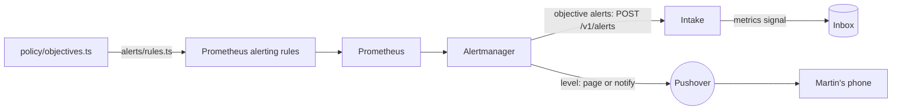

# Alerting

The app's objectives, and what Martin must hear about, watched by the standard tools. Part of the [runtime plane](README.md#runtime-plane).

- **v1:** Prometheus's alerting rules, generated from policy, and Alertmanager, which sends the objectives' alerts to the intake and pages or notifies Martin through Pushover.
- **Later:** a dead man's switch and a check from outside, since alerts from inside a cluster stop with it (milestone 10).

## The objectives

`policy/objectives.ts` holds one error-ratio and one latency objective:

- applied to every route alike, over a short window;
- judged only for a route with a minimum number of requests.

## The rules

`apps/factory/src/alerts/rules.ts` generates Prometheus's alerting rules from it into `deploy/base/telemetry/values/prometheus-rules.yaml`, labelled with the route and the symptom class (`server-error`, `slow-response`). Each rule compares every route's error ratio or p95 over the window, once it has had enough requests, with the objective, by the same expression Prometheus records for dashboards ([recording rules](TELEMETRY.md#each-route-against-the-objectives)), and reads only the app's own series. `make check` fails when the file is out of date.

## Levels and routes

Each rule says how loudly it is told by a `level` label, and Alertmanager routes by it (`deploy/base/telemetry/values/prometheus.yaml`):

| Level | Label | Sent to | For |
|---|---|---|---|
| Page | `level: page` | Pushover, at high priority, which sounds through Martin's quiet hours | the console or the app down, the line stuck, a spend cap reached, a security event |
| Notify | `level: notify` | Pushover, at normal priority | a release rolled back or errored, a new hold, autonomy changed, a security release or fixable vulnerability in a factory image |
| Dashboard only | neither | no one: a receiver that sends nothing | everything else |

- **The app's objective alerts carry no level,** and go to the intake, matched by their `objective` label: they are the senses' signals, not alerts to Martin. An alert with a level never reaches the intake, which would make a signal of it.
- **Each page and notification is a message of its own,** never folded into another's, sent once when it fires and again every four hours while it still does, and not when it resolves.
- **A message says what happened and when:** the rule's description or summary, as the rule writes it, and the time it began firing, in UTC. The receiver adds no label of its own choosing: only the alert's name, when a rule gives no summary.
- **Pushover's keys are in a Secret,** `pushover` in `telemetry`, which `make up` makes from the Keychain's `pushover-app-token` and `pushover-user-key` (`make pushover-key` alone), piped through stdin. Alertmanager reads them from files each time it sends, so a key added later needs no restart. With no keys, Alertmanager still starts and still sends to the intake; each page fails to send, and its own metrics count the failures (`alertmanager_notifications_failed_total`).
- **Emergency priority,** which repeats until acknowledged, is not used: every page so far is one of Martin's own actions, and it would repeat at each sign-in.

## Who reaches Alertmanager

Anything that reached it could make a silence, and a silence keeps a page from Martin's phone. So its [fence](NETWORK-POLICIES.md#telemetry) lets in only Prometheus's server, which sends it alerts and scrapes its metrics, and Grafana. It reaches only DNS, the intake and the internet on 443, for Pushover. With one replica it has no peers, and listens on no gossip port.

## The intake

The intake (`factory intake`) answers `POST /v1/alerts`:

- **each firing alert** becomes a `metrics` signal, with:
  - the series behind it, as a metric picture;
  - the app's version;
  - the route, as the app's log names it;
- **a resolved alert** writes nothing.
