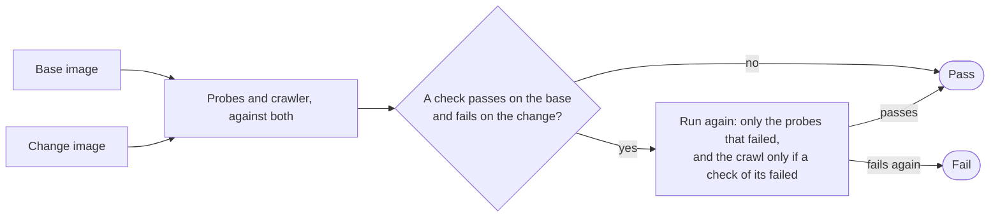

# CI pipeline

Deterministic gates (spec 4.1). Part of the [GitHub plane](README.md#github-plane).

- **v1:** GitHub Actions on GitHub-hosted runners, with a target under 3 minutes and the jobs in parallel.
- **Later:** visual regression, performance budgets, DAST, load tests.

## The jobs

- lint and format;
- type-check;
- unit and integration tests;
- the manifests rendered;
- the app's gates ([shared gates](SHARED-GATES.md)), the journeys among them.

## Journeys

The base's and the change's images are built and run as containers in the runner, and `factory gate journeys` runs the probes and the crawler (with axe) against both at once.

- **It fails** on a check that passes on the base and fails on the change twice.
- **A check the base could not tell about** (the crawler's trouble) is reported, not failed on.
