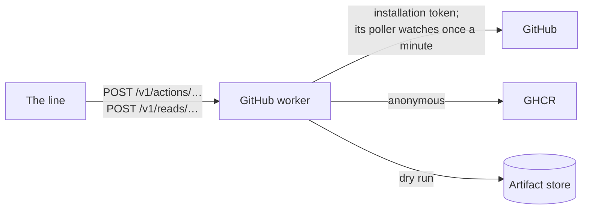
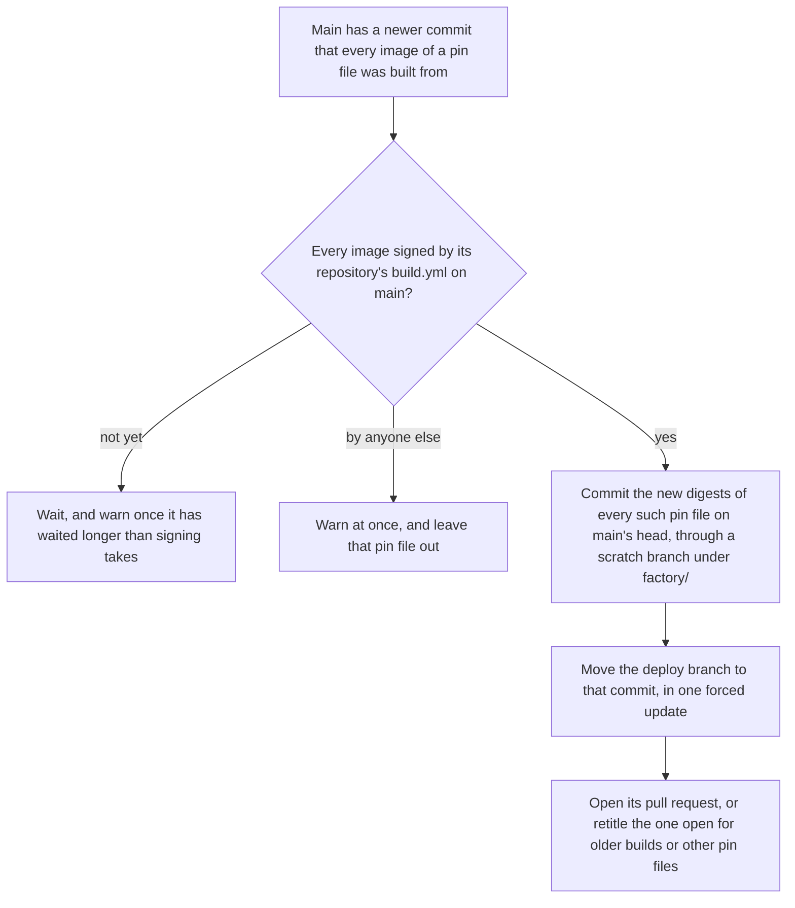

# GitHub worker

The only pod with the [App](GITHUB-APP.md)'s key, and so the only thing that acts in GitHub as the factory. Part of the [factory plane](README.md#factory-plane).

- **v1:** `apps/factory/src/github`, run by `factory github run`.

## Identity

- It signs a JSON Web Token with the key (the Client ID as issuer), and trades it for an installation token narrowed to one repository, made when needed and an hour long. Neither is ever logged.
- The worker itself touches no store.
- The other workers' calls must be JSON, and on a host it listens on loopback only. Only the line may call it in the cluster ([network policies](NETWORK-POLICIES.md)).

## Actions

Workers ask for actions over HTTP, `POST /v1/actions/<action>`, each body checked with Zod and naming one of its repositories (`github/actions.ts`):

- branches;
- signed commits through GraphQL's `createCommitOnBranch`, never `git push`;
- opening, updating, labelling and readying pull requests, and putting them back to draft, and updating a branch;
- closing a pull request unmerged with a comment once (`closePullRequest`), as the line does for a held or waiting work item whose defect went with another change; one already closed is left as it is, and one from a branch the factory does not own is refused;
- comment reviews anchored to lines, and resolving their threads (`resolveThreads`): on each open thread the App began with a finding now answered (matched by path, line and words), the reply it is given, made once, then the thread resolved. The reply names the commit when a later review finds the finding put right or the suggestion taken, gives the coder's reason when it declines a suggestion, and says Martin accepted the review when he approves its hold in the console;
- check runs;
- issues and comments:
  - opening one;
  - closing one, as completed, with a comment once (which a fix verified in production gets);
  - reopening one with a comment (`reopenIssue`, only while it is closed, saying it once since it closed);
  - a comment on its own (`comment`), as the line's hand-over of an improvement makes, made only when the issue does not say it already, word for word, so asking again after a failure or a crash says it once.

The line names the work item an action is for in `x-factory-work-item`, and the agent whose step it carries out in `x-factory-agent`, and the worker's log of the action, or of its failure, carries both, so a fix's commit or pull request is found by its work item. A deploy pull request's description, which carries many work items, names none. Neither header changes what is done.

### Its branches only

It moves, deletes and commits to the factory's own branches only, and refuses any other before GitHub is asked (`github/branches.ts`):

- those under `factory/`: a fix is `factory/<work item>-<a few words of its ticket's title>`;
- the deploy branches.

## Reads

The line reads through it too, `POST /v1/reads/<read>` (`github/reads.ts`):

- **For a fix,** each a conditional request:
  - a pull request's state;
  - the check runs on a commit;
  - the checks a branch's rulesets require;
  - a branch's head;
  - how a commit compares with a branch: its merge base, and each file it changes with its patch;
  - the paths no patch may change at a commit: the workflows, the deployment and what its CODEOWNERS gives a person.
- **For a release:**
  - `commits`: the commits between two, oldest first, and whether one is the other's ancestor. A commit GitHub never had, a dry run's, is a 404;
  - `imageRevision`: the commit an image of a repository's deploy was built from, by its OCI revision label in GHCR;
  - `imageSigned`: whether that image carries its repository's signature;
  - `deployProposal`: the open deploy pull request for a deploy branch of one pin file, as the deploy watch last saw it.

  An image that is not one of that repository's deploys is refused.

## Talking to GitHub

- Every answer from GitHub and GHCR is read through a Zod schema.
- A request is retried after a rate limit, and after a timeout or server error only if repeating it is harmless (never a POST).

## Watches

A poller runs watches once a minute with conditional requests, so an unchanged answer costs nothing against the rate limit. It offers watches for:

- the check runs on a commit;
- merges;
- new image tags in GHCR, read through the registry's API, anonymously.

Each change goes to whatever waits for it, and one a handler failed on is handed over again, without holding back the rest. Watches act on what they see, in both repositories.

Two watches act on their own: deploys and releases. Neither runs without the key.

### Deploys

`github/deploys.ts`. One open deploy pull request per repository and profile, on its deploy branch, `deploy/local`. It moves each pin file that has a newer build: the app's one; in this repository the console's, the factory images', or both together.

- **The pull request** is labelled with the profile, names each pin file's commit in its title (`run console 1f14f44 and the factory 9e0b2d1 on the local cluster`), and links the changes since each commit pinned now.
- **One, not one each.** One pull request waits once for the required `review` check, and takes one run of the merge queue's checks, which run in full for every pull request it merges. Together they deploy in the order of Argo CD's sync waves: the console's image runs the store's migrations before the factory starts.
- **Waits for every signature.** While one pin file's build waits to be signed, none is proposed, so the pull request does not open for the others only to move a minute later. A build still being pushed is not seen yet: the pull request opens without it, and moves once it is there. A build signed by anyone else, or never, is left out; when the open pull request runs an older build of that pin file, it stays as it is rather than drop it.
- **Never at main's head.** The deploy branch is never at main's head, where GitHub would close the pull request for having nothing to merge.
- **Closed unmerged.** A build whose pull request was closed unmerged is not proposed again, alone or beside another; the next build of that pin file is.
- **Main moves on.** When main moves on with no newer build, the branch is left behind it: the merge queue tests the pull request on main as it will be. Only when it conflicts with main, as when main's pin file changed by other means, is the commit made again on main's new head the same way, approved or not, since a conflict cannot merge either way.
- **One owner.** Every image is under `the-roganator` in GHCR, the repositories' owner (ADR 0014), and signed by `build.yml` on `main` of the repository there; an image under any other name is not one the repository deploys, and is refused.
- **One writer.** The deploy branch has this one writer.
- **One head.** A pass reads everything at one head of main.
- **In memory.** Which deploy pull request is open is kept in memory, so a restarted worker knows it after its first pass. The line reads the app's, to say what it carries, and to record where it stands for each held work item it carries ([its state](RELEASE-AND-VERIFY.md#the-deploy-pull-requests-state)), from `pullRequest` and `checkRuns`: the worker keeps no state of it beyond the proposal.

#### Signatures

Only a build whose every image carries the signature of its repository's `build.yml` on main is proposed (`github/signatures.ts`):

- each signature is a Sigstore bundle, kept in GHCR beside the image;
- it is checked with Sigstore's JavaScript verifier, against the trust root it fetches through TUF;
- it must name the image's own digest.

A build with no signature yet is waited for, and warned of once it has waited longer than its signing takes. One signed by anyone else is warned of at once. Neither is proposed. See [supply chain](SUPPLY-CHAIN.md).

#### Carries

A deploy pull request's body ends with what it carries, between markers: each work item of the line's that the deploy carries, with its ticket's title, its issue and its pull request. It lists the latest fifty, and a count of the rest.

- The line works that out, having the store ([what a deploy carries](RELEASE-AND-VERIFY.md#what-a-deploy-carries)), and asks for it to be written (`describeDeploy`).
- The worker writes it only for a pull request open from the deploy branch into main for the commit the line named, and only when the body says something else.
- The deploy watch keeps the section as it moves the pull request.

### Releases

`github/releases.ts`. Each time main moves, release-please, run as a library with the App's token, tags and publishes a merged release and keeps the release pull request current. Releases do not run in a dry run.

## Without a key

With no key it runs read-only, and says so:

- it still serves the line's reads, unauthenticated, which reach public repositories and nothing more;
- a write fails before it is sent;
- the deploy and release watches do not run.

## Dry run

With `GITHUB_DRY_RUN`, or for a worker that asks with `x-factory-dry-run` (the line in `dry-run`, the smoke run), it writes each action it would have taken to the artifact store instead, with the files a commit would have held.

A dry run's reads answer for what it would have made (`github/dry-run-reads.ts`), from its memory, which lasts as long as the worker:

- its pull request is open, and its head is the last commit it would have pushed;
- each commit it made has every check main's ruleset requires, passing `GITHUB_DRY_RUN_CHECKS_SECONDS` after it (120 by default), each titled as having run nothing;
- a comparison is taken from the real commit its first commit went on;
- a step that starts from one of its commits is told the real commit under it, and the dry run's commits as patches (`checkout`), which the runner's prepare step makes on it, so the reviewer, the describer and a later round see the change;
- the pull request is merged, as the App, `GITHUB_DRY_RUN_MERGE_SECONDS` after it was last readied (1200), never while it is a draft, so a line in `dry-run` goes round.
- one it closed (`closePullRequest`) is closed and unmerged, and never merges.

Everything else it reads from GitHub.

## Proving the App cannot touch workflows

`factory github workflow-refusal` has the App try to add a workflow, after a control commit GitHub must accept, and keeps GitHub's refusal (`apps/factory/test/github/workflow-refusals.json`).
