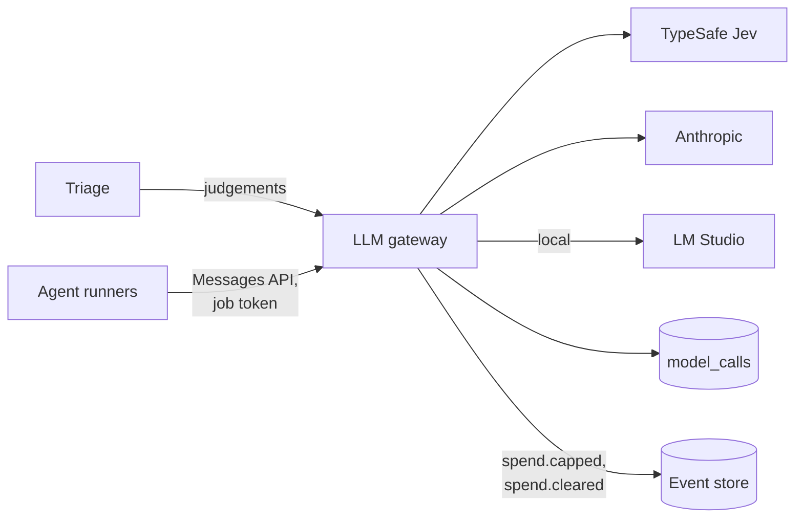

# LLM gateway

Credentials, budgets, logging, redaction and model routing, with live, record and replay modes (spec 7.1). Part of the [factory plane](README.md#factory-plane).

- **v1:** `apps/factory/src/gateway`, a TypeScript service in the `factory` namespace, run by `factory gateway`. It is the only pod with a model provider's key.
- **Later:** Bedrock on `aws` (milestone 11); LiteLLM behind the same interface.

## Two endpoints

### Judgements

`POST /v1/judgements` takes an agent, a work item, a question set, a pinned model, the state and the questions, and returns the answers with their cost and cassette key.

- It holds the TypeSafe key and calls Jev with `fetch`, with a timeout and retries with backoff, honouring `Retry-After`.
- It checks every response with Zod.

See [`TYPESAFE.md`](../TYPESAFE.md).

### Agents

`POST /v1/messages` is Anthropic's Messages API, with streaming, for [runners](AGENT-RUNNERS.md) (`gateway/agents.ts`).

- **The job token** (`packages/store`, `job_tokens`, kept as a hash) stands where the API key would be, and names the work item and agent, and the step's span the call's span goes under. The gateway refuses it once its job has ended, and refuses every agent call while the line is stopped, by a stop one of [Martin's roles](EVENT-STORE.md#martins-commands) appended.
- **Routing is the gateway's.** The provider, the pinned model and, for Claude, the effort come from `policy/models.ts`, whatever the runner asked.
- **Prompt caching** passes through untouched.
- **What gets through** is only the request fields, betas and tools the Agent SDK sends (`REQUEST`, `BETAS`). A server tool, such as web search, would be a way past the runners' fence, and is refused.

## Providers

| Provider | Key | Notes |
|---|---|---|
| Anthropic | From the Keychain | |
| LM Studio, on `local` | None; costs nothing | `ALL_LOCAL=true` sends every agent there |
| TypeSafe (Jev) | `TYPESAFE_API_KEY` or the Keychain ([workers](WORKERS-AND-IMAGES.md#secrets)) | Judgements only |

LM Studio speaks the same API as Anthropic. For it, the gateway:

- sends no effort, since LM Studio reads none from a request: its Reasoning Effort setting for the model decides;
- moves the system messages the Agent SDK puts among a step's turns into the user's turn where each stood, as reminders, so that each call's prompt extends the last and LM Studio's cache holds.

Errors go back in Anthropic's shape.

### Caps the factory does not own

A provider refusing because the account's credit is spent or the workspace's limit is reached, or the local model not listening, is a cap the factory does not own. The gateway reads the refusal by type and status, and by message only where nothing else tells them apart. Then:

1. no retry;
2. it appends `spend.capped`, naming the provider;
3. it answers agent calls 429 until a probe, a few minutes apart, is answered;
4. it appends `spend.cleared`.

## Modes and cassettes

Modes are `live`, `record`, `replay` and `replay-record`. Without a provider's key it replays that provider only.

A cassette is named by a SHA-256:

- **a judgement's**, of the provider, model, questions and state;
- **an agent call's**, of the provider and the request, with:
  - its metadata left out;
  - the date in its prompt left out;
  - the times its tools printed left out (Vitest's and Biome's, and `ls -l`'s);
  - the results of tools run at once in the order of their ids.

So a step run again replays up to its first changed call.

### Keeping them

In `record`, as on the cluster, nothing is replayed from the folder: a cassette is the record of what a call sent and got back, for looking into a run. The gateway deletes one two weeks after the last thing it was for, as it starts and every six hours (`CASSETTES` in `policy/cassettes.ts`, human-owned; `gateway/pruning.ts` applies it):

- **calls for work items:** once every work item they name has been closed two weeks;
- **calls for none,** such as triage judging a report before there is a ticket: two weeks after the last;
- **a file no call names:** two weeks after it was written.

A file written in the last two weeks always stays. Rows in `model_calls` are never changed, so a call may name a cassette that has gone. A gateway that replays from its folder keeps every cassette; one in `record` with no TypeSafe key replays Jev's calls from it, so it prunes only the agents' cassettes.

## Spend

- **One cap across every provider** (`policy/spend.ts`), counted from the `model_calls` table: the audit log of every call, with its tokens, cache reads and writes, cost and job.
- **At a day or month cap** the gateway refuses, and appends `spend.capped` to the line; `spend.cleared` follows when the window ends.
- **Each work item** has a cap of its own ([the line](ORCHESTRATOR.md#spend)).
- **Prices** include the cache's (`gateway/prices.ts`).

## Logging and telemetry

- It never logs a state, a prompt or a provider's body.
- Each agent call is a `model call` span under its step's, with the agent, model, tokens, cost and outcome ([telemetry](TELEMETRY.md#the-factorys-own-traces)).
- Metrics go over OpenTelemetry: calls, latency and spend, tokens by kind, the providers' errors by status, refusals by cap, and spend against the profile's caps ([telemetry](TELEMETRY.md#the-gateways-metrics)).
