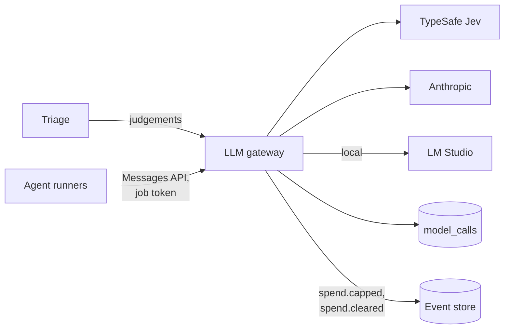

# LLM gateway

Credentials, budgets, logging, redaction and model routing, with live, record and replay modes (spec 7.1). Part of the [factory plane](README.md#factory-plane).

- **v1:** `apps/factory/src/gateway`, a TypeScript service in the `factory` namespace, run by `factory gateway`. It is the only pod with a model provider's key: `apps/factory/test/credentials.test.ts` fails if any other in a profile's rendered manifests names the `anthropic` or `typesafe` Secret.
- **Later:** Bedrock on `aws` (milestone 11); LiteLLM behind the same interface.

## Two endpoints

### Judgements

`POST /v1/judgements` takes an agent, a work item, a question set, a pinned model, the state and the questions, and returns the answers with their cost and cassette key.

- It holds the TypeSafe key and calls Jev with `fetch`, with a timeout and retries with backoff, honouring `Retry-After`.
- It checks every response with Zod.

See [`TYPESAFE.md`](../TYPESAFE.md).

### Agents

`POST /v1/messages` is Anthropic's Messages API, with streaming, for [runners](AGENT-RUNNERS.md) (`gateway/agents.ts`).

- **The job token** (`packages/store`, `job_tokens`, kept as a hash) stands where the API key would be, and names the work item and agent, and the step's span the call's span goes under. The gateway refuses it once its job has ended, and refuses every agent call while the line is stopped, by a stop one of [Martin's roles](EVENT-STORE.md#martins-commands) appended.
- **Routing is the gateway's.** The provider, the pinned model and, for Claude, the effort are those in force for the agent ([below](#settings)), whatever the runner asked.
- **Prompt caching** passes through untouched.
- **What gets through** is only the request fields, betas and tools the Agent SDK sends (`REQUEST`, `BETAS`). A server tool, such as web search, would be a way past the runners' fence, and is refused.

## Providers

| Provider | Key | Notes |
|---|---|---|
| Anthropic | From the Keychain | |
| LM Studio, on `local` | None; costs nothing | One of each agent's models; `ALL_LOCAL=true` sends every agent there |
| TypeSafe (Jev) | `TYPESAFE_API_KEY` or the Keychain ([workers](WORKERS-AND-IMAGES.md#secrets)) | Judgements only |

LM Studio speaks the same API as Anthropic. For it, the gateway:

- sends no effort, since LM Studio reads none from a request: its Reasoning Effort setting for the model decides;
- moves the system messages the Agent SDK puts among a step's turns into the user's turn where each stood, as reminders, so that each call's prompt extends the last and LM Studio's cache holds.

Errors go back in Anthropic's shape.

### Caps the factory does not own

A provider refusing because the account's credit is spent or the workspace's limit is reached, or the local model not listening, is a cap the factory does not own. The gateway reads the refusal by type and status, and by message only where nothing else tells them apart. Then:

1. no retry;
2. it appends `spend.capped`, naming the provider;
3. it answers agent calls 429 until a probe, a few minutes apart, is answered (one token, with no thinking, from the cheapest model the profile offers there: Claude Haiku 5.5, or the local model);
4. it appends `spend.cleared`.

## Modes and cassettes

Modes are `live`, `record`, `replay` and `replay-record`. Without a provider's key it replays that provider only.

A cassette is named by a SHA-256:

- **a judgement's**, of the provider, model, questions and state;
- **an agent call's**, of the provider and the request, with:
  - its metadata left out;
  - the date in its prompt left out;
  - the times its tools printed left out (Vitest's and Biome's, and `ls -l`'s);
  - the results of tools run at once in the order of their ids.

So a step run again replays up to its first changed call.

### Keeping them

In `record`, as on the cluster, nothing is replayed from the folder: a cassette is the record of what a call sent and got back, for looking into a run. The gateway deletes one two weeks after the last thing it was for, as it starts and every six hours (`CASSETTES` in `policy/cassettes.ts`, human-owned; `gateway/pruning.ts` applies it):

- **calls for work items:** once every work item they name has been closed two weeks;
- **calls for none,** such as triage judging a report before there is a ticket: two weeks after the last;
- **a file no call names:** two weeks after it was written.

A file written in the last two weeks always stays. Rows in `model_calls` are never changed, so a call may name a cassette that has gone. A gateway that replays from its folder keeps every cassette; one in `record` with no TypeSafe key replays Jev's calls from it, so it keeps Jev's cassettes, and a file no call names, for longer.

But a cassette of Jev's holds the visitor's report it judged, so none is kept past [a report's time](TRIAGE.md#how-long-a-report-is-kept): one goes seven days after its last call and its writing (`REPORT_TEXT.cassetteDays` in `policy/triage.ts`), whatever the work items its calls name and with or without a TypeSafe key. So does a file no call names, which could be one. Triage judges a report only within 22 days of its arrival, so its cassette is gone within 29.

## Settings

Martin chooses each agent's model and effort, and the spend caps, from the console, within the bounds policy sets (`FACTORY_PROFILE`'s):

- [`policy/models.ts`](../../policy/models.ts) names the models each agent may use (Claude Haiku 5.5, Sonnet 5.5 and Opus 5.5, and Qwen on `local`, each priced in `gateway/prices.ts`, cheapest first) and its most effort, with its default;
- [`policy/spend.ts`](../../policy/spend.ts) names each cap's default and ceiling.

His choice is a `settings.changed` event, which the [admin service](ADMIN-SERVICE.md#the-settings) appends. The gateway reads the latest that one of [Martin's roles](EVENT-STORE.md#martins-commands) appended (`apps/factory/src/settings.ts`), and checks it against policy as it reads it (`policy/settings.ts`, the one check the line and the admin service make too): anything outside policy is not in force, and policy's default is, field by field: an agent left on a model no longer offered runs on its default model, at the effort Martin chose if that is within policy, and the console says so beside it. Zero, null and anything not a finite number are never "no cap".

- **From an agent's next step.** A job runs under the settings in force when its token was issued, read at its first call and kept for the job, never changed part-way through it. The step's `model.called` records the model and effort.
- **The caps** are read again at every check, a few seconds old at most, so a cap Martin raises or lowers applies from the next call, and a day's or month's cap raised past the spend clears its `spend.capped` at the next call or within a minute, which wakes the line.
- **`ALL_LOCAL=true`** sends every agent to the profile's local model whatever the settings say: a night on Qwen, the bench and `soak-check --no-spend` spend nothing, whatever is chosen.

## Spend

- **One cap across every provider** (the day's and the month's [in force](#settings)), counted from the `model_calls` table: the audit log of every call, with its tokens, cache reads and writes, cost and job.
- **At a day or month cap** the gateway refuses, and appends `spend.capped` to the line; `spend.cleared` follows when the window ends, or the cap is raised past the spend.
- **Each work item** has a cap of its own ([the line](ORCHESTRATOR.md#spend)).
- **Prices** include the cache's (`gateway/prices.ts`), and a long prompt's where a model has one: a Claude Haiku 5.5 call whose prompt (fresh, cached and written to the cache) is over 100K tokens is priced whole at the long rate, five times the other.

## Refusals

Each refusal of a guardrail is recorded as `action.refused`, mechanism `gateway`, in the gateway's own words as its answer gives them, appended as the gateway's own role (`policy/refusals.ts` holds the mechanism to it), so the console counts it under the guardrail it shows:

- **A spend cap** (guardrail 7): a day's, a month's or a work item's, or a provider the gateway holds [capped](#caps-the-factory-does-not-own).
- **Its policy on agents and models** (guardrail 6): an agent that calls no model through the Messages API, or a judgement asking for a model that is not pinned or has no price.
- **The line stopped** (guardrail 9): any agent's call while it is.

An agent's refusal is on the work item its job token names. A judgement's is on none, since no job token names one: the work item the request names is the caller's word, and is kept in what was refused. A token that is no running job's, a request the gateway cannot read (a body or beta it does not take), and a replay with no cassette refuse no guardrail, and are not recorded.

Repeats of one refusal (its cause, work item and action) within a minute fold into one event with how many and when the last was (`apps/factory/src/refusals.ts`): the first is appended at once, the rest of its minute once the minute is up, and what is still held as the gateway stops. So a runner retrying in a loop is at most two events a minute. Appends run behind the answer, one at a time: one the store will not take is logged, and the answer is the same.

## Logging and telemetry

- It never logs a state, a prompt or a provider's body.
- Each agent call is a `model call` span under its step's, with the agent, model, tokens, cost and outcome ([telemetry](TELEMETRY.md#the-factorys-own-traces)).
- Metrics go over OpenTelemetry: calls, latency and spend, tokens by kind, the providers' errors by status, refusals by cap, and spend against the caps in force ([telemetry](TELEMETRY.md#the-gateways-metrics)).
