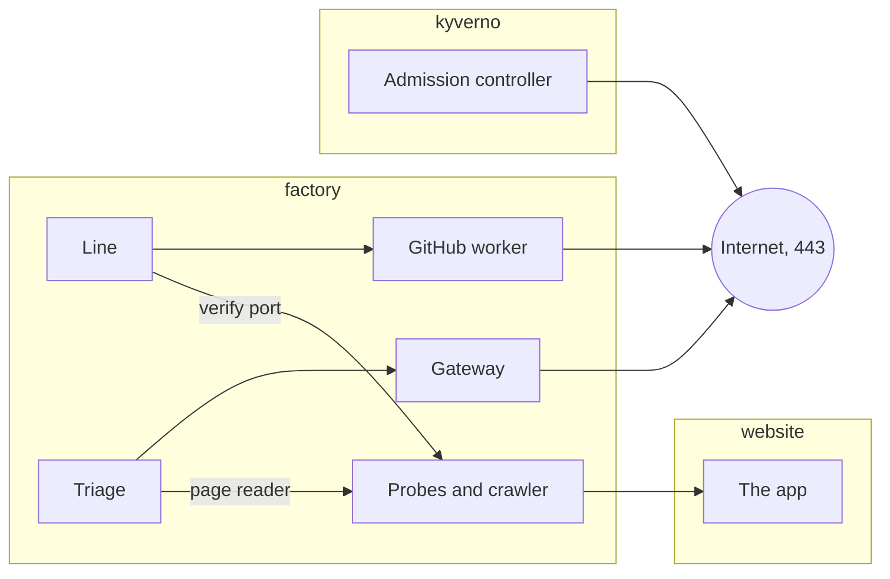

# Network policies

Each pod reaches only what it needs. Of the factory's workers, only the gateway and the GitHub worker may leave the cluster. Part of the [factory plane](README.md#factory-plane).

- **v1:** Kubernetes NetworkPolicies, which k3s enforces.
- **Later:** egress by host name (#176).

A NetworkPolicy cannot name a host, so internet egress is by address and port (#176). Where a pod may reach the internet, it is on port 443, outside the cluster's own and the local network's addresses: the nearest a NetworkPolicy gets to naming a host.

## `factory`

Everything is denied in and out, then each pod is allowed what it needs.

| Pod | Reaches | Reached by |
|---|---|---|
| Every worker but the traffic generator | DNS, Postgres and the collector | |
| Gateway | The internet | Triage, and the runners' agent pods |
| GitHub worker | The internet | The line, only |
| Triage | The gateway; the probes' page reader | |
| Intake and log watcher | Prometheus, Loki and Tempo | Alertmanager calls the intake |
| Probes and crawler | The app, the canary's pods included | The probes: the line, on their verify port; triage, on their page reader |
| Line | The runners' handbacks, the GitHub worker, the Kubernetes API, Prometheus, Loki and the probes' verify port | |
| Traffic generator | DNS, Traefik and the collector, and nothing else | |

- Only the line may call the probes' verify port, as only triage may call their page reader.
- The runners' pods are fenced as [their page](AGENT-RUNNERS.md) says.

## `kyverno`

Everything is denied, then:

- both controllers may reach DNS and the Kubernetes API;
- the API server may call the admission webhook;
- the admission controller alone may reach the internet, for GHCR and Sigstore's trust root ([admission control](ADMISSION-CONTROL.md)).

## `argo-rollouts`

The controller reaches DNS, the Kubernetes API and Prometheus, and nothing calls it.

## `website`

The policy comes from this repository, since the app's AppProject cannot make one ([GitOps](GITOPS.md)).

| Pod | Reaches | Reached by |
|---|---|---|
| The app's pods, whose code agents write | DNS and the collector's OTLP port | Traefik, the probes, the crawler and the canary's journeys Job, on 8080 only |
| The journeys Job | DNS and the app's pods, and nothing else | |

The scoreboard's own policy is on [its page](SCOREBOARD.md#where-it-runs).

## `make egress`

It starts a pod labelled like each fenced part, and shows what each reaches and what it does not:

- a worker;
- a runner's agent and prepare pods;
- the analysis Job;
- the app;
- the Rollouts controller;
- Kyverno's two controllers.

It has controls, which must reach what they reach:

- the gateway reaches TypeSafe;
- the GitHub worker reaches GitHub and GHCR;
- Kyverno's admission controller reaches GHCR and Sigstore;
- the traffic generator reaches the shop only through Traefik;
- the line reaches Loki and the probes' verify port, but not Tempo or their page reader;
- the probes reach the canary;
- Traefik, the probes and the crawler still reach the app.
