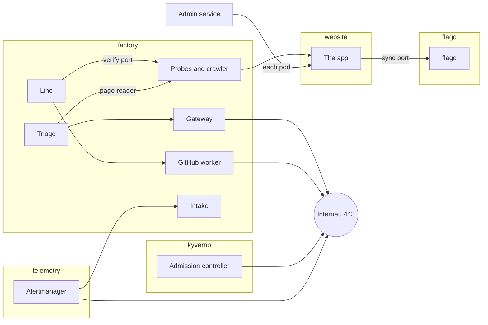

# Network policies

Each pod reaches only what it needs. Of the factory's workers, only the gateway and the GitHub worker may leave the cluster; beyond them, only the runners' prepare pods, Kyverno's admission controller and Alertmanager. Part of the [factory plane](README.md#factory-plane).

- **v1:** Kubernetes NetworkPolicies, which k3s enforces.
- **Later:** egress by host name (#176).

A NetworkPolicy cannot name a host, so internet egress is by address and port (#176). Where a pod may reach the internet, it is on port 443, outside the cluster's own and the local network's addresses: the nearest a NetworkPolicy gets to naming a host.

## `factory`

Everything is denied in and out, then each pod is allowed what it needs.

| Pod | Reaches | Reached by |
|---|---|---|
| Every pod | DNS | |
| Every worker but the GitHub worker and the traffic generator | Postgres and the collector | |
| Gateway | The internet | Triage, and the runners' agent pods |
| GitHub worker | The collector and the internet | The line, only |
| Triage | The gateway; the probes' page reader; Prometheus, Loki and Tempo, through the read-only proxy | |
| Intake | Prometheus and Loki, through the read-only proxy | Alertmanager |
| Log watcher | Prometheus, Loki and Tempo, through the read-only proxy | |
| Probes | The app, the canary's pods included; the console, to ask whether it answers | The line, on their verify port; triage, on their page reader |
| Crawler | The app, the canary's pods included | Nothing |
| Line | The GitHub worker, the Kubernetes API, the probes' verify port, and Prometheus, Loki and Tempo through the read-only proxy | The runners' agent pods, with their handbacks |
| Traffic generator | Traefik and the collector, and nothing else but DNS | |
| Console | Postgres and the collector | Traefik, and the probes |
| Admin service | Postgres, the collector and the Kubernetes API, for Martin's controls of the canary and his flags' stages; the app's pods on 8080, each at its own address, to ask which flags it holds | Traefik, only |
| Migrations (the hook Job) | Postgres | Nothing |
| Postgres exporter | Postgres | Prometheus's server, on 9187 |

- Only the line may call the probes' verify port, as only triage may call their page reader.
- Each pod that reads telemetry reaches the [read-only proxy](TELEMETRY.md#reading-it) on the ports of the backends it reads, and none of the backends: a policy allows a port, not a path, and on those ports the backends take writes too.
- The runners' pods are fenced as [their page](AGENT-RUNNERS.md) says. `apps/factory/test/runner-fences.test.ts` reads each profile's rendered policies, with the pods labelled as the line makes them, and fails unless `runners` denies both ways, the agent pod reaches the gateway's 8080 and the line's 8081 alone, with no DNS, the prepare pod DNS and 443 on public addresses alone, and only the gateway and the line let a runner in, the agent pod alone.

## `kyverno`

Everything is denied, then:

- both controllers may reach DNS and the Kubernetes API;
- the API server may call the admission webhook;
- the admission controller alone may reach the internet, for GHCR and Sigstore's trust root ([admission control](ADMISSION-CONTROL.md));
- Prometheus may scrape both controllers' metrics, on 8000 alone ([telemetry](TELEMETRY.md#the-platforms-own-metrics)).

## `argo-rollouts`

The controller reaches DNS, the Kubernetes API and Prometheus, and only Prometheus calls it, to scrape its metrics on 8090 ([telemetry](TELEMETRY.md#the-platforms-own-metrics)).

## `flagd`

Everything is denied, then:

- the app's pods may reach flagd's sync port (8015), from which their in-process provider streams the flag set, and nothing else of it: not its management (8014), evaluation or OFREP ports, which listen in the pod. The kubelet checks flagd's health on its management port from the node, which needs no policy;
- flagd may reach the Kubernetes API, for its watch of `flags`, DNS, and the collector's OTLP port ([feature flags](FEATURE-FLAGS.md)).

## `pod-logs`

The pod log collector reaches Loki's intake and DNS, and only Prometheus calls it, to scrape its metrics on 8888 ([telemetry](TELEMETRY.md#the-platforms-own-metrics)). It reads the runners' logs from the node's files, so their fence stays shut.

## `telemetry`

The backends take no policy of their own but Prometheus's server and Alertmanager.

Prometheus's server has one port, which answers queries and takes writes: metrics over OTLP, and Tempo's service graph over remote write ([telemetry](TELEMETRY.md#the-service-graph)). A writer could plant the series the alerts and the canary's analysis judge by, so only these reach it, on 9090:

- the collector, which writes over OTLP;
- Tempo, whose metrics generator writes the service graph;
- Grafana and the [read-only proxy](TELEMETRY.md#reading-it), which read;
- Argo Rollouts' controller, which runs the canary's analysis.

Nothing else in `telemetry` does. Prometheus may still reach out to whatever it scrapes, which each target's own policy fences, and scrapes itself on its own address.

Alertmanager pages Martin, and anything that reached it could silence a page ([alerting](ALERTING.md#who-reaches-alertmanager)). So only Prometheus's server, which sends it alerts and scrapes it, and Grafana reach it, on 9093. It reaches DNS, the intake on 8080, and the internet on 443, for Pushover: by address and port, with the cluster's, the local network's and the host's addresses excepted, as for Kyverno's admission controller.

## `website`

The policies come from this repository, since the app's AppProject cannot make one ([GitOps](GITOPS.md)). Everything in `website` is denied, in and out, and each pod below is let through by its own policy. The app's repository gives the app's pods their labels, so a pod it labelled otherwise would match neither, and reaches nothing and is reached by nothing.

| Pod | Reaches | Reached by |
|---|---|---|
| The app's pods, whose code agents write | DNS, the collector's OTLP port, and flagd's sync port | Traefik, the probes, the crawler, the admin service and the canary's journeys Job, on 8080 only |
| The journeys Job | DNS and the app's pods, and nothing else | |

What reaches the app through Traefik has had `x-unmeasured` removed ([the mark](ADMISSION-CONTROL.md#the-mark)), so only the pods this policy lets in beside Traefik can send it. The admin service is one, as it asks each pod, with the mark, for the revision of the flags it holds and nothing else ([admin service](ADMIN-SERVICE.md#whether-the-app-holds-the-flags)): through a Service, one pod of several would answer.

The scoreboard's own policy is on [its page](SCOREBOARD.md#where-it-runs).

## `make egress`

It starts a pod labelled like each fenced part, and shows what each reaches and what it does not:

- a worker;
- a runner's agent and prepare pods;
- the analysis Job;
- the app, which reaches flagd's sync port and not its others, its management port among them, where a worker does not reach flagd at all (flagd's own fence is seen from outside: `flagd-images` admits no other image to start there);
- a pod beside the app that neither `website` policy selects, as one the app's repository relabelled would be, which reaches nothing: not DNS, the collector, flagd, the app or the internet;
- the Rollouts controller;
- Kyverno's two controllers;
- the pod log collector;
- Prometheus's server, which reaches the platform's metrics beyond `telemetry`: Kyverno's two controllers on 8000, Argo Rollouts' controller on 8090, the Postgres exporter on 9187 and the pod log collector on 8888;
- Tempo, which reaches Prometheus's remote-write receiver;
- Alertmanager, which reaches the intake and the internet on 443, and nothing else: not Prometheus, Postgres, the gateway, the admin service, the Kubernetes API, the host or the internet on another port; and which Prometheus's server reaches, and not the pod in `telemetry` below, whose own egress is open, nor a worker;
- the Postgres exporter, which reaches Postgres and nothing else;
- a pod in `telemetry` that is none of its backends, answering on their ports, which no reader of telemetry reaches, and which itself reaches neither Prometheus nor any of the platform's metrics.

The workers' own checks (the gateway, the GitHub worker, triage, the intake, the log watcher, the line, the traffic generator, the probes, the crawler and the scoreboard) run from a short-lived probe pod made from each worker's live Deployment, never inside the worker, whose memory a second Node beside its own could exhaust. The probe pod keeps everything a network policy selects on or that decides where the pod can reach (namespace, labels, DNS, hosts, image, security contexts) and idles in place of the worker's code, with its own small memory limit and no service account token. It is never ready, so the worker's Service sends it nothing. So the checks prove the worker's fences, and not that the worker's own code keeps to them.

Each reader of telemetry queries the backends it reads through the proxy, and through it cannot push metrics or logs, have Prometheus reload or flush Tempo; Prometheus, asked directly by Argo Rollouts' controller, will not reload either.

It has controls, which must reach what they reach:

- the gateway reaches TypeSafe;
- the GitHub worker reaches GitHub and GHCR;
- Kyverno's admission controller reaches GHCR and Sigstore;
- the traffic generator reaches the app only through Traefik;
- the line reaches Loki, Tempo and the probes' verify port, but not their page reader;
- the probes reach the canary, and the console;
- the pod log collector reaches Loki;
- Prometheus's server reaches the metrics of Kyverno, Argo Rollouts, the Postgres exporter and the pod log collector;
- Tempo reaches Prometheus's remote-write receiver, and Argo Rollouts' controller reaches Prometheus;
- Alertmanager reaches the intake and Pushover, and Prometheus's server reaches Alertmanager;
- Traefik, the probes, the crawler and the admin service still reach the app, the admin service each of its pods at its own address, which the pod in `telemetry` below, whose own egress is open, does not;
- the app reaches flagd's sync port.

Given a file (`scripts/egress.sh <record.json>`), it also writes there a record of every check, for `make guardrails`: the hash of the fences and Roles it was taken against (`scripts/policy-hash.ts`, which stops it first unless the cluster runs them as `deploy/` renders them), when, whether all held, and each check's group, what was tried, from where, what it wanted and what it got. The readers of telemetry's checks are tagged `read-only-telemetry`.
