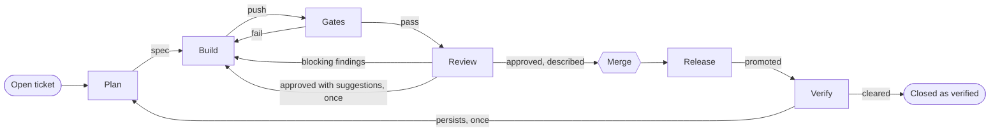
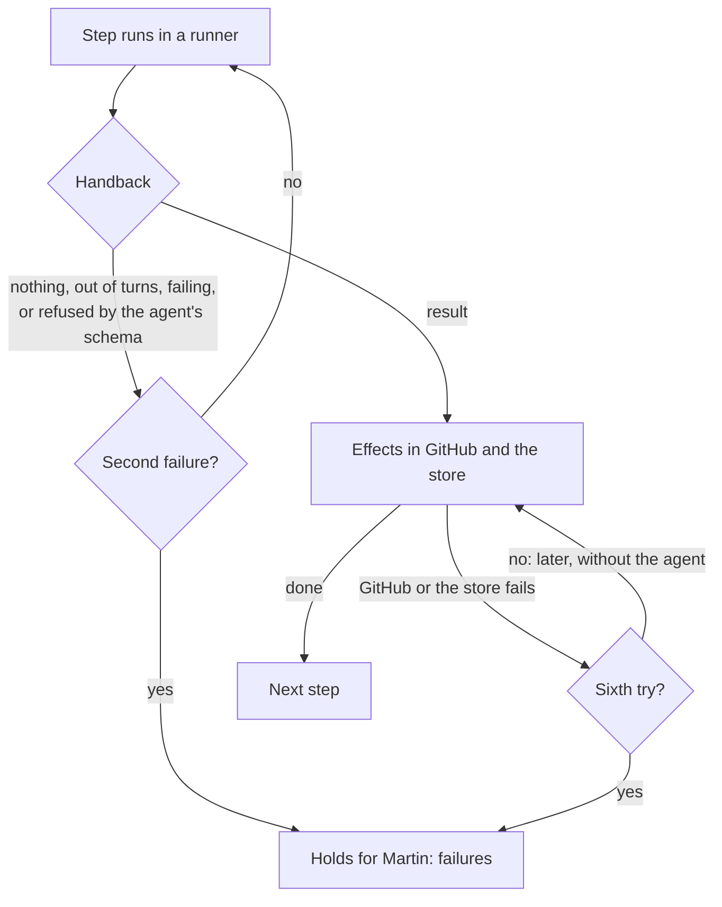

# Orchestrator

Work queue, state, retries, concurrency and stopping the line. Part of the [factory plane](README.md#factory-plane).

- **v1:** Postgres-backed queues and TypeScript workers: the inbox, and the line.
- **Later:** Temporal, AWS Step Functions.

After the merge, the line carries a work item through [Release and Verify](RELEASE-AND-VERIFY.md), which has a page of its own. The agents it runs are [the planner](PLANNER.md), [the coder](CODER.md), [the reviewer](REVIEWER.md) and [the describer](DESCRIBER.md).

## The inbox

Senses insert signals, and the line inserts the planner's findings. Each finding carries an id from its work item and what it says, so neither a step tried again nor a later plan leaves one twice.

[Triage](TRIAGE.md) takes each signal once, with `for update skip locked` under a lease, woken by `NOTIFY`, with a limit on attempts.

## The line

`apps/factory/src/line`, run by `factory line serve`. `LINE_MODE` sets what it does:

| `LINE_MODE` | The line |
|---|---|
| `off` (the default) | Takes no work |
| `live` | Acts in GitHub through the [GitHub worker](GITHUB-WORKER.md) |
| `dry-run` | Has the GitHub worker record what it would do ([dry run](GITHUB-WORKER.md#dry-run)) |

The `line` table holds the work items on the line, by stage and under a lease.

Each stage can also hold for Martin (see [Holds](#holds-and-martins-answers)).

### Taking work

- It takes the oldest open ticket of the highest severity into Plan when nothing is in Plan or waiting for Build.
- It runs one step at a time in each of Plan, Build and Review.
- As a ticket enters Plan, it opens the ticket's issue through the App, from the ticket's public view. The fix's pull request refers to that issue.
- After Martin's merge, it carries the work item through Release and Verify until it closes.

Two settings narrow what it takes:

- **`LINE_ONLY`**, set to a work item, makes the line act on that one alone.
  - It takes that ticket onto the line whatever else is in Plan or Build.
  - It starts no step for any other work item, reads nothing for it and appends nothing.
  - It says nothing of the deploy pull request.
  - It still watches the app's releases, and records one that carries that work item or none (those go on the line). A release that also carries another work item is left for the whole line. The work item stays held at Release (cause `deploy`, so Needs you lists it) until the line records that release, or finds it live.
- **`LINE_TAKE`**, set to a number, has the line take tickets by its own rule until it has taken that many work items in all. The count comes from the `line` table, so a restart takes none more. It then takes no more, and carries those it has to their end.

### A ticket that reopens

When a verified ticket reopens ([triage](TRIAGE.md) reopens it), its work item comes back into Plan for a fresh pass, whatever else is on the line and whatever `LINE_TAKE` says, since the line took it already. Each pass of the line, before it takes a ticket:

1. It waits until the runners' old volume is gone.
2. It reopens the ticket's issue through the App, saying what came back. If the App can no longer open that issue, the work item comes back without it and the line opens a new one.
3. It moves the work item to Plan, forgetting its last pass's failures, pending effects and coder's session.

## Steps

- **State is derived.** What a work item does next is a pure function of its events (`line/machine.ts`), so after a stop or a crash the line carries on from the last event.
- **One module per agent.** Each agent's module (`line/agents/`) says what its step is given, its prompt and schema, and what its result does in GitHub and as events. The worker runs them all one way.
- **Runners.** Each step runs in an [agent runner](AGENT-RUNNERS.md).
- **Turns and deadlines** are set for Claude. When `policy/models.ts` sends an agent's calls to the local model (the profile's, under `ALL_LOCAL`, which the line reads as the [gateway](LLM-GATEWAY.md) does), its step has twice the turns and four times as long.
- **Model calls.** Each step's calls become one `model.called`, summed from `model_calls` by the step's job, with the turns it was given. It counts only the calls a model answered, a cassette replayed, or that failed part way with tokens to show for it; none the gateway or the provider refused.

### When a step fails

- **A failed step** (one that hands back nothing, ends out of turns or failing, or hands back a result its agent's schema refuses) runs again as a new job. After two failures the work item holds.
- **A failed effect is not the step's failure.** When GitHub or the store fails while a result is acted on, the handback is kept in the `line` table and its effects are tried again later without the agent. Each write in GitHub is recorded as it is begun and done, so none is done twice. After six tries the work item holds.
- **A coder that changes nothing and says why** has not failed:
  - after the gates or a review sent the work back, the work item holds where it came from, under that cause (`gates` or `review`), with the coder's reason;
  - a first round that finds nothing to fix holds as `nothing-to-fix`.
- **A patch the scope fence refuses** is recorded as `action.refused` (`scope-fence`, with the fence's output and its verdict on each file). It goes back to the coder once, which resumes its session from a fresh checkout. The second refusal holds the work item.

## Build, gates and review

- **The pull request.** The coder's first push opens the fix's pull request as a draft, with the ticket's issue and the spec. It is readied only once the [describer](DESCRIBER.md) has written its description.
- **Each push** records its own files and the pull request's whole change, as GitHub compares its head with main.
- **Reading GitHub.** Once a minute the line reads its pull requests' check runs and merges through the GitHub worker, and appends `gates.started`, `gate.finished`, `gates.finished` and `pull-request.merged`. It leaves out the factory's own check runs.
- **Failing gates** send the work back to the coder twice.
- **A review's blocking findings** go back to the coder's session, with its suggestions, and a fresh reviewer is told them in the next round. What still blocks after two reviews holds, as does a review the reviewer escalates.
- **An approval's suggestions** go back to the coder once in a pass, before the describer writes the change up, so that every review thread is answered before Martin's merge. The coder takes each or declines it with a reason (`suggestions.answered`). If it takes any, the gates and a fresh reviewer run again, and that review goes on whatever it suggests: suggestions alone never send the work round twice. It counts toward the two reviews like any other, and is at least the second, so if it blocks it holds for Martin. If it declines them all, it changes nothing and the approval stands. Martin's approval of a held review sends the change on with no such round.
- **An out-of-scope spec.** Every spec tagged `out-of-scope` that the planner wrote under the rule (its criteria name where each comes from), a rewritten one too, holds at Plan for Martin's approval before the coder starts, in every autonomy mode ([approval routing](APPROVAL-ROUTING.md)).
- **A spec written again** once there is a pull request sends the work back to the coder, held to the new spec, and sets aside the review of the old one, so the change is reviewed again.
- **The end of a pull request.**
  - A pull request closed unmerged closes its work item.
  - A work item whose pull request merges, or that closes, has its runners' volume deleted, since a later pass starts afresh from main.

## Holds and Martin's answers

Each hold names its cause, and Martin's answer does what `ANSWERS` in `line/machine.ts` says for that cause. Rejecting always closes the work item and its issue.

| Cause | Held when | Approving | Answering |
|---|---|---|---|
| `question` | The planner asks what only Martin can say | Carries on | Carries on; his answer reaches every later plan |
| `ticket-rejected` | The planner rejects the ticket | Agrees, and closes the work item | Carries on; his answer reaches every later plan |
| `spec` | A spec is tagged `out-of-scope` | Carries on to Build | Sends it back to the planner |
| `scope` | The scope fence refused the coder's patch twice | Sends it back to the planner, told the coder needed those files | Sends it back to the planner with what the fence printed |
| `nothing-to-fix` | The coder's first round finds nothing to fix | Agrees, and closes the work item | Sends it back to the planner with the coder's reason |
| `failures` | A step failed twice, or its effects failed six times | Runs the step again | Runs the step again, with his words |
| `gates` | Gates failed after two returns, or the coder changed nothing after gates | Sends the work back to the coder | Sends the work back to the coder, with his words |
| `review` | Still blocking after two reviews, or after the round for an approval's suggestions, an escalation whose findings do not cite the ticket, or the coder changed nothing after a review | Stands in for the reviewer's approval | Sends the work back to the coder, with his words |
| `beyond-ticket` | The reviewer escalates a spec that goes beyond its ticket | Stands in for the reviewer's approval | Sends the spec back to the planner |
| `merge` | The fix has passed its gates and review | Waits for his merge | Sends the work back to the coder |
| `deploy` | The merged fix waits for a release ([Release](RELEASE-AND-VERIFY.md#release)) | Waits: he settles it by merging the deploy pull request | Waits |
| `verify` | The signal persisted a second time, Verify could not tell for 24 hours, or nothing can judge the fix ([Verify](RELEASE-AND-VERIFY.md#verify)) | Closes the work item as verified, with his words | Sends it back to Plan |
| `spend` | The work item has spent its cap on models | Carries on, and holds again until the cap is raised | Carries on |

Triage's own holds, `finding` and `suggestion`, are on [its page](TRIAGE.md).

## Spend

- **A work item's cap.** Each work item has a cap on models (the gateway's, from the same `FACTORY_PROFILE`). A work item that has spent it holds before its next step, with the cap on the hold.
- **The gateway's caps.** A cap the gateway has set and not cleared (`spend.capped`: the factory's own day or month cap, or the provider an agent's calls go to refusing) starts no step for that agent, since every call would be refused.
  - A step that hands back an error while such a cap is set, or after one was set while it ran, counts for nothing and runs again once the cap clears.
  - The `spend.cleared` that clears it wakes the line (`line/caps.ts`).

## Stopping the line

Every worker checks for `line.stopped` before it takes work. `make stop-the-line` appends it, and then the line:

- deletes the Jobs of every step in hand at once, starts none still preparing, and records nothing of them;
- runs them afresh when the line starts;
- aborts a release of the app in flight ([progressive delivery](PROGRESSIVE-DELIVERY.md)).

## The soak check

`factory line soak-check` reads the store and the cluster the morning after a soak (`line/soak.ts`), and reports:

- leases held past their expiry;
- runners' Jobs and volumes left for ended work items, and volumes left for merged ones;
- events that are not valid once upcast;
- the spend: each work item's within the profile's cap on one, or nothing at all with `--no-spend`, for a night on the local model;
- the work items taken, by how each ended, with their minutes in each stage.
