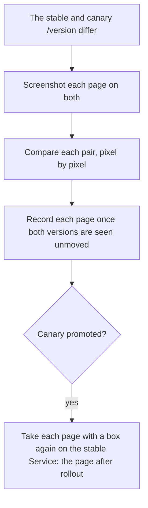

# Probes and crawler

Synthetic journeys and site checks, with screenshots for the event store, the checked elements' positions, and each page compared with the version before. Part of the [runtime plane](README.md#runtime-plane).

- **v1:** Playwright on a schedule, on the `factory-browser` image ([workers and images](WORKERS-AND-IMAGES.md)).

`factory probes run` serves three things on the probes worker:

| What | Where | Who may call it |
|---|---|---|
| [The probes](#the-probes) | Its own schedule | |
| [Pictures](#pictures) | While the stable and canary versions differ | |
| [The page reader](#the-page-reader) | `POST /v1/pages` | Triage, only |
| [Verify](#verify) | `POST /v1/verify`, on `VERIFY_PORT` (8081) | The line, only |

## The probes

`apps/factory/src/probes`. The journeys a visitor takes:

- browse;
- open a product;
- search;
- page through the catalogue;
- send the contact form.

Each is made of generic checks, compared with the app's own API where it has one, and written from its public pages without the answer key.

They look at the stable Service, `website`, so a canary is judged by its analysis, not by the senses ([progressive delivery](PROGRESSIVE-DELIVERY.md)).

Run by the gates (the [journeys gate](CI-PIPELINE.md#journeys) and a canary's journeys) and by [a flag's check](#a-flags-check), each probe also says what is on the device by its end and which other origins its pages asked, as `<probe>/device`; a ticket's Verify and the sense runner's probes, which look after the live app, do not. The check fails on anything kept, but the app's preview cookie once a check of the pass has asked for a preview, and then only as its [contract](FEATURE-FLAGS.md#the-preview-cookie) says (`senses/device.ts`), which it lists as allowed; without the ask, the cookie fails it like any other.

### Not counted

Every request the probes, the crawler and the page reader make sends `x-unmeasured`, from the browser and without it. The app keeps no record of them in its metrics, request log or traces ([whose requests are judged](PROGRESSIVE-DELIVERY.md#whose-requests-are-judged)):

- **During a canary,** the baseline's figures hold none of their requests, nor anything their checks provoke, as the canary's hold none.
- **The objectives** judge the visitors' requests and the [traffic generator](TRAFFIC-GENERATOR.md)'s alone. The senses look for what goes wrong on their own requests themselves.
- **An error** one of their requests causes is still logged, so the [log watcher](LOG-WATCHER.md) sees it, with no trace.
- **Only on the Service.** The app's public route removes the header, so a sense run on the host through Traefik (`APP_URL=http://website.localhost:8080`) is counted like a visitor.

### The sense runner

`apps/factory/src/senses` runs the probes:

- every few minutes, and at once when `/version` changes;
- sending a signal only for a check that has failed twice in a row, with a screenshot and the evidence.

A check that costs something, such as sending a contact message, may run at most so often (the contact checks, once an hour).

## The page reader

For triage: `POST /v1/pages` with a path returns a screenshot in the artifact store, and the page's text in passages.

## Verify

For the line's [Verify](RELEASE-AND-VERIFY.md#verify): `POST /v1/verify` with a ticket's sense, check and route (`probes/verify.ts`).

- It runs that probe, or the crawl, against the stable Service until the check passes or fails twice in a row, at most four times.
- It calls it unsure when it cannot finish, or the version moves between runs.
- A crawl run four times outlasts an HTTP request, so the first call starts it and answers 202, and a later one gets the answer. One runs at a time, a flag's check among them.

## A flag's check

For the line's [Verify by variant](RELEASE-AND-VERIFY.md#the-probes-checks): `POST /v1/flag-check` on the same port, with the flag, the stage (`off`, `checks` or `preview`), the revision of the flag set the app must hold, the pages to picture, and, at Off, the version a baseline was last taken of, or, at Checks and Preview, the baseline to compare with: its checks that did not pass cleanly, and its pictures by page, colour scheme and hash (`probes/flag-check.ts`). Asked and polled as a verification is, with requests up to 64 kB.

- **Each page in light and in dark.** Each page is pictured twice, the browser telling it first that it prefers a light colour scheme and then a dark one (`emulateMedia`'s `colorScheme`, set before the page loads), so a change that answers to `prefers-color-scheme` shows. The journeys run once, in the browser's default: the pictures are evidence, not judged.
- **The probes alone,** never the crawl, with the `/device` check, against the stable Service, every request with the mark: so they see the flag off at Off and on from Checks.
- **At Off,** for a version or flag set the baseline was not taken of: every probe, each that did not pass cleanly run again (one that passes then passed), and each page pictured with the flag off, in each scheme. For the version it was, nothing runs; the line asks without it for a new flag set.
- **At Checks,** the journeys gate's comparison with the baseline as its base: a check the baseline did not name passed there, so one that fails twice now regressed; a check it named says nothing of the flag. Each page pictured with the flag on, in each scheme, and compared pixel by pixel with the baseline's picture of it in the same scheme, found in the index by its hash and scheme: never a file the request merely names.
- **At Preview,** a check of its own runs first and asks the app to preview the flag on the front page (`preview(flag, '/')`), so the probes after it run with the preview cookie, and their `/device` check allows it. The checks its watch makes of the front page are left out, as the probes after it watch the same page and the baseline has none to compare them with; its own, whether the ask was answered, and its `/device` check stay. No pictures.
- **Paths only.** A page is a path on the app: none that a URL would read as another host's (`//host`, `/\host`), and the browser is sent to none off the app's origin.
- **The stage seen.** It reads the app's revision (`x-flags-revision` on a marked `/health`) and version before the run and after; either not as asked, or moved, and it answers that it did not see the stage, judging nothing.

## Pictures

With `CANARY_URL` set to the canary's Service, the probes worker watches both Services' `/version`. While they differ, it pictures the app on each.

### Taking them

- **Which pages:** every page of the app on each Service (the pages the traffic generator finds from the front door, at most sixty, full page to 1600 pixels).
- **Boxed pages first:** the pages where a sense boxed a finding come first, with those elements boxed on both versions: every one, however many checks boxed the page, since the line keeps only a ticket's own ([Verify](RELEASE-AND-VERIFY.md#pictures)). Each box is indexed with the element it was drawn round.
- **Compared** pixel by pixel (`pictures/`, pixelmatch).
- **Not judged:** its requests send `x-unmeasured` too, so they are not judged with the canary's visitors.
- **Recorded** once both versions are seen unmoved. A promotion or rollback while a page is taken drops it and ends the pass, and a page missed is tried again, three passes in all.
- **After rollout:** once the canary is promoted, each page with a box is taken again on the stable Service.

### Where they are kept

The images go to the artifact store, and the index to Postgres:

| Table | Holds | The probes may |
|---|---|---|
| `pictures` | Each page's before, after, share changed, diff and after-rollout shot, by canary and stable version | Add rows, set only the after-rollout shot, and delete them |
| `looks` | Where each sense's finding was boxed, kept 30 days, which the senses write as they signal | Read every sense's, to box them on their pictures, and add and move only their own |
| `flag_pictures` | Each page a [flag's check](#a-flags-check) pictured, by flag, stage (`off` or `checks`), revision, version and colour scheme (`light` or `dark`): the shot, and at Checks the share changed from the baseline's and the diff | Add rows, and delete them; the line reads them, to name them on `flag.checked` |

### Forgetting them

Between releases, once the pages after the rollout are taken, the probes worker forgets the pictures of every release but:

- the last five (`policy/release.ts`'s `pictures`);
- the one the stable version was pictured as a canary in;
- those a work item waits at Verify for (promoted, with no verification, return or close since).

It deletes each of their images that:

- no picture kept,
- no event and no signal triage has still to take names, and
- was not stored again in the ten minutes before;

then the rows whose images are all gone.

- A verification's pages stay as long as its event does.
- A diff, which no event names, goes with its release.
- A flag's pictures stay as long as a `flag.checked` names them. One none came to name (a run that did not see its stage, or a stage Martin left while it ran) is forgotten a day after it was taken, looked for when the worker starts and every six hours, canary or none, with each of its images nothing else names: no event, no other picture of either kind, and no waiting signal. A release's pictures keep every image a flag's picture names.
- A release's pictures take about 12 MB, and at most about 26.

## The crawler

`apps/factory/src/crawler`, `factory crawler run`. It follows every link, image, script and stylesheet from the home page on the same origin, up to a cap, and checks each page and asset for:

- broken links and images;
- redirect loops;
- server errors;
- console errors;
- accessibility with axe, only the rules that name a class: missing alt text, contrast, unlabelled fields;
- the usual security headers;
- caching of static assets;
- response time;
- whether the error pages, for a missing page and a malformed request, give away stack traces, paths or software versions.

It uses the same sense runner, so a check signals after failing twice in a row.

### Routes

- **Templates.** A finding is on the route template worked out from the URLs it saw (`/products/:slug`).
- **Everywhere.** A class found on every page crawled is one finding, for `*`.
- **Redirects.** A page is opened only at its own address. A link that redirects is judged on the route asked for, for what is about the request (a redirect loop, a server error, a slow answer). Where it lands is crawled as a page of its own, so what is wrong with that page is on its route.
- **Unopened pages.** What only an opened page can show (its headers, console, accessibility, and the links and images it holds) is checked where a page was opened. It is trouble, not a pass, on a route whose link led to no page (a loop, an error status, a page that would not open).

## Tests

Each probe is tested against a small shop made in the test, with and without its fault. Those tests run in the pinned Playwright image.
