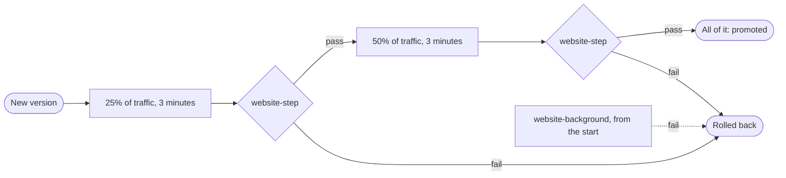

# Progressive delivery

A canary against its baseline, with automatic promotion or rollback. Part of the [runtime plane](README.md#runtime-plane).

- **v1:** Argo Rollouts 1.10, installed by Argo CD from its chart at a pinned version, its image by digest, in `argo-rollouts`.
- **Later:** more steps, business metrics.

## The steps are the app's

The app runs as a Rollout in its own repository's `deploy/`, which CODEOWNERS gives to Martin:

1. a quarter of the traffic for three minutes;
2. half for three minutes;
3. then all of it.

An analysis runs after each pause, and one in the background from the start.

- **Services.** The stable version keeps the Service `website`, which the senses watch. The canary's is `website-canary`.
- **The split.** Traefik splits the shop's traffic between them through a `TraefikService`, whose weights Argo Rollouts sets with its built-in Traefik router, so no plugin is fetched.

## The judgement is the factory's

`policy/release.ts`, which CODEOWNERS gives to Martin, is rendered to two ClusterAnalysisTemplates (`deploy/base/analysis`, by `release/analysis.ts`; `make check` fails when they are out of date), so nothing in the app's repository can loosen it.

- **Against the baseline.** The canary is compared with its baseline, not with the objectives, which the baseline fails on purpose.
- **Telling them apart.** Their telemetry is told apart by the pod-template hash the collector adds ([telemetry](TELEMETRY.md)), and every query sums over routes.
- **No baseline.** A baseline with nothing to compare fails the canary.

### `website-step`

After each pause:

| Measure | Passes when |
|---|---|
| Enough requests to judge | At least 100 are sent to the canary by the traffic split over the step's three minutes, counted at Traefik, whose metrics Prometheus scrapes, so the journeys' own requests to the canary do not count. Otherwise the step fails, saying so |
| Errors | The canary's share of 5xx answers is no more than a point above the baseline's |
| Latency | Its p99 is no more than a quarter, or 100 ms if that is more, above the baseline's |
| Journeys | No check regresses (below) |

### `website-background`

Throughout:

- errors and latency every minute, once the split has sent the canary enough requests;
- the journeys every three minutes.

Each fails the release at its second failed look.

### The journeys

The journeys are the [journeys gate](CI-PIPELINE.md#journeys) aimed at the cluster. A Job on the pinned `factory-browser` runs `factory gate journeys`, with the stable Service as the base and the canary's as the change.

- It fails on a check that passes on the base and fails on the change twice.
- It writes the checks that regressed to its container's termination message, where the line reads them.

## Whose requests are judged

Errors and latency are the visitors' and the [traffic generator](TRAFFIC-GENERATOR.md)'s, so the canary and its baseline are judged on the same mix of requests.

- **Left out:** the factory's own requests send the header `x-unmeasured` (`UNMEASURED`, `senses/http.ts`):
  - the journeys and the pictures, which ask both Services directly;
  - the probes, the crawler and the page reader, which watch the stable Service throughout, so whatever their checks provoke weighs on neither version.
- **No record.** The app keeps no record of those requests in its request log, request metrics or traces, so the three still agree ([log watcher](LOG-WATCHER.md#agreement)). An error one causes is still logged, with no trace.
- **Only from inside.** The shop's public route removes the header (a Traefik `Middleware` in the app's repository), so only a client in the cluster, asking the Services directly, can be left out.
- **Kept:** the traffic generator never sends it. It stands in for the visitors, and goes in through the split as they do.

## Rolling back and stopping

- **A failed analysis** rolls the release back, and each measure it failed on is a signal from the `canary` sense ([rollback signals](RELEASE-AND-VERIFY.md#rollback-signals)).
- **`make stop-the-line`** aborts a release in flight (`scripts/abort-canaries.sh`, with Martin's own kubeconfig). It stays aborted until he retries it or the next deploy starts another.
- **No right to change a Rollout.** The factory holds none, and a test fails a role that would give it one (`release-fences.test.ts`).
