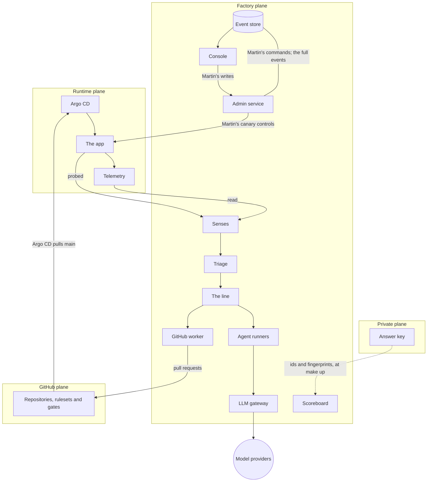

# Software Factory: components

The parts of the factory, how they connect, and what each one is built with in v1. The specification says *what* the factory must do; these pages say *which part does it*. Where they differ, the specification wins.

Each component has a page: its purpose, its v1 choice and, where useful, what it might grow into. Later choices are ideas, not commitments.

## Planes

| Plane | Job | Rule |
|---|---|---|
| **GitHub** | Source of truth and deterministic gates | No model judgement decides anything here |
| **Factory** | Where agents think, and the console | The only plane with model access |
| **Runtime** | Runs the app, telemetry and delivery tooling | Pulls from git; nothing pushes to it |
| **Private** | The correct app, defect patches, answer key, injector catalogue, environment settings | Never reachable by agents |

## Factory plane

| Component | Purpose |
|---|---|
| [Orchestrator](ORCHESTRATOR.md) | Work queue, state, retries, concurrency, stop the line: the inbox and the line |
| [Release and Verify](RELEASE-AND-VERIFY.md) | The line after the merge: which release ships a fix, and whether the defect has gone from production |
| [Event store](EVENT-STORE.md) | Append-only record of every step, with captured artifacts (spec 5.1) |
| [LLM gateway](LLM-GATEWAY.md) | Credentials, budgets, logging, redaction, model routing; live, record and replay modes (spec 7.1) |
| [Agent runners](AGENT-RUNNERS.md) | One disposable sandbox per step, with the repository checked out and its toolchain (ADR 0008) |
| [Factory GitHub App](GITHUB-APP.md) | The factory's identity in GitHub, and its permissions |
| [GitHub worker](GITHUB-WORKER.md) | The only pod with the App's key, and so the only thing that acts in GitHub as the factory |
| [Scoreboard](SCOREBOARD.md) | Matches tickets to answer-key fingerprints |
| [Defect injector](DEFECT-INJECTOR.md) | Opens regression pull requests from the private catalogue |
| [Red-team harness](RED-TEAM-HARNESS.md) | Runs curated attacks against real mechanisms and records the refusals |
| [Guardrails](GUARDRAILS.md) | `make guardrails`: takes every guardrail's proof outside an attack, and records each |
| [Console](CONSOLE.md) | The UI for visitors and admin (spec 5) |
| [Admin service](ADMIN-SERVICE.md) | Martin's sign-in with a passkey, his sessions, and the one write path a browser reaches (spec 5.4) |
| [Workers and images](WORKERS-AND-IMAGES.md) | Where the workers run, and the three images |
| [Network policies](NETWORK-POLICIES.md) | Each pod reaches only what it needs |
| [Factory command](FACTORY-COMMAND.md) | `factory`: events, probes, crawler, GitHub, gates, the line and traffic (spec 5.6) |
| [Samples](SAMPLES.md) | What the console shows in development and in its tests, where there is no real work |
| [Visitor access](VISITOR-ACCESS.md) | Keys, usage tracking, rate limits, visitor budget (spec 5.6) |

### Agents

| Agent | Reads | Produces |
|---|---|---|
| [Triage](TRIAGE.md) | Probe, crawler, telemetry and canary signals; user reports; the planner's findings | Deduplicated, classified tickets with evidence |
| [Planner](PLANNER.md) | Tickets; Martin's improvement requests | A spec per ticket: outcome, acceptance criteria, scope, risk, rollout |
| [Coder](CODER.md) | The planner's spec, the ticket's evidence, the repository and its `AGENTS.md` | A failing test, the fix, and a patch with a title and a note |
| [Reviewer](REVIEWER.md) | The ticket, the spec, the diff and the app's `docs/REVIEWERS.md` at the base, once the gates pass | A comment review, a check run, and its findings |
| [Describer](DESCRIBER.md) | Once review approves: the ticket, the spec, the final diff and the review thread | The pull request's title and description; the work item's summary |

## GitHub plane

| Component | Purpose |
|---|---|
| [Repositories and rulesets](REPOSITORIES-AND-RULESETS.md) | A single path for change |
| [Shared gates](SHARED-GATES.md) | One rule for both public repositories, out of the app repository's reach |
| [Approval routing](APPROVAL-ROUTING.md) | Sends risky changes to a human |
| [CI pipeline](CI-PIPELINE.md) | Deterministic gates (spec 4.1) |
| [Test integrity](TEST-INTEGRITY.md) | Stops agents weakening tests to get green |
| [Security scanning](SECURITY-SCANNING.md) | Code, dependencies, images, secrets |
| [Supply chain](SUPPLY-CHAIN.md) | Only the pipeline can produce deployable images |

## Runtime plane

| Component | Purpose |
|---|---|
| [Ingress](INGRESS.md) | Public entry to `do` and `aws` |
| [Registry](REGISTRY.md) | Signed images, referenced by digest |
| [GitOps](GITOPS.md) | Cluster state reconciled from git |
| [Admission control](ADMISSION-CONTROL.md) | Refuses unsigned images |
| [Progressive delivery](PROGRESSIVE-DELIVERY.md) | Canary against baseline; automatic promote or roll back |
| [Traffic generator](TRAFFIC-GENERATOR.md) | Gives canary analysis enough samples within minutes |
| [Feature flags](FEATURE-FLAGS.md) | Ship improvements switched off; kill switch without rollback |
| [Telemetry](TELEMETRY.md) | Metrics, logs, traces and SLOs |
| [Alerting](ALERTING.md) | The app's objectives, watched by the standard tools, and what Martin must hear about, on his phone |
| [Log watcher](LOG-WATCHER.md) | The app's logs, read for what a query cannot say |
| [Probes and crawler](PROBES-AND-CRAWLER.md) | Synthetic journeys and site checks, with screenshots, and each page compared with the version before |
| [The app](THE-APP.md) | The World's Worst Website (spec 3) |

## What changes per profile

| | `local` | `demo` | `pages` | `do` | `aws` |
|---|---|---|---|---|---|
| Cluster | k3d | k3d | none | DOKS, one node | EKS |
| Models | Anthropic API and Jev, or replay | Replay only | none | Anthropic API and Jev | Bedrock and Jev |
| Model spend cap by default, across every provider | $20 a day | none: replay costs nothing | none | $20 a day, $100 a month | $20 a day, $100 a month |
| Artifacts | Local disk | Local disk | Bundled files | Spaces | S3 |
| Visitor actions | Off | Off | Off | On | On |

## Guardrails and what enforces them

The guardrails are defined in spec section 6. This table shows which component holds each one.

| # | Guardrail | Enforced by |
|---|---|---|
| 1 | Agents cannot change the rules | [GitHub App](GITHUB-APP.md) has no workflows permission; [rulesets and CODEOWNERS](REPOSITORIES-AND-RULESETS.md); Martin's settings and controls are [his commands](EVENT-STORE.md#martins-commands), which row security lets only his roles append, and the factory heeds from no other; the [admin service](ADMIN-SERVICE.md) takes them only within policy, and the passkey again for any that loosens one or raises spend |
| 2 | Gates are deterministic | Required checks on the ruleset; the [reviewer](REVIEWER.md) agent is a non-required check; a canary is judged by Prometheus's numbers and the journeys, never a model ([progressive delivery](PROGRESSIVE-DELIVERY.md)) |
| 3 | Only the pipeline builds releasable artifacts | `build.yml` signs each image keyless, with its SBOM; the deploy watch verifies the signature, and the deploy pull request's checks the signature and the SBOM ([supply chain](SUPPLY-CHAIN.md)); Kyverno admits nothing else in `factory`, `runners`, `website` and `scoreboard` but the third-party images it names by digest ([admission control](ADMISSION-CONTROL.md); also a red-team attack) |
| 4 | No agent writes to production | Argo CD pulls from git ([GitOps](GITOPS.md)); runners have no cluster credentials; telemetry access is read-only, through a [proxy](TELEMETRY.md#reading-it) that passes queries alone; no service account of the factory's may change a Rollout or the app's [feature flags](FEATURE-FLAGS.md#the-stages) but the admin service's, for Martin's controls and stages, held by admission policies to the fields they set and the stages' shapes |
| 5 | Sandboxes are disposable and fenced | Kubernetes Jobs ([agent runners](AGENT-RUNNERS.md)); NetworkPolicy egress allowlist ([network policies](NETWORK-POLICIES.md)); no secrets mounted |
| 6 | One gateway for all model access | Only the [gateway](LLM-GATEWAY.md) holds model credentials |
| 7 | Hard spend caps | The [gateway](LLM-GATEWAY.md#spend)'s caps per day and month, across every provider, and the [line](ORCHESTRATOR.md#spend)'s per work item; Martin sets each up to a ceiling policy sets, and raising one needs his passkey again. A visitor budget comes with [visitor access](VISITOR-ACCESS.md) |
| 8 | Inputs are untrusted | Typed Jev answers in [triage](TRIAGE.md); gates, scope fences and approval routing, not prompts |
| 9 | Everything is reversible | Argo Rollouts rolls back a canary its analysis fails; Martin aborts a canary from the console's Canary panel ([progressive delivery](PROGRESSIVE-DELIVERY.md#rolling-back-and-stopping)); Stop the line (the console's header, or `make stop-the-line`, which needs neither the console nor the admin service) stops the agents and aborts a release in flight ([orchestrator](ORCHESTRATOR.md#stopping-the-line)) |
| 10 | Public means hostile | The GitHub worker acts only on the App's own issues and pull requests, and replies once to an outside issue; `pull_request` only; GitHub-hosted runners |
| 11 | No fix widens its ticket | Each criterion of the [planner's](PLANNER.md) spec names the evidence it comes from and quotes its words, which the line finds there before any review; a spec tagged `out-of-scope` holds for Martin in every autonomy mode ([approval routing](APPROVAL-ROUTING.md)); the [reviewer](REVIEWER.md) holds the spec and the diff to the ticket, and escalates a criterion the ticket does not ask for |
