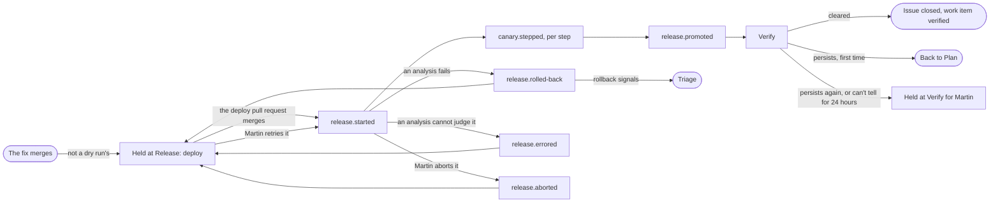

# Release and Verify

The line after the merge: which release ships a fix, and whether the defect has gone from production. Part of the [factory plane](README.md#factory-plane).

- **v1:** part of [the line](ORCHESTRATOR.md), as pure functions of the events and what it reads (`release/watch.ts`, `line/verify.ts`), with the reads and appends in `line/release.ts` and `line/worker.ts`.
- **Later:** promote, hold and roll back from the console (milestone 8).

## Release

- **The hold.** Martin's merge clears any hold the change had, and the work item holds at Release (cause `deploy`, for his approval, so Needs you lists it) until a release that carries it starts. He settles it by merging the app's deploy pull request, not by answering, and `release.started` ends the hold by itself.
- **A rollback.** A release that rolls back holds it again, for the next release that carries it.
- **An analysis error.** A release whose analysis could not judge it holds it again too, as an abort does: Martin's retry starts the same release again, or the next release that carries it ends the hold.
- **An abort.** A release Martin aborts holds it again too, with the hold's reason saying whether Stop the line aborted it or he did. His retry starts the same release again, which ends the hold as any start does; otherwise the next release that carries it does.
- **A dry run's merge**, which no deploy pull request can carry, is not held: it waits at Release for the dry run's release, and Needs you never lists it ([Dry run](#dry-run)).

### What a deploy carries

Once a minute the line tells the [GitHub worker](GITHUB-WORKER.md#carries) what the open deploy pull request carries, and the worker writes it into the pull request.

`carried`, in `line/release.ts`, works it out. A deploy carries every merged work item, not closed or reopened since, whose latest merge commit is between two commits, read through the worker's `commits`:

- the commit the stable version runs: the last promoted release's, or else the pinned one;
- the one proposed.

For a reopened work item, only a merge after its reopening counts.

The same function decides what a release carries, so while a release is in its canary the deploy pull request lists its work items too, until it is promoted.

## The release watch

`RELEASE_ROLLOUT` (`<namespace>/<name>`) turns it on; unset, there is none. Every 30 seconds it reads the app's Rollout and its AnalysisRuns, and it changes nothing. It goes on while the line is stopped, so the abort Stop the line makes is recorded as it happens; a dry run's releases wait for the line to start.

- A Role in `website` lets the line get, list and watch Rollouts and AnalysisRuns, and list pods, and nothing else there (`deploy/base/analysis/line-reads-release.yaml`). `release-fences.test.ts` holds it to exactly that.
- A release is named by its canary's pod-template hash and the Rollout's revision, `<hash>-<revision>`. Argo Rollouts gives the same pod template the same hash and counts the revision up on every new rollout, so pinning an image released before (to go back to it) starts a release of its own, with its own runs. A retry keeps the revision, and is the same release. A release recorded before the revision is named by its hash alone, and read as it was then, until it ends: a later rollout of its hash is a release of its own.
- The line reads the revision only once the Rollout's status has caught up with its spec (`observedGeneration`): Argo Rollouts writes the next revision before the status that names the next version's hash.
- The stable version is the last release of its hash the line recorded that was promoted, or is still in flight: a Rollout goes back only to a version it promoted. A Rollout sent back to its stable version with no canary, as after a rollback, takes the next revision without releasing anything, and the line records nothing of it. An image promoted before and released again while the line was not looking is at a revision of its own too, and is found live: a release leaves runs of its hash at its revision, and a Rollout sent back leaves none. Argo Rollouts keeps only the latest runs (the app's Rollout sets no history limit, so five successful and five unsuccessful, of which a release makes three), so where there are none the store says, by the last release the line recorded as promoted, dry runs aside: sent back, the Rollout runs that release; released again, an image promoted before it. A line that also missed a rollback reads it wrong.
- A release's version is the image's commit, which the GitHub worker reads from GHCR with its signature (`imageRevision`, `imageSigned`), since the line cannot reach GHCR.
- A release carries every merged work item whose latest merge commit is in its image and not in the one before. Each gets the release's events, with actor `rollouts`. A release that carries none has them on the line itself.

### Its events

| Event | When | What it holds |
|---|---|---|
| `release.started` | The canary's pods take traffic (or with `admitted: false` when its pods are refused), recorded only once the stable version has a record of its own | The canary's steps as the Rollout has them then: each weight set, how long it pauses there and whether a step analysis judges it (null when a pause cannot be read). The console draws the steps from the event and copies nothing of the app's Rollout |
| `canary.stepped` | Each step's analysis ends | The analysis's own measures (each one's phase, value, limit and words), and each version's requests, error rate and p99 from Prometheus (`PROMETHEUS_URL`), by pod-template hash |
| `release.promoted` | The release becomes the stable version | |
| `release.rolled-back` | The Rollout is aborted and a run of the release's latest attempt failed | Each failed measure and, for errors and latency, its series from the release's start to the failure |
| `release.errored` | The Rollout is aborted, Argo Rollouts has acted on it (`status.abortedAt`), no run of the release's latest attempt failed, and one ended in Error in the minute before | The weight the canary had reached, the analysis's words, each measure it could not take, and when Argo Rollouts acted on it. Actor `rollouts` |
| `release.aborted` | The Rollout is aborted, Argo Rollouts has acted on it (`status.abortedAt`), and no run of the release's latest attempt failed or ended in Error | When Argo Rollouts acted on it, and who aborted it (`by`): `stop` for Stop the line, `martin` for his own. Actor `martin` |

A figure or series Prometheus did not give is left out.

- **Who aborted it.** Martin's abort terminates the runs, which fails none, and is no signal. To Argo Rollouts, Stop the line's abort (`scripts/abort-canaries.sh`) and Martin's by hand are the same patch of the Rollout's status, so the line says which: `stop` when the last `line.started` or `line.stopped` before the abort is a stop recorded within the minute before it (`make stop-the-line` records the stop, then aborts), `martin` otherwise. It is decided by time alone, so when the stop cannot be recorded (the store is down, and the make target aborts anyway) the abort reads as Martin's, and an abort he makes by hand within the minute after a stop reads as the stop's. A retry and a second abort between two reads are both recorded, by the abort's later time.
- **Where it was.** An abort sends the Rollout back to its first step, so the event holds no weight: the console reads the canary's weight then from the release's steps, as it reads one in flight.
- **Where it rolled back.** `release.rolled-back` holds the weight of the step that failed: a step run's own, by its step index. The background analysis's run has no step, and the abort has already sent the Rollout back to its first, so its weight is read from the step runs of the release's latest attempt: the step after the last whose analysis passed, or the step of one that did not pass, or the first before any; or further, the step of a run made after that one, which the abort terminated. Weights are the Rollout's, by step index, as each step's are.
- **An analysis that ends in Error** aborts the Rollout itself: the analysis could not judge (Prometheus did not answer, say), and nobody stopped it. A run of the latest attempt that ended in Error within the minute before the abort made it, and the line records `release.errored`, at the weight a rollback would have, with no signal: nothing failed. The release stays stopped until Martin retries it or a later release carries its work items. An abort he makes by hand within that minute, before Argo Rollouts acted on the Error, reads as the Error's: the Rollout keeps only one time for both, so the release is held for him either way, and his retry carries it on the same way.

### Found live

A stable version with no record and nothing in flight was released before the watch saw it. The line records `release.started` (with no steps: nobody saw them) and `release.promoted` for it, with actor `factory` and `watched: false`, on every merged work item no release has carried whose merge commit it holds, or on the line.

### Rollback signals

Each measure that failed a release the line recorded and watched start is a signal from the `canary` sense, named by the run and the measure so it is sent once (`release/signals.ts`).

- The measures are errors, latency and the journeys. Too few requests is no signal.
- A release found live sends none.
- A retried release's earlier attempts' failed runs are its own.

| Measure | Signal class | Route |
|---|---|---|
| Errors | `server-error` | The one route where the canary did worse than its baseline (from Prometheus, per route); `*` when it was more than one, or Prometheus found none |
| Latency | `slow-response` | As for errors |
| Journeys | The first failing check's class | Its route when every failing check shares one; otherwise `*` |

- **On an open ticket.** A rollback whose signal has an open ticket's fingerprint joins that ticket as its evidence, naming the release ([triage](TRIAGE.md#matching-an-open-ticket)); the Canary panel says triage added it to that ticket.
- **A canary's `*`** means routes the analysis could not narrow to one, and its ticket is titled "&lt;class&gt; in a canary release". Any other sense's `*` is every page.
- **The journeys' checks.** The journeys Job writes the checks that regressed to its container's termination message (`COMPARISON_FILE`), which the line reads from the Job's pod. When that is lost, the signal is `wrong-result` on `*`.
- **Not yet readable.** A measure whose routes or pod cannot be read yet, or whose pod's container has no status yet, waits for the next pass.

## Verify

A promoted release moves its work items to Verify. Every 5 minutes, in the background, the line looks at the version the stable Service runs (the release that carried the fix, or a later one) by the sense that saw the ticket's defect, from the ticket's first signal (ADR 0011):

| First signal from | How it is looked at | Cleared when | Persists when |
|---|---|---|---|
| A probe or crawler check | The check runs again on the [probes worker](PROBES-AND-CRAWLER.md#verify) (`PROBES_URL`, their verify port), at most four runs | It passes twice in a row | It fails twice in a row |
| An alert | Its expression, over the new version's requests to the route (`service_version`) | It stays inside the objective for 30 minutes with enough requests | It is outside for as long as the alert waits to fire |
| A log pattern | Loki (`LOKI_URL`) | The new version logs none of it for 30 minutes with enough requests | It logs any |
| The canary | The release's own analysis | The release was promoted with that measure passing at its last step | — (holds for Martin when the measure did not pass there, or the release was found live, which no analysis judged) |
| A visitor's report or the planner alone | — | — (holds for Martin's approval) | — |

The windows and counts are `policy/release.ts`'s `verify`.

- **Can't tell yet.** A look that cannot tell (too little traffic, a check that could not finish, a sense the line has no address for) looks again later, and holds after 24 hours with its reason.
- **Another release.** A look during which another release promoted counts for nothing.

### Outcomes

- **Cleared** appends `verification.finished`, has the App close the ticket's issue as completed with a comment saying what cleared it, and closes the work item as `verified`.
- **Persists** appends `verification.finished` too, and sends the work item back to Plan once, for a fresh pass whose planner is told what persisted. A second persisting holds (cause `verify`).
- **Martin's answer to a Verify hold:** approving closes the work item as verified, with his words; answering sends it back to Plan; rejecting closes it.

### Pictures

The verification, and either Verify hold, names up to twelve pages the probes worker compared while the release ran as a canary ([pictures](PROBES-AND-CRAWLER.md#pictures)):

- the ticket's own page first, then those that changed most;
- with their screenshots as the event's artifacts;
- each keeping only the boxes of the ticket's own check on its own page, so a ticket whose sense boxes nothing (the logs, the metrics, the canary) has none.

The line's event writer vouches for those by the picture index (`IndexedArtifacts`), and for no other artifact.

## Dry run

A merge the dry run made never ships, so with `LINE_MODE=dry-run` the line releases it by the dry run's word, `LINE_DRY_RUN_RELEASE_SECONDS` apart (60). Each event has `dryRun: true` and actor `factory`:

1. `release.started`, recording two steps, each pausing that long;
2. `canary.stepped` at a quarter, and at half;
3. `release.promoted`;
4. `verification.finished`, cleared.

A dry run's release on a line no longer in a dry run holds at Verify for Martin.

## With `LINE_ONLY`

The watch records only a release that carries that work item or none. One that also carries another is left for the whole line, and that work item stays held at Release. The line says nothing of the deploy pull request.
