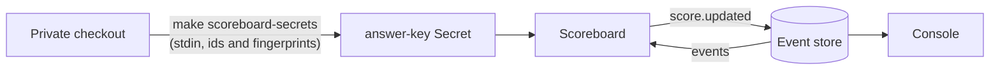

# Scoreboard

Matches tickets to answer-key fingerprints. Part of the [factory plane](README.md#factory-plane).

- **v1:** `factory scoreboard` (`apps/factory/src/scoreboard`), the only component that can read the answer key.

## Where it runs

- **Alone in the `scoreboard` namespace**, on the `factory` image, which `scoreboard-images` admits there and nothing else ([admission control](ADMISSION-CONTROL.md)).
- **No Service, no service account token, no telemetry.**
- **Its NetworkPolicy** lets it reach Postgres and DNS, and nothing in.
- **Checked:** `make egress` checks where it reaches, and asks the API server that no service account of ours, or of a chart but Argo Rollouts' controller, may read its Secrets. `scoreboard-fences.test.ts` holds `deploy/` to the same, and to nothing reaching it.

## Its secrets and role

- `make scoreboard-secrets`, from `make up`, writes its two Secrets through stdin:
  - its role's password;
  - `answer-key`: each entry's id and fingerprint from the private checkout (`PRIVATE_DIR`, by default beside this one), and nothing else.
- Its role, `scoreboard_writer`, reads the events and appends `score.updated`, nothing more.

## The figures

It keeps nothing. On each append, and every minute, it works the figures out from the events by the rule in `policy/scoreboard.ts` (CODEOWNERS; the private repository imports it and checks its own count agrees). It appends `score.updated` when they differ from the last.

One pass runs at a time, and a wake during a pass runs one more after it (`scoreboard/loop.ts`). `loop.test.ts` holds the loop to that, and `scoreboard.test.ts` to found moving at a boundary on the minute's timer alone.

| Figure | Published | Moves |
|---|---|---|
| The key's entries | Yes | |
| Found | Yes | On a cadence of `SCOREBOARD.foundEveryHours` (6): an entry matched by a ticket opened before the last boundary counts, and one verified fixed counts at once, so found is never below verified fixed |
| Verified fixed | Yes | As it changes |
| The median from a ticket's first signal (or its `ticket.opened`, with none) to its verified close | Yes | As it changes |
| False positives | Never | |

It never names a ticket.

- **For the results,** `factory scoreboard --print` prints all four figures once, false positives too.
- **With no key** it publishes once that it is off.
- **The console** draws the latest beside the app's name, or "Scoreboard off".
