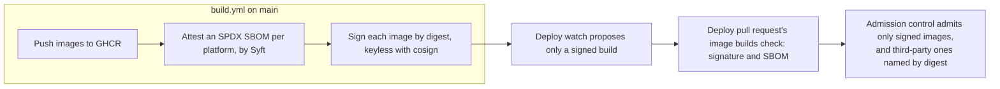

# Supply chain

Only the pipeline can produce deployable images. Part of the [GitHub plane](README.md#github-plane).

- **v1:** each public repository's `build.yml` builds, attests and signs its images, and three places check the signature.
- **Later:** SLSA provenance, a policy gate with conftest.

## Building and signing

Each public repository's `build.yml` pushes its images to GHCR from `main`. Then, in a job for each image, side by side, the only jobs that may ask for the workflow's OIDC token, it:

1. attests an SPDX SBOM of each platform, made by Syft;
2. signs each image by digest with cosign's keyless signing, signature last.

Fulcio certifies the workflow's identity for minutes, and the signature goes into Rekor, so there is no key to keep or steal.

## Whose signature

The signature names the workflow, the repository and the ref. Only `build.yml` on `main` of the repository that builds the image is trusted, compared whole.

## Where it is checked

| Where | Checks |
|---|---|
| The deploy watch ([GitHub worker](GITHUB-WORKER.md#signatures)) | Proposes only a signed build |
| A deploy pull request's `image builds` check | Verifies the signature and the SBOM of each image it moves to, with `cosign` |
| [Admission control](ADMISSION-CONTROL.md) | Admits nothing else, but the third-party images it names by digest, in `factory`, `runners`, `website` and `scoreboard` |
