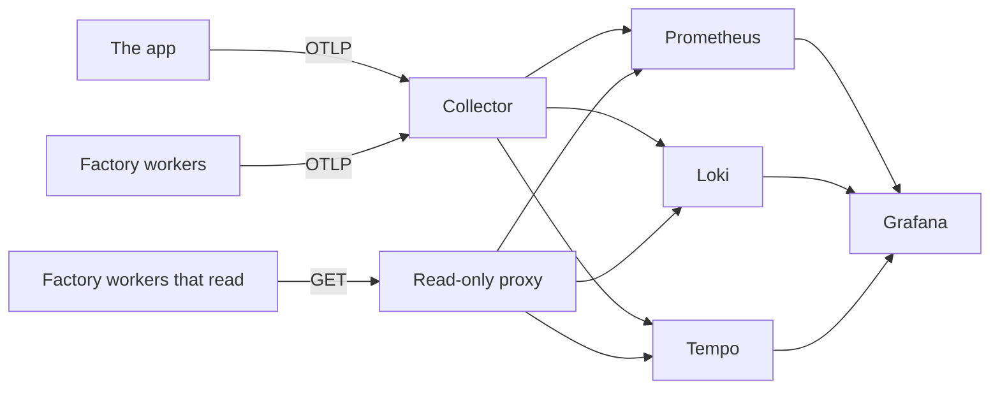

# Telemetry

Metrics, logs, traces and SLOs. Part of the [runtime plane](README.md#runtime-plane).

- **v1:** the OpenTelemetry SDK and collector, feeding Prometheus, Loki, Tempo and Grafana, all over OTLP; upstream charts at pinned versions.
- **Later:** CloudWatch on `aws`.

## Reading it

The workers that read telemetry (triage, the intake, the log watcher and the line) reach Prometheus, Loki and Tempo only through a read-only proxy in `telemetry`, `query`, and never the backends themselves ([network policies](NETWORK-POLICIES.md)). A NetworkPolicy allows a port, not a path, and on the ports they query the backends also take writes: Loki takes pushed logs, Prometheus metrics over OTLP, Tempo a flush. A worker that untrusted input had turned could plant the evidence the senses and the canary judge by.

| Address | Backend | Passes, by GET only |
|---|---|---|
| `query.telemetry:9090` | Prometheus | `/api/v1/query`, `/api/v1/query_range`, `/-/healthy`, `/-/ready` |
| `query.telemetry:3100` | Loki | `/loki/api/v1/query`, `/loki/api/v1/query_range`, `/ready` |
| `query.telemetry:3200` | Tempo's query port | `/api/search`, `/api/traces/<id>`, `/ready` |

Any other method is answered 405 and any other path 403, before it reaches a backend. The proxy passes on the path as nginx has decoded and normalised it, never as the client wrote it, and keeps no access log, since a query can hold a visitor's report. A read the factory starts to need is a line in `deploy/base/telemetry/query/nginx.conf`.

Every worker still sends its own telemetry to the collector, which passes it on to the backends with the service name the sender gave. The collector writes, Grafana and the canary's analysis read, and each reaches the backends directly. Prometheus's lifecycle endpoints are off, so nothing that reaches it can stop it or have it reload: it reloads its configuration and rules itself when they change, every 30 seconds.

## Dashboards

Grafana has three:

- the app;
- the console;
- the factory: inbox depth, signals by sense, time from signal to ticket, and gateway spend.

## What the app records

| Record | Carries |
|---|---|
| Request metrics | `http_route` (the path asked for, such as `/products/glove-left`), the status and `service_version` |
| Request log records | `route` (the template, `/products/:slug`), `path`, `status`, `ms` and the trace id |

## Telling a canary from its baseline

The collector adds to each of the app's records its pod's name and its `rollouts-pod-template-hash` label (`k8s_attributes`, reading the `website` namespace's pods and nothing else). So metrics, logs and traces tell a canary from its baseline ([progressive delivery](PROGRESSIVE-DELIVERY.md)).

It first deletes any `k8s.pod.*` attribute a record brings, on its resource or on the record itself, in any spelling Prometheus would turn into the same label, so the app cannot report its canary under the stable version's hash.
