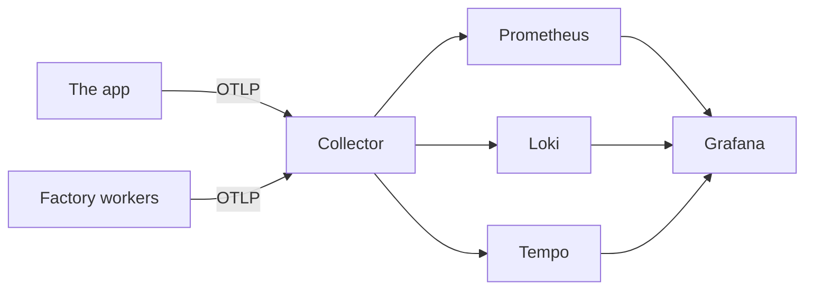

# Telemetry

Metrics, logs, traces and SLOs. Part of the [runtime plane](README.md#runtime-plane).

- **v1:** the OpenTelemetry SDK and collector, feeding Prometheus, Loki, Tempo and Grafana, all over OTLP; upstream charts at pinned versions.
- **Later:** CloudWatch on `aws`.

## Dashboards

Grafana has three:

- the app;
- the console;
- the factory: inbox depth, signals by sense, time from signal to ticket, and gateway spend.

## What the app records

| Record | Carries |
|---|---|
| Request metrics | `http_route` (the path asked for, such as `/products/glove-left`), the status and `service_version` |
| Request log records | `route` (the template, `/products/:slug`), `path`, `status`, `ms` and the trace id |

## Telling a canary from its baseline

The collector adds to each of the app's records its pod's name and its `rollouts-pod-template-hash` label (`k8s_attributes`, reading the `website` namespace's pods and nothing else). So metrics, logs and traces tell a canary from its baseline ([progressive delivery](PROGRESSIVE-DELIVERY.md)).

It first deletes any `k8s.pod.*` attribute a record brings, on its resource or on the record itself, in any spelling Prometheus would turn into the same label, so the app cannot report its canary under the stable version's hash.

## Which records are the app's

Every factory worker sends its own telemetry to the same collector, and a record's `service.name` is whatever its sender says. So the senses, the alerting rules and the app's dashboard take a record as the app's only when it carries what the collector stamped, which no sender can: in Loki, a stream with a `k8s_pod_name`; in Prometheus, a series with a `k8s_pod_label_rollouts_pod_template_hash`, the label Prometheus keeps of the two; in Tempo, a span whose resource has a `k8s.pod.name` ([`provenance.ts`](../../apps/factory/src/provenance.ts)). A worker that names itself `website` sends records the senses never read.
