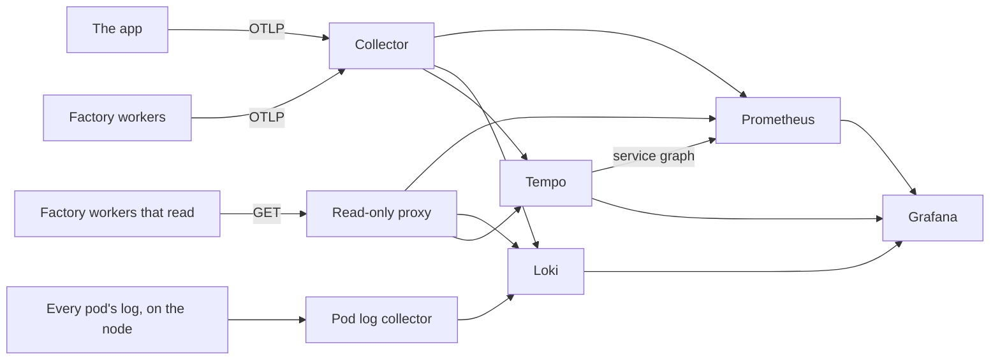

# Telemetry

Metrics, logs, traces and SLOs. Part of the [runtime plane](README.md#runtime-plane).

- **v1:** the OpenTelemetry SDK and collector, feeding Prometheus, Loki, Tempo and Grafana, all over OTLP; upstream charts at pinned versions.
- **Later:** CloudWatch on `aws`.

## Reading it

The workers that read telemetry (triage, the intake, the log watcher and the line) reach Prometheus, Loki and Tempo only through a read-only proxy in `telemetry`, `query`, and never the backends themselves ([network policies](NETWORK-POLICIES.md)). A NetworkPolicy allows a port, not a path, and on the ports they query the backends also take writes: Loki takes pushed logs, Prometheus metrics over OTLP, Tempo a flush. A worker that untrusted input had turned could plant the evidence the senses and the canary judge by.

| Address | Backend | Passes, by GET only |
|---|---|---|
| `query.telemetry:9090` | Prometheus | `/api/v1/query`, `/api/v1/query_range`, `/-/healthy`, `/-/ready` |
| `query.telemetry:3100` | Loki | `/loki/api/v1/query`, `/loki/api/v1/query_range`, `/ready` |
| `query.telemetry:3200` | Tempo's query port | `/api/search`, `/api/metrics/query`, `/api/traces/<id>`, `/ready` |

Any other method is answered 405 and any other path 403, before it reaches a backend. The proxy passes on the path as nginx has decoded and normalised it, never as the client wrote it, and keeps no access log, since a query can hold a visitor's report. A read the factory starts to need is a line in `deploy/base/telemetry/query/nginx.conf`.

The proxy passes a search on over whatever range it is given, so Tempo bounds what one may take ([`values/tempo.yaml`](../../deploy/base/telemetry/values/tempo.yaml)): a search or a TraceQL metrics query covers a day at most, a search may ask for 1,000 traces at most, the querier runs eight of their jobs at once across every query, and Go collects hard before the pod's memory limit (`GOMEMLIMIT`, at 90% of it). Wider asks are refused. The factory's widest read covers ten minutes; in Grafana, a dashboard's trace table over more than a day errors, and a longer look is several searches.

The collector, which every worker still sends its own telemetry to, writes, and so does Tempo, its [service graph](#the-service-graph) to Prometheus; Grafana and the canary's analysis read; each reaches the backends directly. Prometheus's port takes writes as well as queries, so only these reach it, and nothing else in `telemetry` ([network policies](NETWORK-POLICIES.md#telemetry)). Its lifecycle endpoints are off, so nothing that reaches it can stop it or have it reload: it reloads its configuration and rules itself when they change, every 30 seconds.

## Every pod's log

A second collector, `pod-logs`, runs on each node in a namespace of its own and reads every container's log from the files the kubelet writes them to ([`values.yaml`](../../deploy/base/pod-logs/values.yaml)). So a pod's log outlives the pod: Argo CD's, Argo Rollouts', Kyverno's, the cluster's own, the telemetry stack's, Postgres's, and the runners', whose pods go when their step ends. It reads them from the node, so the runners' fence stays shut. A file goes with its pod, so a line it had not read by then never reaches Loki: it reads a few times a second, but less when Loki is behind and its queue fills. A runner's log is not lost with it: the line keeps each runner pod's log with its step, in the artifact store ([`AGENT-RUNNERS.md`](AGENT-RUNNERS.md#a-steps-logs)).

- **In Loki** as the `pod-logs` service, each stream labelled with its namespace, pod and container: `{service_name="pod-logs", k8s_namespace_name="argocd"}`. Nothing of the factory's reads them; they are for a person looking back.
- **Left out:** the scoreboard's, which sends nothing by design, and the collector's own.
- **After a restart** it reads on from a mark it keeps on the node for each file, and sends what it had read and Loki had yet to take, from a queue kept there too; while Loki refuses, it keeps trying. A file already there when it first starts on a node is read from its end, so that every node's backlog does not run into Loki's limit at once, which the app's records share.
- **Its namespace** is the one of ours that does not enforce the restricted Pod Security Standard, which refuses the host path. The collector runs as root, since the log files are root's alone to read, with every capability dropped, a read-only root, the logs mounted read-only, no service account token and no port but its health check's and its metrics'. It reaches Loki and DNS, and only Prometheus reaches it, for its metrics ([network policies](NETWORK-POLICIES.md#pod-logs)).

## Routine polling

What repeats many times an hour and says nothing new each time is kept out of the way of what matters. The factory's workers leave out of their traces Kubernetes probing `/health` and the line's release watch reading the app's Rollout and AnalysisRuns every 30 seconds ([`untraced.ts`](../../apps/factory/src/untraced.ts)). A request out made outside any span makes no span, so the polling workers' own rounds (the probes', the crawler's, the log watcher's, traffic's, and the line's loop outside the spans it starts for a step, a release or a look) send nothing to Tempo of what they ask ([the factory's own traces](#the-factorys-own-traces)). A sense logs one warning a run for each route and reason its checks could not tell, naming the checks, not one for each check. Tempo's backend worker logs each empty answer to its asks for work, and backs off up to five minutes between them; Grafana's dashboard sidecar starts its watch again every ten minutes, not every minute, and logs each start.

## The platform's own metrics

Prometheus also scrapes the components beneath the factory, so what they took in, refused or failed to deliver is kept: a record the collector dropped, a push Loki or Tempo refused, an alert Alertmanager could not deliver to the intake or to Pushover. Each asks to be scraped through its chart's settings, with the `prometheus.io/` pod annotations the chart's `kubernetes-pods` job reads, as Traefik already does (CoreDNS asks the same on its Service).

| Component | Port | Set in |
|---|---|---|
| The collector | 8888 | [`values/otel-collector.yaml`](../../deploy/base/telemetry/values/otel-collector.yaml) |
| The pod log collector | 8888 | [`pod-logs/values.yaml`](../../deploy/base/pod-logs/values.yaml) |
| Loki | 3100 | [`values/loki.yaml`](../../deploy/base/telemetry/values/loki.yaml) |
| Tempo | 3200 | [`values/tempo.yaml`](../../deploy/base/telemetry/values/tempo.yaml) |
| Alertmanager | 9093 | [`values/prometheus.yaml`](../../deploy/base/telemetry/values/prometheus.yaml) |
| Argo Rollouts' controller | 8090 | [`rollouts/values.yaml`](../../deploy/base/rollouts/values.yaml) |
| Kyverno's two controllers | 8000 | [`admission/values/kyverno.yaml`](../../deploy/base/admission/values/kyverno.yaml) |
| Argo CD's application controller, server, repo server and ApplicationSet controller | 8082, 8083, 8084, 8080 | [`deploy/argocd/values.yaml`](../../deploy/argocd/values.yaml) |

Prometheus scrapes itself in its own job. Kyverno's, Argo Rollouts' and the pod log collector's fences let Prometheus in on those ports alone ([network policies](NETWORK-POLICIES.md)). Argo CD's chart is installed by `make up` with Helm, not by Argo CD, so its settings reach a cluster at the next `make up`.

- **They do not count toward the environment.** Triage takes Prometheus as healthy when the targets the senses read are `up`, Traefik and each node's kubelet ([triage](TRIAGE.md#what-a-sense-reads)), and none of these is one: a component Prometheus cannot scrape, even one crash-looping, holds nothing, and a healthy reading counts how many of the rest are down.
- **`target_info` is OTLP's alone.** It is how Prometheus records a service that sends metrics over OTLP, and triage counts it to see that metrics still arrive. The collector also serves its own where it is scraped, so each of the chart's jobs that scrape what asks to be scraped, by pod or by Service, drops `target_info`, and a count of it still falls to nothing when OTLP stops.
- **Only the platform's namespaces are looked in.** The jobs that scrape what asks, by pod or by Service, look for it in `argo-rollouts`, `argocd`, `factory`, `kube-system`, `kyverno`, `pod-logs` and `telemetry`, and nowhere else ([`values/prometheus.yaml`](../../deploy/base/telemetry/values/prometheus.yaml)). Not `website`, whose pods come from the app's repository, which the line changes, nor `runners` or `scoreboard`. A pod there that asked would be a target behind a fence Prometheus cannot pass, down for as long as it asked; one Prometheus could reach would keep the labels it sent, since the job honours them, and could stamp its series as [the app's](#which-records-are-the-apps). Whatever they do scrape has the label that marks [the app's](#which-records-are-the-apps) metrics dropped, since only the collector stamps it, on what arrives over OTLP. A namespace the platform starts to run a target in is a name added there: a test fails until it is, for a chart whose values ask and for a pod or Service deploy/ declares. The chart's jobs for Services that ask to be probed, through a blackbox exporter or a Pushgateway, are off, since neither runs.

## What Prometheus keeps

Seven days, or less when they would outgrow its volume: past 3 GiB of blocks and write-ahead log, it deletes its oldest blocks ([`values/prometheus.yaml`](../../deploy/base/telemetry/values/prometheus.yaml)). Two kinds of series are dropped as they are scraped, since nothing reads them and they would be much of what it keeps:

- **The nodes' histogram buckets.** The kubelet's endpoint serves its own latency histograms and, on k3s, the control plane's, one series for each bucket of each operation (about 6,800 of 46,000 head series on 19 October). Every bucket of them goes; their `_count` and `_sum` stay, enough for rates and mean latencies, and no dashboard draws a quantile of them.
- **Postgres's settings,** `pg_settings_*` from the exporter: 284 constants, of which only `pg_settings_max_connections` is kept, read against the connections in use.

## Recording rules

Prometheus records the figures the dashboards draw, so each is defined once ([`prometheus-rules.yaml`](../../deploy/base/telemetry/values/prometheus-rules.yaml)). They are generated with the alerting rules from the policy, by [`alerts/rules.ts`](../../apps/factory/src/alerts/rules.ts), and `make check` fails when the file is out of date.

### Each route against the objectives

What the app's alerting rules judge, recorded each minute for dashboards to draw: each route over the [objectives'](../../policy/objectives.ts) 15 minutes, its error ratio and p95 only once it has had the 20 requests a route needs to be judged. Each record's expression is the one its alert compares with 5% or 1 s, word for word. The alerts do not read the records: anything that sends metrics over OTLP may send a series by any name, and an alert judges only [the app's own](#which-records-are-the-apps) requests.

| Series | Says |
|---|---|
| `website:route_requests:increase15m` | Each route's requests in the last 15 minutes, by `http_route`: the app's own, by [their stamp](#which-records-are-the-apps) |
| `website:route_errors:ratio_rate15m` | Each route's share of 5xx answers over them; 0 for one with none, and no series for a route with fewer than 20 requests |
| `website:route_latency_seconds:p95_rate15m` | Each route's p95 over them, in seconds; no series for a route with fewer than 20 requests |

The names carry the window and the percentile (a whole one: the generator refuses p99.5), so a policy that changes either renames the series.

### The app's error budget

Each of the app's [objectives](../../policy/objectives.ts) gives a share of its requests that may be bad, over every route together: 5% that answer with a 5xx status (`objective="error-ratio"`), and the 5% slower than 1 s that a p95 of 1 s allows (`objective="latency"`). The budget is that share of the last seven days' requests: as many days as Prometheus keeps, and fewer for a while after it starts, or when its volume holds less.

| Series | Says |
|---|---|
| `website:requests:rate5m` | The app's requests a second, to a route, over five minutes: the alerting rules' requests, the app's own by [their stamp](#which-records-are-the-apps) |
| `website:requests_bad:rate5m` | Of those, the bad ones a second, by `objective` |
| `website:error_budget:ratio` | The share each `objective` allows to be bad: 0.05 for both |
| `website:requests_bad:ratio_rate1h`, `…_rate6h`, `…_rate7d` | The share of requests that were bad over the last hour, six hours and seven days, by `objective`; none with no requests |
| `website:error_budget_burn:rate1h`, `…_rate6h` | How fast the budget burns: the share bad over the window against the share allowed, so 1 spends it in exactly seven days, and 14 in half a day |
| `website:error_budget_remaining:ratio7d` | How much of the budget the last seven days left: 1 is all of it, 0 none, and below 0 overspent |

The five-minute rates are recorded every five minutes, so a longer window sums one sample of a rate for each five minutes it covers: 2,016 over seven days, from one series. What is read from them is recorded every minute: Prometheus looks back five minutes for a series' latest sample, so one recorded only as often would be missing while its next was being written. The app is broken on purpose, so its budget is overspent while its faults stand: the figure says how far.

### The line's stuck limits

How long a work item may stay at a stage before the line counts as stuck there ([`policy/stuck.ts`](../../policy/stuck.ts)): the longest the line's own bounds should let it stay on Claude, and half an hour more. A step holds its work item for its lease, its agent's deadline and fifteen minutes, and one that fails runs once more. Past a limit, something the line should have done has not happened: a step that should have ended, a hold that should have started, a release that should have ended. Two waits pass the limits by design: on the local model a step may take four times as long, so a night on Qwen can pass them at Plan and Build; and while the day's or the month's spend cap is reached the line starts no step, and the gateway's cap refusals say why. The recorded figures below are the whole store's, for the dashboards; [the alert that the line is stuck](ALERTING.md#the-factorys-health) reads instead what the line says it is carrying against the limits in force ([`line_taken_*`](#the-lines-metrics)), which allow for both waits, and for a line told to stop.

| Stage | Limit | Because |
|---|---|---|
| `plan` | 1.5 hours | The planner's step, a 15-minute deadline and its lease's fifteen, twice |
| `build` | 2 hours | The coder's step, a 30-minute deadline and its lease's fifteen, twice |
| `gates` | 1 hour | The app's checks on the pull request |
| `review` | 2 hours | The reviewer's step and then the describer's, 30 minutes each, and one of them again |
| `release` | 1 hour | A canary's steps take minutes |
| `verify` | 25 hours | Verify holds for Martin after 24 hours of a sense not telling |
| `waiting`, `held` | none | Waits on other work, or on Martin |

| Series | Says |
|---|---|
| `line:stage_limit_seconds` | Each stage's limit, by `stage`; no series for a stage with none |
| `line:work_items:max` | Work items at each stage now, by `stage`: [`line_work_items`](#the-lines-metrics) read with `max`, as two replicas would each report the whole store |
| `line:stage_oldest_seconds:max` | How long the work item longest at each stage has been there, by `stage`; 0 with none |
| `line:stage_oldest:ratio_to_limit` | That against the stage's limit: above 1 is stuck; none for a stage with no limit |
| `line:steps:last_timestamp_seconds` | When the line last finished a step, as a Unix time, up to five minutes late: a sample each minute a step was counted in the five before it, and none otherwise, so `last_over_time` over a week reads a few samples |

## The service graph

Tempo's metrics generator turns the traces into a graph of the services and the calls between them, which Grafana's Tempo data source draws ([`values/tempo.yaml`](../../deploy/base/telemetry/values/tempo.yaml)). Each pair of a client span and the server span under it, in two services, is an edge from one to the other, counted with its latency and failures, and written to Prometheus over remote write each minute as `traces_service_graph_*`: about two dozen series an edge.

- **The service graph alone.** Span metrics, a series for each span name and its attributes, are off. A node is a service's `service.name`, or, for a call out no service of ours answered, the host it called (`server.address`) or the database system (`db.system`), never Tempo's defaults, `peer.service` and `db.name`, which a span may set to anything. The factory's code calls a handful of hosts, so the nodes are few. Tempo writes only these series, and only Tempo reaches Prometheus's remote-write receiver ([network policies](NETWORK-POLICIES.md#telemetry)).
- **Read by nothing that judges.** No sense, alert or canary analysis reads a `traces_` series: any worker may name its spans' service as it likes, so the edges say what services claimed to be, which is enough for a picture and not for a judgement.
- **TraceQL metrics need no more of it.** In Tempo 3 the querier answers a TraceQL metrics query over recent spans itself, so the agreement check and the dashboards' step durations need no `local-blocks` processor in the generator.
- **Its cost.** Tempo holds each edge's series and the spans it waits to pair, beside the searches that take it to about 900 MiB, so it may use 1.5 GiB.

## Naming the factory's series

The workers and the console send their metrics over OTLP, and Prometheus's OTLP receiver names each series from its instrument: dots become underscores, a counter's name ends `_total`, a histogram's series `_bucket`, `_sum` and `_count`, and a unit it knows goes on the name, `s` as `_seconds`, `ms` as `_milliseconds`, `By` as `_bytes`.

- **A unit is the instrument's, never in its name:** `line.stage.duration`, in `s`, is `line_stage_duration_seconds`. A time is in seconds, as OpenTelemetry's own are; the one in milliseconds is the gateway's call duration (`gateway_call_duration_milliseconds`), whose name is kept.
- **Dollars are in the name, with no unit given** (`factory_gateway_spend_usd_total`, `gateway_cap_spent_usd`): a currency is no unit Prometheus translates.
- **A count has none:** `1` on a gauge would add `_ratio`.

## The line's metrics

The line sends what an alert needs to say it is stuck: how work items move through it, and through Release and Verify ([`line/metrics.ts`](../../apps/factory/src/line/metrics.ts)). The [event store](EVENT-STORE.md) holds the same facts for the console; these put them where Prometheus can read them. Every label is from a closed list, never a work item, a job or a release, which would make a series of each, but on `line_hold_age_seconds` (below).

| Series | Labels | What it counts |
|---|---|---|
| `line_work_items` | `stage` | Work items at each stage now: `plan`, `build`, `waiting`, `gates`, `review`, `release`, `verify`, `held` |
| `line_stage_oldest_seconds` | `stage` | How long the work item longest at each stage has been there; 0 with none |
| `line_stage_duration_seconds` | `stage` | A histogram of how long a work item was at a stage, recorded as it left it, in buckets from a minute to a week |
| `line_steps_total` | `agent`, `provider`, `outcome` | Each agent's step as it ended, by the provider its calls went to: `done`, `failed`, `max-turns` (it ran out of turns), `capped` (a spend cap ended it), `stopped` (the line stopped), `stale` (out of date, runs again), `effects-failed` (its result could not be put in GitHub, and the work item holds) or `errored` (something outside the agent failed, such as a read of GitHub or the runners, and the next pass tries again) |
| `line_holds_total` | `cause`, `stage` | Each hold for Martin the line started, by [cause](ORCHESTRATOR.md#holds-and-martins-answers) and the stage held at |
| `line_releases_total` | `outcome`, `dry_run` | Each release the line recorded the end of: `promoted`, `rolled-back`, `aborted` or `errored` |
| `line_verifications_total` | `sense`, `outcome`, `dry_run` | Each verification after a release, by the sense that looked and whether the signal `cleared` or `persists` |
| `line_security_events_total` | `kind` | Martin's [security events](ALERTING.md#security-events) the store holds: `sign-in`, `passkey-enrolled`, `passkey-revoked`, `setting-changed`, `release-control`, `guardrail-approved`, `line-started`, `line-stopped`, and each change of the line's controls (`autonomy-loosened`, `autonomy-tightened`, `new-work-on`, `new-work-off`, `auto-merge-on`, `auto-merge-off`, `take-widened`, `take-narrowed`), each switch of alerts to the phone (`phone-on`, `phone-off`), each move of a flag (`flag-widened`, `flag-narrowed`, `flag-off`), and each improvement asked for or approved |
| `line_security_events_counting` | | 1 if the line's last read of them from the store succeeded, 0 if not, when the count above is stale |
| `line_admin_actions_uncounted` | `action` | Whether the admin service has changed something no event names, by what: `flags`, `rollout` or `sessions`; 1 if so, 0 if every change is named ([alerting](ALERTING.md#changes-no-event-records)) |
| `line_admin_actions_compared` | `action` | 1 if the line's last comparison of that with the events was made, 0 if a read of Kubernetes or the store failed, when the figure above is stale |
| `line_alerts_phone` | | Whether alerts reach Martin's phone, as the line reads his latest switch, or the profile's default: 1 or 0. [`PhoneOff`](ALERTING.md#alerts-to-the-phone) mutes them only while this and the admin service's `admin_alerts_phone` both read 0 |
| `line_holds_stored_total` | `cause` | Every hold the store holds, by cause, whoever started it: the line or triage |
| `line_hold_age_seconds` | `work_item`, `cause`, `pull_request` | Each hold that waits for Martin now, one series each, and how long it has waited; 0 once it no longer does. `pull_request` is the one he answers it on, on GitHub: a merge hold's latest pushed pull request, a deploy hold's deploy pull request; no other has one |
| `line_taken_work_items` | `stage` | Work items the line has taken and is carrying at each stage now: those it should be moving, so none while it is stopped or a day's or month's cap is reached, none but the one under Just one, and none at Plan, Build or Review while agents take no new work |
| `line_taken_oldest_seconds` | `stage` | How long the work item it is carrying longest at each stage has been there; 0 with none |
| `line_taken_limit_seconds` | `stage` | Each stage's [stuck limit](#the-lines-stuck-limits) in force, for a stage that has one: four times longer at Plan, Build and Review where their agents run on the local model |
| `line_lease_overrun_seconds` | | How long the lease held longest past its expiry has been so: a worker that took a work item and neither let it go nor renewed its lease; 0 with none |

- **The stages are read from the store, not counted.** Each collection reads the `line` table (a count and the oldest `moved_at` for each stage), so a line that restarts reports what is there, not what it has seen since it started, and every stage is reported, an empty one as 0. Two replicas would each report the whole store's figures: read them with `max by (stage)`, never `sum`. Only a line that takes work (`LINE_MODE` not `off`) reports them.
- **What the line is carrying is read from the store too,** for [the alert that it is stuck](ALERTING.md#the-factorys-health): the `line` table again, with whether the line is stopped and the spend caps in force, and Martin's take and switch for new work as the line last read them ([`line/metrics.ts`](../../apps/factory/src/line/metrics.ts), `observeTaken`). What it is told not to move reads as none, every stage reported, so a figure falls to 0 when the line is stopped rather than standing at its last value, which the SDK would otherwise send again. `line_stage_oldest_seconds`, the whole table's, stays for the dashboards.
- **The leases are read from the store too:** every row's, whatever the line carries, stopped or not.
- **The rest is counted where the line records it,** after the store has taken the event, so a series and the events cannot disagree: a hold or a verification as the line appends it, a release's end as the release watch does. A release recorded on every work item it carries is one release, and one the store already has an end for is not counted again; the line runs as one replica, and two recording the same end at once could each count it. Holds triage makes (a suggestion, a burst, a finding) are triage's, not the line's.
- **A step is counted once, as it ends.** A result whose effects failed and wait to be tried again has not ended; it is counted when they end, by whichever start of the line tries them. `failed` and `max-turns` count against the step, which runs again until the line holds the work item for failures.
- **Each count starts at 0 as a line that takes work starts,** and the zeros are sent before it counts anything ([`counts.ts`](../../apps/factory/src/counts.ts)): Prometheus's `increase` and `changes` read nothing into a series' first sample, so a series that began at 1 would lose the first step, hold, release or verification of each kind after every restart, and a quiet panel would read nothing rather than 0. Every label set is drawn from the code's own closed sets: each agent's steps on the provider it is sent to, each way a step ends (32 series); each cause of a hold the line starts, at each stage from Plan on (84); each release's end (4); each sense's verification, or one that names none (`unknown`), cleared or persisting (14). A dry run's releases and verifications start at 0 only on a dry run, which doubles those two.
- **Held for the merge and then for a deploy is one stay at `held`,** as the `line` table has it: the cause is in `line_holds_total`.
- **Each hold that waits for Martin is read from the store too,** as the line folds each work item's events ([`line/holds.ts`](../../apps/factory/src/line/holds.ts)), so [each hold's alert](ALERTING.md#holds) can name its work item and link it. It is the one series that names a work item, a stated exception: the series are as many as the holds that waited for him since the line started, a handful, and both labels are numbers the store or GitHub assigned, never a title, a reason or a visitor's words. A deploy hold waits for him only once its deploy pull request's checks have passed ([its state](RELEASE-AND-VERIFY.md#the-deploy-pull-requests-state)), and from then; one whose release was stopped waits for his retry, from the hold's start. A hold that ends reads 0 from then, so a rule matching `> 0` resolves at the next collection, rather than when Prometheus stops looking back for a series that has stopped (its OTLP receiver writes no staleness marker). The series stays at 0 until the line next starts: OpenTelemetry's SDK keeps every attribute set it has sent in the reader's cumulative storage, and no gauge can remove one; only delta temporality drops a set not observed, and that is the reader's choice for every observable gauge of a worker, not one instrument's. It is small: one series for each hold that waited for Martin while the line ran, and each deploy of the factory starts the line again. The line itself remembers a series only while its hold waits, and once more to say it ended. Only a line that takes work reports them.
- **Martin's security events and the holds stored are read from the store too,** whatever `LINE_MODE` is ([`line/security.ts`](../../apps/factory/src/line/security.ts)): the events for the [alerts to Martin](ALERTING.md#security-events); the holds stored for [a hold's alert](ALERTING.md#holds) while no line takes work and reports each hold that waits. Each is the number the store holds, so it never falls, a restart or a second replica reports the same, and every kind and cause is reported, none as 0. Events commit in order, so each collection reads only those after the last it read; the whole table once, as the line starts. A read that fails counts nothing new and sets `line_security_events_counting` to 0: the SDK goes on sending the last count it had.
- **What the admin service changes is compared with the events each collection,** whatever `LINE_MODE` is ([`line/admin-actions.ts`](../../apps/factory/src/line/admin-actions.ts)): `flags` at `FEATURE_FLAGS` and the app's Rollout at `RELEASE_ROLLOUT`, each read from Kubernetes, and only when the line is given it; the sessions of the last hour, always, from the store. Kubernetes is read first, then the store. A comparison that fails sets `line_admin_actions_compared` to 0 for it, and the SDK goes on sending its last `line_admin_actions_uncounted`.

## Dashboards

Grafana's dashboards are provisioned from [`dashboards/`](../../deploy/base/telemetry/dashboards), one ConfigMap each, into one folder, and each links to the others by their shared tag, keeping the time range. The overview is Grafana's home page. Grafana has 768Mi, and Go collects hard at 90% of it (`GOMEMLIMIT`): it idles near 250Mi, and each dashboard opened grows its heap until Go next collects.

| Dashboard | uid | Range | Answers |
|---|---|---|---|
| Overview | `overview` | 24 h | Is the factory healthy right now, and if not, where: the app against its objectives and alerts, its [error budget](#the-apps-error-budget) and its Rollout; the line's work in progress, the work item nearest its [stage's limit](#the-lines-stuck-limits), holds, steps and releases; spend against the caps; and the platform's targets, restarts, dropped telemetry, Argo CD and admissions. Each tile opens the dashboard behind it. |
| The line | `line` | 24 h | How work moves through the line: work items at each stage and the oldest against its limit, time at each stage, steps by outcome and agent, holds, releases and verifications, model calls, tokens and spend by agent and model, triage, and the recent steps' traces and the line's and runners' logs. An agent and a work item (typed, or all) narrow it, and whether to count dry runs narrows its releases and verifications, which alone record it |
| The app | `website` | 6 h | Is the app meeting its objectives, and if not, which route and since when: its worst route's error ratio and p95 against the alerts' 5% and 1 s, each route over 15 minutes with the alerts' minimum of 20 requests, the alerts pending and firing, its [error budget](#the-apps-error-budget) and how fast the last hour and six hours burnt it; its Rollout, the canary against the stable version as Traefik splits them, and requests by version; its traffic by status and route; what visitors report, and its logs and traces. A route (or all) narrows it |
| The platform | `platform` | 6 h | Is what the factory runs on healthy, and if not, what: each worker's memory against its limit, CPU against its request, event loop, heap, restarts and the warnings and errors it logged, in one table and over time; the store and Postgres; the telemetry pipeline, what it accepted and dropped, its queues, and how many days of metrics Prometheus keeps; Argo CD's applications and syncs, the Rollouts, and Kyverno's admissions; and the workers' logs, narrowed by worker and level. Its rows below the workers' are closed until opened |
| The console | `console` | 1 h | The console's requests, latency, event stream, logs and traces |
| Alerts | `alerts` | 24 h | Which alerts fire or are pending now, whatever their level, and when each did over the range: how many at Page, Notify, Inform and none, every alert with its level and labels, and each one's states over time ([alerting](ALERTING.md#seeing-them)) |

Releases and Argo CD's syncs are annotated on every time series but the console's; the app's alerts too on the overview, the line's and the app's, the app's Rollout's start, end and abort on the app's, and containers' restarts on the platform's.

- **A rate reads at least two samples.** Grafana sizes `$__rate_interval` from what the services push every 15 seconds, but Prometheus scrapes its other targets (Traefik, the collectors, Postgres's exporter) every minute, so a panel that rates one of theirs asks for an interval of two minutes at least, or it draws nothing over a short range.
- **Built for a line that is idle for hours.** A count is over the range shown and a bar is its interval's count, so together the bars come to about the count beside them (Prometheus's `increase` estimates each window from its samples), and a stat or table that has nothing to show says why ("No steps in this range", "The line is off"), never Grafana's "No data". Tempo searches a day at most, so the tables of recent steps and the step durations read the last 24 hours whatever the range.
- **One palette** ([`palette.ts`](../../apps/factory/test/dashboards/palette.ts)). Green is good, amber asks for a look (held, capped, refused), orange is something around an agent failing, red is a failure, grey is neither; an outcome (`done`, `failed`, `promoted`, `persists`, …) is the same colour on every dashboard. Identity (an agent, a source of signals, stable and canary) takes colours in a fixed order, distinct from those.
- **Held to it by a test** ([`dashboards.test.ts`](../../apps/factory/test/dashboards/dashboards.test.ts)): each dashboard is provisioned, every panel has a description, a unit and an empty state, every colour is the palette's, every link reaches a dashboard, every service a log query reads sends logs, every log range is aggregated (`sum`, `max`, `topk`, …) before anything else touches it (renamed per stream first, Loki holds a series for each and refuses past 500), and every series a PromQL query names is one the code makes, a recording rule or a known exporter's ([`series.ts`](../../apps/factory/test/dashboards/series.ts)). The tiles that draw the app read only [its own records](#which-records-are-the-apps), or the rules Prometheus records from them.
- **The objectives defined once.** A tile that judges a route against the objectives reads the [routes' records](#each-route-against-the-objectives), worked out by the alerts' own expression, never a copy of their PromQL, and the test holds each threshold it draws to the policy's figure, since Grafana takes a threshold as a number, not from a series. A policy that renames the records fails the test until the dashboards read the new names.

## The cluster's state and Postgres

Two more targets ask Prometheus to scrape them, with the `prometheus.io/` pod annotations the chart's `kubernetes-pods` job reads:

| Target | What it says | Where |
|---|---|---|
| kube-state-metrics, on 8080 | Each pod's restarts, readiness, phase, owner and start; each Deployment's, StatefulSet's and DaemonSet's ready replicas; each Job's outcome; each node's conditions; each volume claim's phase | `telemetry`, from the Prometheus chart ([`values/prometheus.yaml`](../../deploy/base/telemetry/values/prometheus.yaml)) |
| The Postgres exporter, on 9187 | The store's connections against `max_connections`, transactions, locks, each table's size and dead rows, the database's size | `factory`, beside Postgres ([`postgres-exporter`](../../deploy/base/postgres-exporter/deployment.yaml)) |

- **kube-state-metrics reads only those kinds.** Its chart grants list and watch on each collector's kind, so its role reads no Secret or ConfigMap anywhere, the scoreboard's among them, and `make egress` still finds no service account that may. The `kubernetes-pods` job honours the labels a target sends, so its series keep the `namespace` and `pod` they describe.
- **The exporter is in `factory`,** where the store's other passwords are: its role's password is a Secret there, made by `make up` and set by the migrations, and its pod is fenced to Postgres and Prometheus alone ([network policies](NETWORK-POLICIES.md)). Its image is the Prometheus community's own build, named by digest in `factory-images` ([admission control](ADMISSION-CONTROL.md)).
- **Its role is granted nothing** ([event store](EVENT-STORE.md#roles)), so other sessions' state is hidden from it: it counts connections from `pg_stat_database`, and its collectors of sessions by state, and of the write-ahead log's files, are off.
- **Postgres down leaves the exporter's target up.** It answers every scrape and says in `pg_up` whether it reached Postgres. Neither target is one the senses read, so neither of them unscraped holds a sense's new problems ([triage](TRIAGE.md#what-a-sense-reads)), and Postgres unreachable holds nothing either.
- **The exporter reads its password when it starts.** On a cluster made before it, run `make up` again to make its Secret, and once the migrations have set the role's password, restart it (`kubectl -n factory rollout restart deployment/postgres-exporter`).

### What each client of the store sees

The exporter counts the store's connections as Postgres sees them, all clients together. Each worker and the console also says how the store answers it: the client is postgres.js, which OpenTelemetry's `pg` instrumentation does not cover, so the store makes it with instruments of its own ([`client.ts`](../../packages/store/src/client.ts)). Every client is made by its `connect()`, and outside the tests the linter refuses any import of postgres.js but the types it names (`biome.json`), so no client is made without it. In Prometheus, by `job`:

| Series | Says | Labels |
|---|---|---|
| `store_query_duration_seconds` (histogram) | How long each query took, from when it was asked for to its answer, so a wait for a free connection counts too | `operation`: the statement's first word (`select`, `insert`, `update`, `delete`, `with`, `begin`, `commit`, `listen`, …) or `other`; `outcome`: `ok` or `error`; `code`, for an error: Postgres's SQLSTATE, such as `23505` or `40001`, or the client's own, such as `CONNECTION_CLOSED`, `CONNECT_TIMEOUT` or `ECONNREFUSED` |
| `store_connections` | The connections the client holds open now, its `LISTEN` included | none |
| `store_connection_attempts_total` | The connections it tried to open, each `outcome` from 0 as the client first counts | `outcome`: `connected`, or `failed` for one that closed before it opened, refused, timed out, or ended by the client as it stopped |

- **Never a work item, a row or a statement's text.** A statement's first word is kept only if it is one of a fixed few, and a code only if it has a code's shape, so no query can make a series of its own, and no text a visitor wrote, in a statement or its parameters, reaches a label. Each operation and outcome a worker meets makes 17 series of the histogram, its 15 buckets, sum and count: about 100 to 200 a worker that writes.
- **A transaction's queries are timed one by one,** its `begin` and `commit` with them, and a cursor from its first batch to its last; a fragment nested in a query is part of it, never a query of its own. postgres.js's own lookup of the server's types, as it first connects, counts as a `select`.
- **The scoreboard's client counts too, and sends nothing,** since the scoreboard starts no telemetry. Nor do one-off commands run without `telemetry.ts`, such as the migrations.

## What the app records

| Record | Carries |
|---|---|
| Request metrics | `http_route` (the path asked for, such as `/products/glove-left`), the status and `service_version` |
| Request log records | `route` (the template, `/products/:slug`), `path`, `status`, `ms` and the trace id |

## What is kept of a visitor

Nothing that says who they are. The collector rewrites every span and log record before it is sent anywhere, the app's, the console's and the admin service's alike (`transform/visitors` in [`values/otel-collector.yaml`](../../deploy/base/telemetry/values/otel-collector.yaml)):

- **No address.** It deletes the client's and the peer's address and port, in OpenTelemetry's current names and its old ones (`client.address`, `network.peer.address`, `net.peer.ip`, `http.client_ip` and the rest), and every request header a sender captured, the proxy's `X-Forwarded-For` among them. `server.address`, which names the server a call went to and the [service graph](#the-service-graph) draws, stays.
- **No user agent.** A server span keeps of the browser only `browser.name` (Chrome, Safari, Firefox, Edge or `other`), `browser.major`, `os.name` (macOS, iOS, Android, Windows, Linux, ChromeOS or `other`) and `device.type` (`mobile`, a phone or a tablet, or `desktop`; an iPad's Safari says it is a Mac), read from the user agent with OTTL's `UserAgent()`; then the user agent itself goes. A sender's own values of these are deleted first, so each is one of the few set here, and a client span, a call out, gets none. A log record keeps none of it: none carries a browser.
- **The factory's own traffic is marked.** `traffic` is `factory` on a request the [traffic generator](TRAFFIC-GENERATOR.md) sent, which names itself `software-factory-traffic`, and `visitor` on any other. The probes, the crawler and the journeys send `x-unmeasured`, so the app records nothing of theirs ([whose requests are judged](PROGRESSIVE-DELIVERY.md#whose-requests-are-judged)).

What a pod writes to its own output goes to Loki through the [pod log collector](#every-pods-log) instead, untouched: the app and the console write no address or user agent there, only the method, path, status and time of each request.

Loki keeps the logs for seven days, Tempo the traces for three, and Prometheus its series for [seven days](#what-prometheus-keeps), or less when they outgrow its volume.

### Browsers, counted

The collector counts the app's and the console's requests from browsers as it passes their server spans on, and Prometheus keeps the count: anonymous in aggregate, and the one place browsers are counted.

| Series | Labels |
|---|---|
| `http_server_browser_requests_total` | `browser_name`, `os_name`, `device_type` and `traffic`, beside the sender's `job`; not the major version, which would make a series of every release of every browser |

`sum by (browser_name) (increase(http_server_browser_requests_total{traffic="visitor"}[1d]))` is the last day's visitors' requests by browser. A request is a page, a stylesheet or a call to an API, not a visit. The count is a delta for each batch of spans, which the collector adds to a running total as it arrives (`delta_to_cumulative`), so a restart of the collector starts every total again, as a restarted service's counters do. A series with no request for a day is forgotten too. Prometheus reads nothing into a series' first sample, so the first request of each kind after either is not counted. Any sender may name itself `website`, so it is a picture of who visits, never [evidence](#which-records-are-the-apps).

## The factory's own health

Each worker that sends telemetry, and the console, reports its own runtime over OTLP ([`telemetry.ts`](../../apps/factory/src/telemetry.ts), the OpenTelemetry runtime instrumentation): the series an alert or a dashboard would need to see one running out of memory or stalling before Kubernetes restarts it, though none reads them yet. The scoreboard and the runners send nothing, so report none. In Prometheus, by `job` (`software-factory/<worker>`):

| Series | Says | Labels |
|---|---|---|
| `v8js_memory_heap_used_bytes`, `v8js_memory_heap_space_size_bytes`, `…_physical_size_bytes`, `…_available_size_bytes` | The heap, by space | `v8js_heap_space_name` |
| `v8js_gc_duration_seconds` (histogram) | Each garbage collection's pause | `v8js_gc_type`: `major`, `minor`, `incremental`, `weakcb` |
| `nodejs_eventloop_delay_{min,max,mean,stddev,p50,p90,p99}_seconds` | How late the event loop ran what was due | none |
| `nodejs_eventloop_utilization_ratio` | How busy the event loop has been since the last export | none |
| `nodejs_eventloop_time_seconds_total` | The event loop's time, busy and idle | `nodejs_eventloop_state`: `active`, `idle` |
| `v8js_resource_active` | What keeps the process alive: sockets, servers, timers | `v8js_resource_type` |

Every label is the runtime's own, with a handful of values, so a process makes about 120 to 150 series. A pod's memory against its limit is still cAdvisor's (`container_memory_working_set_bytes`): the heap is only part of it.

## The factory's own traces

Each worker traces what it is asked over HTTP, and what it asks through `node:http` and `fetch` ([`instrumentations.ts`](../../apps/factory/src/instrumentations.ts)). A request out makes a client span, and sends `traceparent` on, only inside a span, so a call joins the trace of whatever made it: the gateway's calls to its providers sit under the request that asked for them, and the GitHub worker's calls to GitHub under the action that made them. Anthropic, LM Studio and GitHub are sent `traceparent` too: random ids, which name neither the caller nor the work. Outside a span a request out makes no span and sends no trace, only its point in the client's request duration histogram, so the polling workers' rounds stay out of Tempo, and nothing samples: every trace is kept. A Verify rerun the probes are asked for runs as their own round, outside the request that asked for it.

The line and the gateway start spans of their own, so one trace follows a work item from the line through its runner's calls to the gateway and the GitHub worker ([`spans.ts`](../../apps/factory/src/spans.ts)):

| Span | Started by | Attributes | Under it |
|---|---|---|---|
| `step` | the line, for each agent's step | `work_item`, `agent`, `job`, `outcome` | its reads and writes in GitHub, its Kubernetes calls (not its polls of its Jobs), and each `model call` of its job |
| `step effects` | the line, trying a kept handback's effects again | `work_item`, `agent`, `job` | its writes in GitHub |
| `release` | the line, for each pass of its release watch that reads or records something of a release, and each recording of a dry run's | `release`, `dry_run`, `work_items` | a watched release's reads through the GitHub worker, of Prometheus and of the journeys' pods, and the failed measures it sends triage |
| `verify`, `recheck` | the line, for each look by a sense | `work_item`, `release` (Verify's), `outcome` | its first ask of the probes (not its polls for the answer) and the telemetry it reads |
| `model call` | the gateway, for each call it takes from a runner | `work_item`, `job`, `agent`, `provider`, `model`, `outcome`, `reason`, `input_tokens`, `output_tokens`, `cache_read_tokens`, `cache_write_tokens`, `cost_usd` | the provider's call |

- **A model call joins its step through the job token.** The line keeps the step's span context with the token as it makes it (`job_tokens.traceparent`), and the gateway starts the call's span as that span's child, linked to the request that carried it; its `model call` log line names the step's trace. The runner needs nothing, which suits a pod that cannot reach the collector. A token made with no span in hand (the bench's) puts the call under the request instead.
- **The names are those the gateway's metrics, its log line and the store already use,** in snake case, so a dashboard reads a span, a series and a row alike. A metric takes only the few-valued ones (`agent`, `provider`, `model`, `outcome`, and [the gateway's](#the-gateways-metrics) closed sets beside them); a work item or a job would make a series of each.
- **A step's span ends with the step,** up to its deadline, so Tempo shows its calls first and the step once it is over. A line that restarts mid-step never sends that step's span, and its calls' spans point to a parent Tempo does not have.

## The probes' metrics

The probes count whether the console and the app answer them ([who answers](PROBES-AND-CRAWLER.md#who-answers)), for the alerts that either is down ([`probes/health.ts`](../../apps/factory/src/probes/health.ts)):

| Series | Labels | What it counts |
|---|---|---|
| `probes_checks_total` | `target`, `address`, `outcome` | Each check of an address the profile names, every fifteen seconds: `target` is `console` or `app`, `address` its origin, and `outcome` `answered` (a 2xx status within ten seconds) or `failed` |

- **Each count starts at 0 as the probes start,** for every address and outcome, so the first failure after a restart is counted.
- **Read only from the probes' pod,** by the stamp [below](#which-series-are-the-lines): a worker that sent its own could neither page Martin for nothing nor answer for a console that is down.

## The gateway's metrics

The gateway counts every call it takes, a judgement's or an agent's, over OTLP ([`gateway/metrics.ts`](../../apps/factory/src/gateway/metrics.ts)). Each series is labelled with the `agent`, `provider` and `model` the `model call` span names, and at most one closed set beside them:

| Series | Kind | Labelled also with |
|---|---|---|
| `gateway_calls_total` | counter | `outcome`: `answered`, `replayed`, `refused` or `failed` |
| `gateway_call_duration_milliseconds` | histogram | `outcome` |
| `factory_gateway_spend_usd_total` | counter, in US dollars | nothing more |
| `gateway_tokens_total` | counter | `outcome`, and `kind`: `input`, `output`, `cache_read` or `cache_write` |
| `gateway_provider_errors_total` | counter | `status`: the HTTP status the provider answered, or `network`, `timeout`, `malformed` or `broken` (a stream that reported an error or broke off); each failed attempt, the ones TypeSafe retries included |
| `gateway_cap_refusals_total` | counter | `cap`: `day`, `month`, `work-item`, or `provider` (one the factory does not own) |
| `gateway_cap_spent_usd` | gauge | `cap` (`day`, `month`) and `profile` |
| `gateway_cap_limit_usd` | gauge | `cap` (`day`, `month`, `work-item`) and `profile` |

- **Never a work item or a job,** which would make a series of each. A work item's spend against its cap is the audit log's (`model_calls`); the gauge gives the cap alone, and a refusal at it is counted.
- **Spend against a cap is two gauges,** what the day's or the month's window has spent and the profile's cap, so `gateway_cap_spent_usd / on (cap, profile) gateway_cap_limit_usd` is how near each is. They are what the gateway last counted from the store, which it does after each paid call and once a minute, one count at a time, so a window that has just reset reads its old spend for up to a minute, and a restarted gateway carries on from the store. A profile with no monthly cap has no `month` limit.
- **A replay's tokens are its cassette's,** counted under `outcome="replayed"` and costing nothing; a stream that broke off counts what the provider billed, under `failed`. A kind a call used none of is not counted.
- **Each count starts at 0 as the gateway starts,** for each agent's route on the profile (its provider and model, all the local model's with `ALL_LOCAL`) and for triage's judgements, and the zeros are sent before it takes a call, so the first call, refusal or error of each kind, and the first call's spend, are counted after a restart: about 115 series. A provider's HTTP status is an open set, so only `network`, `timeout`, `malformed` and `broken` start at 0, and the first of each status is still lost.
- **A refusal with nothing sent for want of a cassette, or of a request the gateway will not send,** is only an `outcome`, as is a cassette that no longer reads; a runner that goes away mid-call is not the provider's error.

## Telling a canary from its baseline

The collector adds to each of the app's records its pod's name and its `rollouts-pod-template-hash` label (`k8s_attributes`, reading the `website` namespace's pods and nothing else). So metrics, logs and traces tell a canary from its baseline ([progressive delivery](PROGRESSIVE-DELIVERY.md)).

It first deletes any `k8s.pod.*` or `k8s.namespace.*` attribute a record brings, on its resource or on the record itself, in any spelling Prometheus would turn into the same label, so the app cannot report its canary under the stable version's hash, nor a worker claim to be [the line](#which-series-are-the-lines).

## Which records are the app's

Every factory worker sends its own telemetry to the same collector, and a record's `service.name` is whatever its sender says. So the senses, the alerting rules and the dashboards that draw the app take a record as the app's only when it carries what the collector stamped, which no sender through it can: in Loki, a stream with a `k8s_pod_name`; in Prometheus, a series with a `k8s_pod_label_rollouts_pod_template_hash`, the label Prometheus keeps of the two; in Tempo, a span whose resource has a `k8s.pod.name` ([`provenance.ts`](../../apps/factory/src/provenance.ts)). A worker that names itself `website` to the collector sends records the senses never read. The dashboards also draw the app from the [figures Prometheus records](#recording-rules) from its stamped series, which a sender could imitate by name: a dashboard is a picture, and only the senses and the alerts judge. The pod log collector gives every pod's log its pod's name too, but always as the `pod-logs` service, and the senses never count twice the app's pods' output, which the app also sends over OTLP. The stamp says nothing of a record written to a backend directly, so no worker may be able to write to one ([network policies](NETWORK-POLICIES.md)).

## Which series are the line's

The alerts to Martin read the line's counts of his security events and of the holds, and its comparison of what the admin service changes with the events, and any worker could name itself `line`. So the collector stamps every metric from a pod in `factory` with its namespace and its `app.kubernetes.io/name` label (`k8s_attributes/factory`, reading that namespace's pods and nothing else), after deleting any `k8s.namespace.*` or `k8s.pod.*` attribute a record brought, and Prometheus keeps both as labels, `k8s_namespace_name` and `k8s_pod_label_app_kubernetes_io_name`. The alerts read a series as the line's only with both, `factory` and `line` ([`provenance.ts`](../../apps/factory/src/provenance.ts)), and the scrapes drop both from whatever they take. The same stamp marks the other series that alert Martin: the admin service's figures of whether the app holds the flags as set ([admin service](ADMIN-SERVICE.md#whether-the-app-holds-the-flags)), and whether alerts reach Martin's phone (`admin_alerts_phone`, [alerting](ALERTING.md#alerts-to-the-phone)), `factory` and `admin`; the probes' checks of who answers, `factory` and `probes`; and the gateway's spend against its caps, `factory` and `gateway`. Metrics only: logs and traces keep no such stamp, and the factory's pods are not given their pod's name, which marks [the app's](#which-records-are-the-apps) logs.
