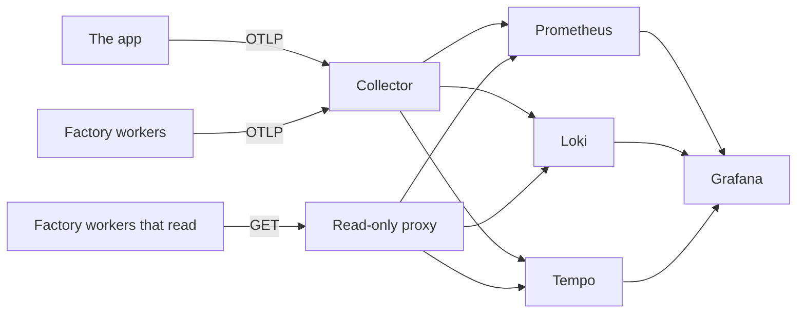

# Telemetry

Metrics, logs, traces and SLOs. Part of the [runtime plane](README.md#runtime-plane).

- **v1:** the OpenTelemetry SDK and collector, feeding Prometheus, Loki, Tempo and Grafana, all over OTLP; upstream charts at pinned versions.
- **Later:** CloudWatch on `aws`.

## Reading it

The workers that read telemetry (triage, the intake, the log watcher and the line) reach Prometheus, Loki and Tempo only through a read-only proxy in `telemetry`, `query`, and never the backends themselves ([network policies](NETWORK-POLICIES.md)). A NetworkPolicy allows a port, not a path, and on the ports they query the backends also take writes: Loki takes pushed logs, Prometheus metrics over OTLP, Tempo a flush. A worker that untrusted input had turned could plant the evidence the senses and the canary judge by.

| Address | Backend | Passes, by GET only |
|---|---|---|
| `query.telemetry:9090` | Prometheus | `/api/v1/query`, `/api/v1/query_range`, `/-/healthy`, `/-/ready` |
| `query.telemetry:3100` | Loki | `/loki/api/v1/query`, `/loki/api/v1/query_range`, `/ready` |
| `query.telemetry:3200` | Tempo's query port | `/api/search`, `/api/metrics/query`, `/api/traces/<id>`, `/ready` |

Any other method is answered 405 and any other path 403, before it reaches a backend. The proxy passes on the path as nginx has decoded and normalised it, never as the client wrote it, and keeps no access log, since a query can hold a visitor's report. A read the factory starts to need is a line in `deploy/base/telemetry/query/nginx.conf`.

The proxy passes a search on over whatever range it is given, so Tempo bounds what one may take ([`values/tempo.yaml`](../../deploy/base/telemetry/values/tempo.yaml)): a search or a TraceQL metrics query covers a day at most, a search may ask for 1,000 traces at most, the querier runs eight of their jobs at once across every query, and Go collects hard before the pod's memory limit (`GOMEMLIMIT`, at 90% of it). Wider asks are refused. The factory's widest read covers ten minutes; in Grafana, a dashboard's trace table over more than a day errors, and a longer look is several searches.

The collector, which every worker still sends its own telemetry to, writes; Grafana and the canary's analysis read; each reaches the backends directly. Prometheus's lifecycle endpoints are off, so nothing that reaches it can stop it or have it reload: it reloads its configuration and rules itself when they change, every 30 seconds.

## Routine polling

What repeats many times an hour and says nothing new each time is kept out of the way of what matters. The factory's workers leave out of their traces Kubernetes probing `/health` and the line's release watch reading the app's Rollout and AnalysisRuns every 30 seconds; their other requests are traced ([`untraced.ts`](../../apps/factory/src/untraced.ts)). A sense logs one warning a run for each route and reason its checks could not tell, naming the checks, not one for each check. Tempo's backend worker logs each empty answer to its asks for work, and backs off up to five minutes between them; Grafana's dashboard sidecar starts its watch again every ten minutes, not every minute, and logs each start.

## The platform's own metrics

Prometheus also scrapes the components beneath the factory, so what they took in, refused or failed to deliver is kept: a record the collector dropped, a push Loki or Tempo refused, an alert Alertmanager could not deliver to the intake. Each asks to be scraped through its chart's settings, with the `prometheus.io/` pod annotations the chart's `kubernetes-pods` job reads, as Traefik already does (CoreDNS asks the same on its Service).

| Component | Port | Set in |
|---|---|---|
| The collector | 8888 | [`values/otel-collector.yaml`](../../deploy/base/telemetry/values/otel-collector.yaml) |
| Loki | 3100 | [`values/loki.yaml`](../../deploy/base/telemetry/values/loki.yaml) |
| Tempo | 3200 | [`values/tempo.yaml`](../../deploy/base/telemetry/values/tempo.yaml) |
| Alertmanager | 9093 | [`values/prometheus.yaml`](../../deploy/base/telemetry/values/prometheus.yaml) |
| Argo Rollouts' controller | 8090 | [`rollouts/values.yaml`](../../deploy/base/rollouts/values.yaml) |
| Kyverno's two controllers | 8000 | [`admission/values/kyverno.yaml`](../../deploy/base/admission/values/kyverno.yaml) |
| Argo CD's application controller, server, repo server and ApplicationSet controller | 8082, 8083, 8084, 8080 | [`deploy/argocd/values.yaml`](../../deploy/argocd/values.yaml) |

Prometheus scrapes itself in its own job. Kyverno's and Argo Rollouts' fences let Prometheus in on those ports alone ([network policies](NETWORK-POLICIES.md)). Argo CD's chart is installed by `make up` with Helm, not by Argo CD, so its settings reach a cluster at the next `make up`.

- **They count toward the environment.** Triage takes Prometheus as healthy when every target it scrapes is `up` ([triage](TRIAGE.md#what-a-sense-reads)), and each of these is one: a component Prometheus cannot scrape holds a sense's new problems for Martin until it can.
- **`target_info` is OTLP's alone.** It is how Prometheus records a service that sends metrics over OTLP, and triage counts it to see that metrics still arrive. The collector also serves its own where it is scraped, so each of the chart's jobs that scrape what asks to be scraped, by pod or by Service, drops `target_info`, and a count of it still falls to nothing when OTLP stops.

## Dashboards

Grafana has three:

- the app;
- the console;
- the factory: inbox depth, signals by sense, time from signal to ticket, and gateway spend.

## What the app records

| Record | Carries |
|---|---|
| Request metrics | `http_route` (the path asked for, such as `/products/glove-left`), the status and `service_version` |
| Request log records | `route` (the template, `/products/:slug`), `path`, `status`, `ms` and the trace id |

## Telling a canary from its baseline

The collector adds to each of the app's records its pod's name and its `rollouts-pod-template-hash` label (`k8s_attributes`, reading the `website` namespace's pods and nothing else). So metrics, logs and traces tell a canary from its baseline ([progressive delivery](PROGRESSIVE-DELIVERY.md)).

It first deletes any `k8s.pod.*` attribute a record brings, on its resource or on the record itself, in any spelling Prometheus would turn into the same label, so the app cannot report its canary under the stable version's hash.

## Which records are the app's

Every factory worker sends its own telemetry to the same collector, and a record's `service.name` is whatever its sender says. So the senses, the alerting rules and the app's dashboard take a record as the app's only when it carries what the collector stamped, which no sender through it can: in Loki, a stream with a `k8s_pod_name`; in Prometheus, a series with a `k8s_pod_label_rollouts_pod_template_hash`, the label Prometheus keeps of the two; in Tempo, a span whose resource has a `k8s.pod.name` ([`provenance.ts`](../../apps/factory/src/provenance.ts)). A worker that names itself `website` to the collector sends records the senses never read. The stamp says nothing of a record written to a backend directly, so no worker may be able to write to one ([network policies](NETWORK-POLICIES.md)).
