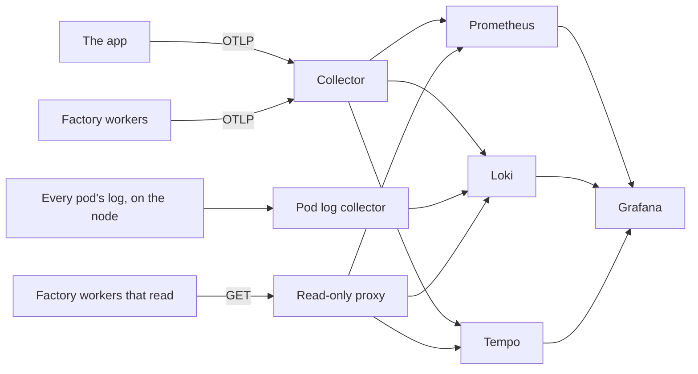

# Telemetry

Metrics, logs, traces and SLOs. Part of the [runtime plane](README.md#runtime-plane).

- **v1:** the OpenTelemetry SDK and collector, feeding Prometheus, Loki, Tempo and Grafana, all over OTLP; upstream charts at pinned versions.
- **Later:** CloudWatch on `aws`.

## Reading it

The workers that read telemetry (triage, the intake, the log watcher and the line) reach Prometheus, Loki and Tempo only through a read-only proxy in `telemetry`, `query`, and never the backends themselves ([network policies](NETWORK-POLICIES.md)). A NetworkPolicy allows a port, not a path, and on the ports they query the backends also take writes: Loki takes pushed logs, Prometheus metrics over OTLP, Tempo a flush. A worker that untrusted input had turned could plant the evidence the senses and the canary judge by.

| Address | Backend | Passes, by GET only |
|---|---|---|
| `query.telemetry:9090` | Prometheus | `/api/v1/query`, `/api/v1/query_range`, `/-/healthy`, `/-/ready` |
| `query.telemetry:3100` | Loki | `/loki/api/v1/query`, `/loki/api/v1/query_range`, `/ready` |
| `query.telemetry:3200` | Tempo's query port | `/api/search`, `/api/metrics/query`, `/api/traces/<id>`, `/ready` |

Any other method is answered 405 and any other path 403, before it reaches a backend. The proxy passes on the path as nginx has decoded and normalised it, never as the client wrote it, and keeps no access log, since a query can hold a visitor's report. A read the factory starts to need is a line in `deploy/base/telemetry/query/nginx.conf`.

The proxy passes a search on over whatever range it is given, so Tempo bounds what one may take ([`values/tempo.yaml`](../../deploy/base/telemetry/values/tempo.yaml)): a search or a TraceQL metrics query covers a day at most, a search may ask for 1,000 traces at most, the querier runs eight of their jobs at once across every query, and Go collects hard before the pod's memory limit (`GOMEMLIMIT`, at 90% of it). Wider asks are refused. The factory's widest read covers ten minutes; in Grafana, a dashboard's trace table over more than a day errors, and a longer look is several searches.

The collector, which every worker still sends its own telemetry to, writes; Grafana and the canary's analysis read; each reaches the backends directly. Prometheus's lifecycle endpoints are off, so nothing that reaches it can stop it or have it reload: it reloads its configuration and rules itself when they change, every 30 seconds.

## Every pod's log

A second collector, `pod-logs`, runs on each node in a namespace of its own and reads every container's log from the files the kubelet writes them to ([`values.yaml`](../../deploy/base/pod-logs/values.yaml)). So a pod's log outlives the pod: Argo CD's, Argo Rollouts', Kyverno's, the cluster's own, the telemetry stack's, Postgres's, and the runners', whose pods go when their step ends. It reads them from the node, so the runners' fence stays shut. A file goes with its pod, so a line it had not read by then never reaches Loki: it reads a few times a second, but less when Loki is behind and its queue fills. A runner's log is not lost with it: the line keeps each runner pod's log with its step, in the artifact store ([`AGENT-RUNNERS.md`](AGENT-RUNNERS.md#a-steps-logs)).

- **In Loki** as the `pod-logs` service, each stream labelled with its namespace, pod and container: `{service_name="pod-logs", k8s_namespace_name="argocd"}`. Nothing of the factory's reads them; they are for a person looking back.
- **Left out:** the scoreboard's, which sends nothing by design, and the collector's own.
- **After a restart** it reads on from a mark it keeps on the node for each file, and sends what it had read and Loki had yet to take, from a queue kept there too; while Loki refuses, it keeps trying. A file already there when it first starts on a node is read from its end, so that every node's backlog does not run into Loki's limit at once, which the app's records share.
- **Its namespace** is the one of ours that does not enforce the restricted Pod Security Standard, which refuses the host path. The collector runs as root, since the log files are root's alone to read, with every capability dropped, a read-only root, the logs mounted read-only, no service account token and no port but its health check's and its metrics'. It reaches Loki and DNS, and only Prometheus reaches it, for its metrics ([network policies](NETWORK-POLICIES.md#pod-logs)).

## Routine polling

What repeats many times an hour and says nothing new each time is kept out of the way of what matters. The factory's workers leave out of their traces Kubernetes probing `/health` and the line's release watch reading the app's Rollout and AnalysisRuns every 30 seconds ([`untraced.ts`](../../apps/factory/src/untraced.ts)). A request out made outside any span makes no span, so the polling workers' own rounds (the probes', the crawler's, the log watcher's, traffic's, and the line's loop outside the spans it starts for a step, a release or a look) send nothing to Tempo of what they ask ([the factory's own traces](#the-factorys-own-traces)). A sense logs one warning a run for each route and reason its checks could not tell, naming the checks, not one for each check. Tempo's backend worker logs each empty answer to its asks for work, and backs off up to five minutes between them; Grafana's dashboard sidecar starts its watch again every ten minutes, not every minute, and logs each start.

## The platform's own metrics

Prometheus also scrapes the components beneath the factory, so what they took in, refused or failed to deliver is kept: a record the collector dropped, a push Loki or Tempo refused, an alert Alertmanager could not deliver to the intake. Each asks to be scraped through its chart's settings, with the `prometheus.io/` pod annotations the chart's `kubernetes-pods` job reads, as Traefik already does (CoreDNS asks the same on its Service).

| Component | Port | Set in |
|---|---|---|
| The collector | 8888 | [`values/otel-collector.yaml`](../../deploy/base/telemetry/values/otel-collector.yaml) |
| The pod log collector | 8888 | [`pod-logs/values.yaml`](../../deploy/base/pod-logs/values.yaml) |
| Loki | 3100 | [`values/loki.yaml`](../../deploy/base/telemetry/values/loki.yaml) |
| Tempo | 3200 | [`values/tempo.yaml`](../../deploy/base/telemetry/values/tempo.yaml) |
| Alertmanager | 9093 | [`values/prometheus.yaml`](../../deploy/base/telemetry/values/prometheus.yaml) |
| Argo Rollouts' controller | 8090 | [`rollouts/values.yaml`](../../deploy/base/rollouts/values.yaml) |
| Kyverno's two controllers | 8000 | [`admission/values/kyverno.yaml`](../../deploy/base/admission/values/kyverno.yaml) |
| Argo CD's application controller, server, repo server and ApplicationSet controller | 8082, 8083, 8084, 8080 | [`deploy/argocd/values.yaml`](../../deploy/argocd/values.yaml) |

Prometheus scrapes itself in its own job. Kyverno's, Argo Rollouts' and the pod log collector's fences let Prometheus in on those ports alone ([network policies](NETWORK-POLICIES.md)). Argo CD's chart is installed by `make up` with Helm, not by Argo CD, so its settings reach a cluster at the next `make up`.

- **They do not count toward the environment.** Triage takes Prometheus as healthy when the targets the senses read are `up`, Traefik and each node's kubelet ([triage](TRIAGE.md#what-a-sense-reads)), and none of these is one: a component Prometheus cannot scrape, even one crash-looping, holds nothing, and a healthy reading counts how many of the rest are down.
- **`target_info` is OTLP's alone.** It is how Prometheus records a service that sends metrics over OTLP, and triage counts it to see that metrics still arrive. The collector also serves its own where it is scraped, so each of the chart's jobs that scrape what asks to be scraped, by pod or by Service, drops `target_info`, and a count of it still falls to nothing when OTLP stops.
- **Only the platform's namespaces are looked in.** The jobs that scrape what asks, by pod or by Service, look for it in `argo-rollouts`, `argocd`, `factory`, `kube-system`, `kyverno`, `pod-logs` and `telemetry`, and nowhere else ([`values/prometheus.yaml`](../../deploy/base/telemetry/values/prometheus.yaml)). Not `website`, whose pods come from the app's repository, which the line changes, nor `runners` or `scoreboard`. A pod there that asked would be a target behind a fence Prometheus cannot pass, down for as long as it asked; one Prometheus could reach would keep the labels it sent, since the job honours them, and could stamp its series as [the app's](#which-records-are-the-apps). Whatever they do scrape has the label that marks [the app's](#which-records-are-the-apps) metrics dropped, since only the collector stamps it, on what arrives over OTLP. A namespace the platform starts to run a target in is a name added there: a test fails until it is, for a chart whose values ask and for a pod or Service deploy/ declares. The chart's jobs for Services that ask to be probed, through a blackbox exporter or a Pushgateway, are off, since neither runs.

## Naming the factory's series

The workers and the console send their metrics over OTLP, and Prometheus's OTLP receiver names each series from its instrument: dots become underscores, a counter's name ends `_total`, a histogram's series `_bucket`, `_sum` and `_count`, and a unit it knows goes on the name, `s` as `_seconds`, `ms` as `_milliseconds`, `By` as `_bytes`.

- **A unit is the instrument's, never in its name:** `line.stage.duration`, in `s`, is `line_stage_duration_seconds`. A time is in seconds, as OpenTelemetry's own are; the one in milliseconds is the gateway's call duration (`gateway_call_duration_milliseconds`), whose name is kept.
- **Dollars are in the name, with no unit given** (`factory_gateway_spend_usd_total`, `gateway_cap_spent_usd`): a currency is no unit Prometheus translates.
- **A count has none:** `1` on a gauge would add `_ratio`.

## The line's metrics

The line sends what an alert needs to say it is stuck: how work items move through it, and through Release and Verify ([`line/metrics.ts`](../../apps/factory/src/line/metrics.ts)). The [event store](EVENT-STORE.md) holds the same facts for the console; these put them where Prometheus can read them. Every label is from a closed list, never a work item, a job or a release, which would make a series of each.

| Series | Labels | What it counts |
|---|---|---|
| `line_work_items` | `stage` | Work items at each stage now: `plan`, `build`, `waiting`, `gates`, `review`, `release`, `verify`, `held` |
| `line_stage_oldest_seconds` | `stage` | How long the work item longest at each stage has been there; 0 with none |
| `line_stage_duration_seconds` | `stage` | A histogram of how long a work item was at a stage, recorded as it left it, in buckets from a minute to a week |
| `line_steps_total` | `agent`, `provider`, `outcome` | Each agent's step as it ended, by the provider its calls went to: `done`, `failed`, `max-turns` (it ran out of turns), `capped` (a spend cap ended it), `stopped` (the line stopped), `stale` (out of date, runs again), `effects-failed` (its result could not be put in GitHub, and the work item holds) or `errored` (something outside the agent failed, such as a read of GitHub or the runners, and the next pass tries again) |
| `line_holds_total` | `cause`, `stage` | Each hold for Martin the line started, by [cause](ORCHESTRATOR.md#holds-and-martins-answers) and the stage held at |
| `line_releases_total` | `outcome`, `dry_run` | Each release the line recorded the end of: `promoted`, `rolled-back`, `aborted` or `errored` |
| `line_verifications_total` | `sense`, `outcome`, `dry_run` | Each verification after a release, by the sense that looked and whether the signal `cleared` or `persists` |

- **The stages are read from the store, not counted.** Each collection reads the `line` table (a count and the oldest `moved_at` for each stage), so a line that restarts reports what is there, not what it has seen since it started, and every stage is reported, an empty one as 0. Two replicas would each report the whole store's figures: read them with `max by (stage)`, never `sum`. Only a line that takes work (`LINE_MODE` not `off`) reports them.
- **The rest is counted where the line records it,** after the store has taken the event, so a series and the events cannot disagree: a hold or a verification as the line appends it, a release's end as the release watch does. A release recorded on every work item it carries is one release, and one the store already has an end for is not counted again; the line runs as one replica, and two recording the same end at once could each count it. Holds triage makes (a suggestion, a burst, a finding) are triage's, not the line's.
- **A step is counted once, as it ends.** A result whose effects failed and wait to be tried again has not ended; it is counted when they end, by whichever start of the line tries them. `failed` and `max-turns` count against the step, which runs again until the line holds the work item for failures.
- **Held for the merge and then for a deploy is one stay at `held`,** as the `line` table has it: the cause is in `line_holds_total`.

## Dashboards

Grafana has three:

- the app;
- the console;
- the factory: inbox depth, signals by sense, time from signal to ticket, and gateway spend.

## The cluster's state and Postgres

Two more targets ask Prometheus to scrape them, with the `prometheus.io/` pod annotations the chart's `kubernetes-pods` job reads:

| Target | What it says | Where |
|---|---|---|
| kube-state-metrics, on 8080 | Each pod's restarts and readiness; each Deployment's, StatefulSet's and DaemonSet's ready replicas; each Job's outcome; each node's conditions; each volume claim's phase | `telemetry`, from the Prometheus chart ([`values/prometheus.yaml`](../../deploy/base/telemetry/values/prometheus.yaml)) |
| The Postgres exporter, on 9187 | The store's connections against `max_connections`, transactions, locks, each table's size and dead rows, the database's size | `factory`, beside Postgres ([`postgres-exporter`](../../deploy/base/postgres-exporter/deployment.yaml)) |

- **kube-state-metrics reads only those kinds.** Its chart grants list and watch on each collector's kind, so its role reads no Secret or ConfigMap anywhere, the scoreboard's among them, and `make egress` still finds no service account that may. The `kubernetes-pods` job honours the labels a target sends, so its series keep the `namespace` and `pod` they describe.
- **The exporter is in `factory`,** where the store's other passwords are: its role's password is a Secret there, made by `make up` and set by the migrations, and its pod is fenced to Postgres and Prometheus alone ([network policies](NETWORK-POLICIES.md)). Its image is the Prometheus community's own build, named by digest in `factory-images` ([admission control](ADMISSION-CONTROL.md)).
- **Its role is granted nothing** ([event store](EVENT-STORE.md#roles)), so other sessions' state is hidden from it: it counts connections from `pg_stat_database`, and its collectors of sessions by state, and of the write-ahead log's files, are off.
- **Postgres down leaves the exporter's target up.** It answers every scrape and says in `pg_up` whether it reached Postgres. Neither target is one the senses read, so neither of them unscraped holds a sense's new problems ([triage](TRIAGE.md#what-a-sense-reads)), and Postgres unreachable holds nothing either.
- **The exporter reads its password when it starts.** On a cluster made before it, run `make up` again to make its Secret, and once the migrations have set the role's password, restart it (`kubectl -n factory rollout restart deployment/postgres-exporter`).

## What the app records

| Record | Carries |
|---|---|
| Request metrics | `http_route` (the path asked for, such as `/products/glove-left`), the status and `service_version` |
| Request log records | `route` (the template, `/products/:slug`), `path`, `status`, `ms` and the trace id |

## The factory's own traces

Each worker traces what it is asked over HTTP, and what it asks through `node:http` and `fetch` ([`instrumentations.ts`](../../apps/factory/src/instrumentations.ts)). A request out makes a client span, and sends `traceparent` on, only inside a span, so a call joins the trace of whatever made it: the gateway's calls to its providers sit under the request that asked for them, and the GitHub worker's calls to GitHub under the action that made them. Anthropic, LM Studio and GitHub are sent `traceparent` too: random ids, which name neither the caller nor the work. Outside a span a request out makes no span and sends no trace, only its point in the client's request duration histogram, so the polling workers' rounds stay out of Tempo, and nothing samples: every trace is kept. A Verify rerun the probes are asked for runs as their own round, outside the request that asked for it.

The line and the gateway start spans of their own, so one trace follows a work item from the line through its runner's calls to the gateway and the GitHub worker ([`spans.ts`](../../apps/factory/src/spans.ts)):

| Span | Started by | Attributes | Under it |
|---|---|---|---|
| `step` | the line, for each agent's step | `work_item`, `agent`, `job`, `outcome` | its reads and writes in GitHub, its Kubernetes calls (not its polls of its Jobs), and each `model call` of its job |
| `step effects` | the line, trying a kept handback's effects again | `work_item`, `agent`, `job` | its writes in GitHub |
| `release` | the line, for each pass of its release watch that reads or records something of a release, and each recording of a dry run's | `release`, `dry_run`, `work_items` | a watched release's reads through the GitHub worker, of Prometheus and of the journeys' pods, and the failed measures it sends triage |
| `verify`, `recheck` | the line, for each look by a sense | `work_item`, `release` (Verify's), `outcome` | its first ask of the probes (not its polls for the answer) and the telemetry it reads |
| `model call` | the gateway, for each call it takes from a runner | `work_item`, `job`, `agent`, `provider`, `model`, `outcome`, `reason`, `input_tokens`, `output_tokens`, `cache_read_tokens`, `cache_write_tokens`, `cost_usd` | the provider's call |

- **A model call joins its step through the job token.** The line keeps the step's span context with the token as it makes it (`job_tokens.traceparent`), and the gateway starts the call's span as that span's child, linked to the request that carried it; its `model call` log line names the step's trace. The runner needs nothing, which suits a pod that cannot reach the collector. A token made with no span in hand (the bench's) puts the call under the request instead.
- **The names are those the gateway's metrics, its log line and the store already use,** in snake case, so a dashboard reads a span, a series and a row alike. A metric takes only the few-valued ones (`agent`, `provider`, `model`, `outcome`); a work item or a job would make a series of each.
- **A step's span ends with the step,** up to its deadline, so Tempo shows its calls first and the step once it is over. A line that restarts mid-step never sends that step's span, and its calls' spans point to a parent Tempo does not have.

## Telling a canary from its baseline

The collector adds to each of the app's records its pod's name and its `rollouts-pod-template-hash` label (`k8s_attributes`, reading the `website` namespace's pods and nothing else). So metrics, logs and traces tell a canary from its baseline ([progressive delivery](PROGRESSIVE-DELIVERY.md)).

It first deletes any `k8s.pod.*` attribute a record brings, on its resource or on the record itself, in any spelling Prometheus would turn into the same label, so the app cannot report its canary under the stable version's hash.

## Which records are the app's

Every factory worker sends its own telemetry to the same collector, and a record's `service.name` is whatever its sender says. So the senses, the alerting rules and the app's dashboard take a record as the app's only when it carries what the collector stamped, which no sender through it can: in Loki, a stream with a `k8s_pod_name`; in Prometheus, a series with a `k8s_pod_label_rollouts_pod_template_hash`, the label Prometheus keeps of the two; in Tempo, a span whose resource has a `k8s.pod.name` ([`provenance.ts`](../../apps/factory/src/provenance.ts)). A worker that names itself `website` to the collector sends records the senses never read. The pod log collector gives every pod's log its pod's name too, but always as the `pod-logs` service, and the senses never count twice the app's pods' output, which the app also sends over OTLP. The stamp says nothing of a record written to a backend directly, so no worker may be able to write to one ([network policies](NETWORK-POLICIES.md)).
