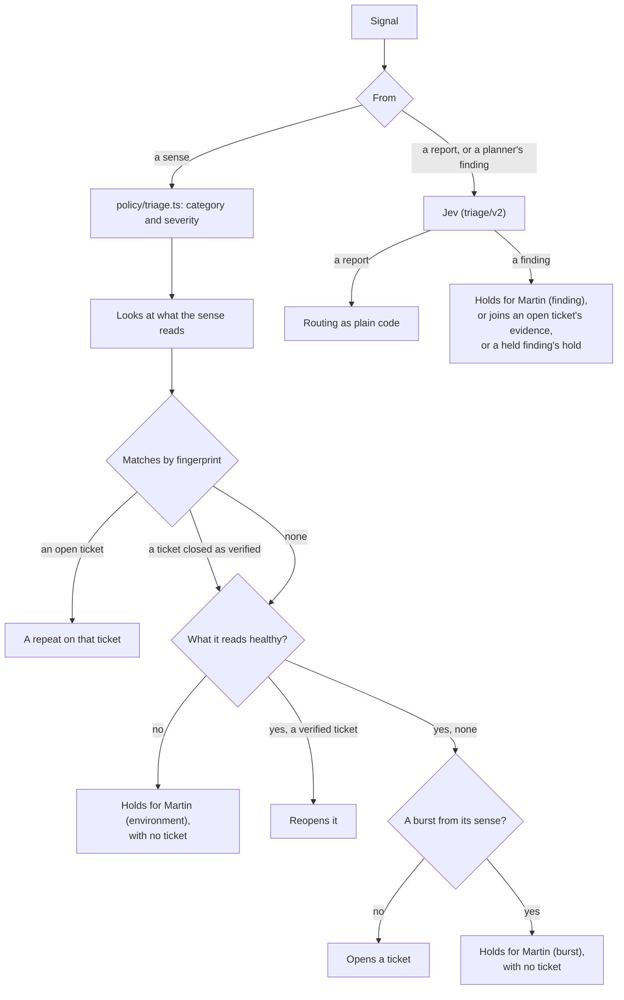

# Triage

An agent: turns signals into tickets. Part of the [factory plane](README.md#agents).

- **Reads:** probe, crawler, telemetry and canary signals; user reports; the planner's findings.
- **Produces:** deduplicated, classified tickets with evidence.
- **v1:** `packages/triage`, run by `factory triage`. It takes signals from [the inbox](ORCHESTRATOR.md#the-inbox).

## Every signal

- **A sense's signal** takes its category and severity from `policy/triage.ts`, and repeats by fingerprint.
- **Only reports and the planner's findings go to Jev** (`triage/v2`), with routing as plain code.
- It quarantines injection attempts, and parks suggestions for Martin.
- **One fingerprint, one ticket.**
- **More new problems than a handful from one sense at once** wait for Martin as one [burst](#a-burst), before any has a ticket.
- **A new problem seen while what its sense reads was not healthy** waits for Martin too, its cause [the environment](#what-a-sense-reads).

## Matching an open ticket

A sense's signal on an open ticket adds its evidence (`signal.received`) the first time that sense sees it in each version of the app. So the ticket records every version the problem was seen in, so every version of the app rolled back on it, and the planner is told each. Within a version, the inbox counts it (outcome `counted`) and nothing is appended: the events grow with tickets and releases, not with the minutes a defect stays unfixed.

- An open ticket on `*` (a class the crawler found on every page) takes its class's signals on any route.
- But not where the canary is on either side: the canary's `*` means worse on more than one route, or on routes its analysis could not name, so it matches only another canary `*` ([rollback signals](RELEASE-AND-VERIFY.md#rollback-signals)).

## Reopening a verified ticket

A sense's signal that no open ticket has, on the exact fingerprint of a ticket closed as verified, reopens it (`work-item.reopened`, then the signal): the same defect came back, and [the line](ORCHESTRATOR.md#a-ticket-that-reopens) takes the work item back into Plan.

It counts as a repeat on that ticket instead when:

- the sense saw it before that close: it is of the version the fix replaced;
- the ticket's last verification was a dry run's, whose fix never shipped.

A report or a planner's finding never reopens a ticket.

## A burst

A sense that finds many new problems at once may have found as many defects, or one fault in what it reads, such as a gap in the log that looks like a missing record on every page. Each ticket would be a planner's step and more, so triage holds a burst for one look from Martin instead (cause `burst`).

- **What counts.** A sense's signal that would open a ticket, when with it that sense has found more than five new problems within ten minutes of it (`BURST` in `policy/triage.ts`, human-owned). It counts the tickets the sense opened in that time, and the new problems in its signals still waiting in the inbox, so a burst that arrives at once is held from its first signal. A signal on an open ticket, or one that reopens a verified ticket, never counts.
- **What it holds.** One work item, held at Triage with no ticket, so nothing of it reaches Plan. Each new problem the sense finds while it waits joins it as evidence, however long after; one it holds already is counted. Other senses carry on as ever.
- **A fresh app.** The line's first start on a fresh app finds many problems by design, and costs this one answer: a first look at what the senses see is worth it, and approving lets them all through.

### Martin's answer to a burst

And to problems held for the environment.

| Answer | Does |
|---|---|
| Approve | Makes of each problem what it would have made without the burst, in the order the sense sent them: a ticket, as a rule, which the line takes in its turn, or evidence on a ticket opened since. Closes the burst, naming the tickets |
| Reject | Closes it with no ticket. A problem the sense still sees is found again, and counts toward a burst afresh |
| Answer in words | Leaves it waiting |

Triage does as he answered once an event is appended, as for a finding.

## What a sense reads

Each sense reads something besides the app, and when that fails a sense can see the app as broken. A Loki on a full disk stores no records, and the log watcher would see a missing record on every page. No agent can mend a full disk or a backend that stores nothing, so triage looks before it trusts a sense's signal.

- **What each reads.** `ENVIRONMENT` in `policy/triage.ts` (human-owned): the log watcher reads Prometheus, Loki and Tempo; the metrics and the canary, Prometheus; every sense, the disk under the cluster's volumes, which the app, the senses and the backends share.
- **Healthy.** Prometheus, when every target it scrapes is `up` and metrics still arrive over OTLP. Loki, when it stored a record from anything in the five minutes before; Tempo, a trace in the ten minutes before. "Answers" is not enough: a Loki on a full disk answers every query, and returns nothing. The disk, when every volume has a tenth or more free, below which the kubelet starts evicting pods. A backend that cannot be asked, or has no measure, is not seen to be healthy.
- **When.** As of the time the sense saw it, so a signal that waited in the inbox is judged on how things stood then. One look a minute serves every signal seen in it, unless a backend did not answer when asked twice: the next signal asks again.
- **The look is evidence.** Each sense's signal records it (`environment` on `signal.received`): a ticket that opens shows how its sense's dependencies stood when it was seen.
- **What it holds.** A signal that would open or reopen a ticket while anything its sense reads was not healthy is held for Martin as a burst is, with cause `environment`: one work item with no ticket, which every new problem the sense finds while it waits joins. A signal on an open ticket adds its evidence as ever. Martin answers it as [a burst](#martins-answer-to-a-burst).
- **Where it looks.** `factory triage` looks at the backends it has an address for (`PROMETHEUS_URL`, `LOKI_URL`, `TEMPO_URL`; the disk through Prometheus). With none, it looks at nothing and holds nothing for the environment. The cluster's triage has all three.

## The planner's findings

A planner's finding is trusted no more than a report, since a visitor can read the app's public code and argue an agent into seeing a bug. It is judged the same way but never opens a ticket (`routeFinding`). Nothing else opens a ticket from a finding.

- **A defect it noticed** holds for Martin (cause `finding`), with its fingerprint as a report's ticket would have it: the route the planner named and the symptom Jev judged, or, for wrong words, the passage of the page Jev chose.
- **One that repeats an open ticket** joins its evidence, though never the ticket the planner was planning, which it is beyond. One with that ticket's fingerprint is held, saying so, until that ticket closes and a sense's ticket can take it.
- **One a held defect has.** Another finding with the fingerprint of a defect still held joins that hold, its words kept beside the first's, so one defect waits for one answer.
- **A later ticket.** A ticket triage opens later with the same fingerprint, from a sense or a report, closes the held defect into it ("A sense saw it: ticket #N").

### Martin's answer to a finding

| Answer | Does |
|---|---|
| Approve | Opens its ticket on its own work item, with the category and severity `policy/triage.ts` gives its symptom, as a sense's would be, or joins it to an open ticket that has it |
| Reject | Closes it |
| Answer in words | Leaves it waiting |

An answer settles only the findings that reached the hold before it, in the store's order, however it was written. If one joined after it, triage acts on none of them: the hold starts again on the same work item, and waits for an answer that has read them all.

Triage does as he answered once an event is appended, reading only the finding holds (an index of their own). It leaves one it cannot act on after as many tries as a signal gets.
