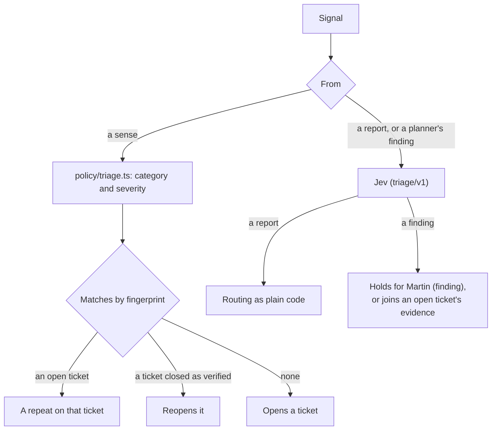

# Triage

An agent: turns signals into tickets. Part of the [factory plane](README.md#agents).

- **Reads:** probe, crawler, telemetry and canary signals; user reports; the planner's findings.
- **Produces:** deduplicated, classified tickets with evidence.
- **v1:** `packages/triage`, run by `factory triage`. It takes signals from [the inbox](ORCHESTRATOR.md#the-inbox).

## Every signal

- **A sense's signal** takes its category and severity from `policy/triage.ts`, and repeats by fingerprint.
- **Only reports and the planner's findings go to Jev** (`triage/v1`), with routing as plain code.
- It quarantines injection attempts, and parks suggestions for Martin.
- **One fingerprint, one ticket.**

## Matching an open ticket

A sense's signal on an open ticket adds its evidence (`signal.received`) the first time that sense sees it in each version of the app. So the ticket records every version the problem was seen in, so every version of the app rolled back on it, and the planner is told each. Within a version, the inbox counts it (outcome `counted`) and nothing is appended: the events grow with tickets and releases, not with the minutes a defect stays unfixed.

- An open ticket on `*` (a class the crawler found on every page) takes its class's signals on any route.
- But not where the canary is on either side: the canary's `*` means worse on more than one route, or on routes its analysis could not name, so it matches only another canary `*` ([rollback signals](RELEASE-AND-VERIFY.md#rollback-signals)).

## Reopening a verified ticket

A sense's signal that no open ticket has, on the exact fingerprint of a ticket closed as verified, reopens it (`work-item.reopened`, then the signal): the same defect came back, and [the line](ORCHESTRATOR.md#a-ticket-that-reopens) takes the work item back into Plan.

It counts as a repeat on that ticket instead when:

- the sense saw it before that close: it is of the version the fix replaced;
- the ticket's last verification was a dry run's, whose fix never shipped.

A report or a planner's finding never reopens a ticket.

## The planner's findings

A planner's finding is trusted no more than a report, since a visitor can read the app's public code and argue an agent into seeing a bug. It is judged the same way but never opens a ticket (`routeFinding`). Nothing else opens a ticket from a finding.

- **A defect it noticed** holds for Martin (cause `finding`), with its fingerprint as a report's ticket would have it: the route the planner named and the symptom Jev judged, or, for wrong words, the passage of the page Jev chose.
- **One that repeats an open ticket** joins its evidence, though never the ticket the planner was planning, which it is beyond. One with that ticket's fingerprint is held, saying so, until that ticket closes and a sense's ticket can take it.
- **A later ticket.** A ticket triage opens later with the same fingerprint, from a sense or a report, closes the held defect into it ("A sense saw it: ticket #N").

### Martin's answer to a finding

| Answer | Does |
|---|---|
| Approve | Opens its ticket on its own work item, with the category and severity `policy/triage.ts` gives its symptom, as a sense's would be, or joins it to an open ticket that has it |
| Reject | Closes it |
| Answer in words | Leaves it waiting |

Triage does as he answered once an event is appended, reading only the finding holds (an index of their own). It leaves one it cannot act on after as many tries as a signal gets.
